# Project 40: Physical Hallucination Sandbox & GUI Backend Blueprint

# Part I: Motivation

> **Scope:** Standalone **Physical Hallucination Sandbox** for testing, calibrating, and benchmarking information- and physics-inspired hallucination metrics before exposing them as a backend telemetry engine to a future GUI.

## 1. Executive Overview & Architectural Vision

**Project 40** establishes a controlled experimental sandbox designed to measure, compare, and diagnose semantic and structural drift in AI-agent responses. Rather than treating model hallucination purely as a black-box accuracy failure, the sandbox models response trajectories as dynamical systems moving through embedding spaces and token co-occurrence graphs.

At its core, the sandbox serves two complementary roles:

1. **Research & Calibration Lab:** It provides a reproducible testbed where mathematical estimators—specifically **Semantic Quantum Drift (SQD)** via regularized diagonal Kullback-Leibler (KL) divergence, **Renormalization Group (RG) Coarse-Graining Instability** via Principal Component Analysis (PCA) projection ratios, and **Token Co-Occurrence Graph Entropy**—can be stress-tested against paradoxical prompts and synthetic dynamical attractors.
2. **GUI Backend Readiness Layer:** It decouples metric computation, synthetic/live agent adapters, and experiment orchestration from user-interface concerns so that a future GUI can consume clean, structured telemetry (`H_Score`, phase-space coordinates, and exported CSV/JSON artifacts) without blocking UI threads or duplicating scientific logic.

### Why a Sandbox First?

Evaluating hallucination estimators directly against live external APIs or inside an interactive GUI introduces friction that slows iteration:

* **Cost & Rate Limits:** Repeated multi-iteration sweeps across multiple temperature regimes and paradox prompts can quickly incur API token costs or hit rate limits when driven by a live model endpoint.
* **Non-Determinism vs. Reproducibility:** Stochastic sampling is essential for studying ensemble dispersion, yet controllable synthetic attractors (`stable_attractor`, `limit_cycle`, `dissipative_divergence`) 
are needed to verify that a metric responds as expected under known dynamical regimes.
* **Separation of Concerns:** Keeping numerical linear algebra, graph entropy, and experiment loops inside dedicated sandbox modules prevents UI code from accumulating scientific drift or ad-hoc patches.

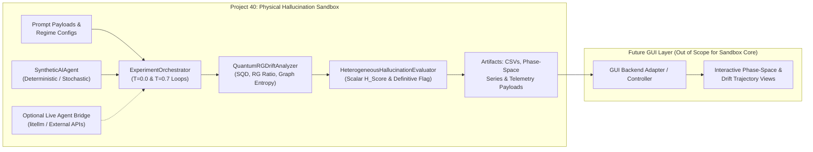

### Visual Mental Model: From Raw Trajectories to GUI Telemetry

```text
+-----------------------------------------------------------------------+
|                       SANDBOX EXECUTION ENGINE                        |
|                                                                       |
|  [Prompt / Paradox] ---> [Agent Adapter] ---> [Response Text t]       |
|                                                      |                |
|               +--------------------------------------+                |
|               |                                                       |
|               v                                                       |
|  +-------------------------+     +---------------------------------+  |
|  | Embedding Space (Lambda_0)|     | Sliding-Window Graph (W = 3)  |  |
|  |  - Baseline (mu_0, Sig_0) |     |  - Directed token transitions |  |
|  |  - Current  (mu_t, Sig_t) |     |  - PageRank stationary dist.  |  |
|  +-------------------------+     +---------------------------------+  |
|               |                                      |                |
|               +------------------+-------------------+                |
|                                  |                                    |
|                                  v                                    |
|                 +---------------------------------+                   |
|                 | Heterogeneous Evaluator         |                   |
|                 |  - sqd_value                    |                   |
|                 |  - rg_instability               |                   |
|                 |  - graph_entropy_drift          |                   |
|                 |  - H_Score in [0, 1)            |                   |
|                 +---------------------------------+                   |
+---------------------------------|-------------------------------------+
                                  |  Structured Rows / CSV / JSON
                                  v
+-----------------------------------------------------------------------+
|                 FUTURE GUI CONSUMPTION BOUNDARY                       |
|  - Phase-space scatter: x = mean_drift, y = trace_covariance          |
|  - Time-series inspection: iteration vs. H_Score & sub-metrics        |
|  - Run comparison: synthetic attractors vs. paradox sweeps            |
+-----------------------------------------------------------------------+

```

## 2. Core Physical & Information-Theoretic Concepts

The sandbox organizes hallucination diagnostics around three complementary perspectives. Together, they capture shifts in central tendency, variance structure across scales, and local token-level organization.

### 2.1 Semantic Quantum Drift (SQD) & Regularized Diagonal KL Divergence

In the sandbox formulation, a baseline reference ensemble of vector representations defines an initial state $(\mu_0, \Sigma_0)$, while a subsequent observation window or perturbed ensemble defines a drifted state $(\mu_t, \Sigma_t)$. 

To keep covariance inversion numerically well-conditioned—especially when sample counts are small or feature dimensions are correlated—the diagonal variance entries are regularized with a small floor $\epsilon$ (such as `1e-6`).

Using a diagonal covariance approximation with Tikhonov-style floor regularization yields a closed-form Gaussian KL-divergence expression that is fast to evaluate inside iterative loops:

$$D_{\text{KL}}\!\left(\mathcal{N}(\mu_t, \tilde{\Sigma}_t) \,\Vert{}\, \mathcal{N}(\mu_0, \tilde{\Sigma}_0)\right) = \frac{1}{2} \sum_{i=1}^{d} \left( \frac{\tilde{\sigma}_{0,i}^2}{\tilde{\sigma}_{t,i}^2} \text{ or } \frac{\tilde{\sigma}_{t,i}^2}{\tilde{\sigma}_{0,i}^2} + \frac{(\mu_{t,i} - \mu_{0,i})^2}{\tilde{\sigma}_{t,i}^2} - 1 - \ln\!\left(\frac{\tilde{\sigma}_{t,i}^2}{\tilde{\sigma}_{0,i}^2}\right) \right)$$

> **Implementation Note:** In practice, verify the exact direction of $D_{\text{KL}}(P_t \,\Vert{}\, P_0)$ versus $D_{\text{KL}}(P_0 \,\Vert{}\, P_t)$ during unit testing so that sign conventions and variance ratios remain consistent across all modules.

### 2.2 Renormalization Group (RG) Coarse-Graining Instability

Inspired by renormalization group coarse-graining in statistical physics, the sandbox compares behavior across two representation scales:

* **Microscopic Scale ($\Lambda_0$):** The full ambient representation space (for example, $d = 1536$ or another embedding dimension).
* **Macroscopic Scale ($\Lambda_1$):** A coarse-grained subspace obtained via PCA projection onto $k$ principal components, where $k$ is chosen dynamically based on available samples and rank constraints.

If semantic drift is merely a harmless fine-grained fluctuation, coarse-graining onto dominant modes should damp or preserve the divergence. Conversely, when drift amplifies under coarse-graining—producing a high ratio between macroscopic KL divergence and microscopic KL divergence—the trajectory exhibits **RG coarse-graining instability**, signaling structural shift across collective modes rather than isolated noise.

### 2.3 Token Co-Occurrence Graph Entropy

Embedding geometry alone can overlook subtle structural degradation in how tokens sequence together. To complement vector-space drift, the sandbox constructs a directed token co-occurrence graph using a sliding window (default window size $w = 3$):

1. Tokenize the response text into ordered tokens.
2. For each token position $i$, link token $t_i$ to subsequent tokens within the window $[i+1, \min(n, i+w)]$, accumulating edge weights from co-occurrence counts.
3. Compute a stationary node distribution over the resulting directed graph (for instance via PageRank with fallback handling for small or disconnected graphs).
4. Evaluate the Shannon entropy of the stationary distribution and track **graph entropy drift** relative to the baseline or prior state.

### 2.4 Scalarised $H$-Score & Phase-Space Coordinates

To support both quick filtering and deeper dynamical analysis, the evaluator combines the normalized or bounded contributions of SQD, RG instability, and graph entropy drift into a single scalar hallucination index $H \in [0, 1)$, paired with a boolean `definitive_flag` when threshold rules are exceeded.

In addition to $H$, the sandbox records **phase-space coordinates**:

* **`mean_drift` (horizontal axis):** Captures the magnitude of mean semantic shift away from the baseline reference.
* **`trace_covariance` (vertical axis):** Captures spread or dispersion ($\operatorname{tr}(\Sigma)$) within the representation ensemble.

Plotting `(mean_drift, trace_covariance)` across iterations lets researchers distinguish between:

* **Stable / Localized Behavior:** Low drift and bounded dispersion.
* **Oscillatory / Limit-Cycle Behavior:** Recurrent excursions without runaway divergence.
* **Dissipative / Runaway Drift:** Growing displacement and/or expanding spread across iterations.

| Diagnostic Metric / Coordinate | Primary Domain | What It Captures | Key Sandbox Role |
| --- | --- | --- | --- |
| **`sqd_value`** | Embedding distribution | Shift in mean and regularized diagonal variance | Core drift magnitude estimator |
| **`rg_instability`** | Multi-scale PCA subspace | Ratio of coarse-grained to microscopic KL divergence | Detects collective / structural mode shift |
| **`graph_entropy_drift`** | Token sequence graph ($w=3$) | Change in directed co-occurrence stationary entropy | Catches lexical / structural disorder |
| **`H_Score`** | Composite scalar in $[0, 1)$ | Aggregated risk index across drift dimensions | Fast ranking, alerting, and GUI summary |
| **`definitive_flag`** | Boolean threshold rule | Whether core drift thresholds are jointly breached | Binary triage indicator for downstream inspection |
| **`mean_drift` & `trace_covariance`** | Phase space $(\mathbb{R}^2)$ | Central displacement vs. ensemble spread | Trajectory classification & phase plots |

## 3. Pre-Assumptions & Design Boundaries

Before building out modules or wiring a future GUI, the sandbox relies on explicit engineering assumptions so that every component has clear responsibilities and predictable behavior:

1. **Threshold Calibration Is Context-Dependent:** Numeric thresholds (such as indicative reference cutoffs around `sqd_value > 2.0`, `rg_instability > 0.4`, or `graph_entropy_drift > 0.15`) serve as starting baselines for experimentation, not universal constants across all embedding models, domains, or prompt lengths.
2. **Synthetic Attractors Are Benchmarks, Not Ground-Truth Oracles:** Regimes such as `stable_attractor`, `limit_cycle`, and `dissipative_divergence` validate mathematical behavior and regression stability, but real-world LLM hallucinations require empirical calibration against task-specific datasets.
3. **Embeddings and Live APIs Are Pluggable:** A sandbox run must remain runnable offline with deterministic/synthetic vectors and synthetic agents, while allowing an optional live adapter (such as a `litellm`-backed bridge) to be swapped in without changing evaluator or orchestrator contracts.
4. **Secrets Stay Out of Code and Configs:** API keys and provider credentials are supplied via environment variables or runtime secret injection—never hardcoded in source files, notebooks, or default YAML configs.
5. **GUI Consumes Aggregated Telemetry, Not Raw Loops:** Future GUI views should read structured outputs (`H_Score`, sub-metrics, phase-space points, and exported CSV/JSON files) via a clean backend interface rather than embedding raw experiment orchestration inside UI callbacks.

## 4. Recommended Sandbox Repository Layout

Mirrored after clean modular Python project layouts, organizing Project 40 into focused packages keeps the sandbox easy to test in isolation and straightforward to wrap later as a GUI backend service:

```text
project40_hallucination_sandbox/
├── README.md
├── requirements.txt
├── configs/
│   └── sandbox_defaults.yaml
├── sandbox_core/
│   ├── __init__.py
│   ├── embeddings.py              # Deterministic / pluggable embedding providers
│   └── metrics_rg_kl.py           # QuantumRGDriftAnalyzer (SQD, RG ratio, graph entropy)
├── agents/
│   ├── __init__.py
│   ├── base_agent.py              # Common agent interface / response contract
│   ├── synthetic_agent.py         # SyntheticAIAgent (attractor & paradox regimes)
│   └── litellm_bridge.py          # Optional RealAIAgentBridge (guarded live API adapter)
├── experiments/
│   ├── __init__.py
│   └── orchestrator.py            # ExperimentOrchestrator (T=0.0 & T=0.7 dual-track loop)
├── evaluation/
│   ├── __init__.py
│   └── hallucination_evaluator.py # HeterogeneousHallucinationEvaluator & CSV exporters
├── visualization/
│   ├── __init__.py
│   └── phase_space_plotter.py     # Phase-space & drift plots + GUI telemetry payloads
├── tests/
│   ├── __init__.py
│   ├── test_metrics_rg_kl.py
│   └── test_evaluator_and_loop.py
└── outputs/                       # Generated CSVs, JSON summaries, and plots (gitignored)

```

## 5. Dual-Track Experiment Loop & GUI Backend Contract

A hallmark of the experimental workflow is running **dual-track sweeps** across temperature regimes—typically a low-temperature / deterministic-leaning track ($T = 0.0$) and a higher-temperature / stochastic ensemble track ($T = 0.7$)—across prompts such as `QM_PARADOX` and `SELF_REF_PARADOX`, as well as controlled synthetic attractor profiles.

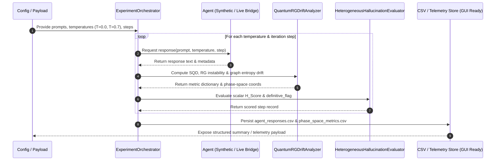

### What the Future GUI Backend Should Expose

When Project 40 eventually connects to a GUI, the GUI should interact with a thin service/controller boundary that wraps the sandbox rather than calling low-level NumPy/NetworkX internals directly:

* **`run_benchmark(config_override)`:** Executes a configured sweep and returns a `run_id` plus summary status.
* **`get_trajectory_table(run_id, filters)`:** Returns tabular rows (`iteration`, `temperature`, `regime`, `sqd_value`, `rg_instability`, `graph_entropy_drift`, `H_Score`, `definitive_flag`) for data grids and filters.
* **`get_phase_space_series(run_id)`:** Returns `(mean_drift, trace_covariance, H_Score, step)` series ready for scatter and trajectory plotting.
* **`export_run_artifacts(run_id, output_dir)`:** Writes reproducible CSV/JSON files for external analysis.

# Part II: Configuration

> **Scope:** Configuration schema, deterministic/pluggable embedding providers, and the numerical core (`QuantumRGDriftAnalyzer`) implementing regularized diagonal KL divergence (SQD), PCA-based Renormalization Group (RG) coarse-graining instability, and sliding-window token co-occurrence graph entropy.

## 6. Configuration Schema & Environment Contract (`configs/sandbox_defaults.yaml`)

To keep experiments reproducible across runs and clean when later controlled by a GUI backend, all tunable parameters live in a single declarative configuration structure (`configs/sandbox_defaults.yaml`) with strict defaults and zero hardcoded secrets.

Key parameter groups align directly with the analytical pipeline:

* **Embedding & Subspace Parameters:** Embedding dimensionality (e.g., `1536` for high-dimensional spaces or smaller dimensions during fast unit/synthetic tests), regularization floor $\epsilon$ (`1e-6`), and dynamic PCA component cap (`max_pca_components`).
* **Graph Co-Occurrence Parameters:** Directed sliding-window size (`window_size: 3`), PageRank damping factor (`damping: 0.85`), and fallback entropy handling for degenerate or single-token sequences.
* **Experiment & Regime Parameters:** Temperature tracks (`[0.0, 0.7]`), iteration counts per track, prompt payload keys (`QM_PARADOX`, `SELF_REF_PARADOX`), and synthetic dynamical regimes (`stable_attractor`, `limit_cycle`, `dissipative_divergence`).
* **GUI Backend & Export Parameters:** Output directory (`outputs/`), target filenames (`agent_responses.csv`, `phase_space_metrics.csv`), and GUI telemetry payload formatting options.

```yaml
# configs/sandbox_defaults.yaml
project:
  name: "project40_hallucination_sandbox"
  schema_version: "1.0"
  seed: 42

embeddings:
  ambient_dim: 1536
  epsilon_floor: 1.0e-6
  min_pca_components: 1
  max_pca_components: 16
  explained_variance_target: 0.90

graph_entropy:
  window_size: 3
  pagerank_alpha: 0.85
  pagerank_max_iter: 200
  pagerank_tol: 1.0e-8

evaluator:
  thresholds:
    sqd_value: 2.0
    rg_instability: 0.40
    graph_entropy_drift: 0.15
  weights:
    sqd: 0.45
    rg: 0.30
    graph_entropy: 0.25
  saturation_scale: 1.0

experiment:
  temperatures:
    - 0.0
    - 0.7
  steps_per_temperature: 25
  ensemble_size: 8
  prompt_payloads:
    QM_PARADOX: "If a quantum superposition collapses only upon observation, how does an internal self-consistent state evolve without external measurement?"
    SELF_REF_PARADOX: "Provide a complete, non-circular proof of your own epistemic reliability using only premises internal to your current response."
  synthetic_regimes:
    - "stable_attractor"
    - "limit_cycle"
    - "dissipative_divergence"

io:
  output_dir: "outputs"
  responses_filename: "agent_responses.csv"
  metrics_filename: "phase_space_metrics.csv"
  summary_filename: "run_summary.json"

```

## 7. Embedding Layer & Representation Interface (`sandbox_core/embeddings.py`)

Before computing distributional shifts or coarse-grained projections, responses or states must be mapped into numerical vector ensembles. In the sandbox, `EmbeddingProvider` defines a clean interface that works offline with deterministic pseudo-embeddings while allowing external or live embedding backends to plug in later without altering downstream math.

### Design Choices in `sandbox_core/embeddings.py`

* **Deterministic Hashing for Reproducibility:** When running offline benchmarks or unit tests, seeding a NumPy generator from a SHA-256 digest of `(text, namespace, seed)` guarantees bit-identical vectors across runs and platforms.
* **Ensemble Generation:** `embed_ensemble(texts, n_samples, jitter_std)` produces a `(n_samples, dim)` matrix around each base representation so covariance and trace estimators operate on genuine multi-sample ensembles rather than degenerate rank-zero points.
* **Guarded Optional Live Hook:** External embedding calls (such as `litellm.embedding`) can be wrapped behind an explicit `allow_live_api=False` flag so accidental network calls never occur during offline or CI runs.

```python
# sandbox_core/embeddings.py
from __future__ import annotations

import hashlib
from dataclasses import dataclass
from typing import Protocol, Sequence

import numpy as np


class EmbeddingBackend(Protocol):
    """Protocol for any embedding provider feeding the sandbox metrics engine."""

    @property
    def dim(self) -> int:
        ...

    def embed_text(self, text: str, salt: str = "") -> np.ndarray:
        ...

    def embed_ensemble(
        self,
        texts: Sequence[str],
        jitter_std: float = 0.02,
        salt: str = "",
    ) -> np.ndarray:
        ...


@dataclass(frozen=True)
class DeterministicEmbeddingProvider:
    """Offline, reproducible embedding provider for sandbox calibration and tests."""

    ambient_dim: int = 1536
    seed: int = 42
    normalize: bool = True

    def __post_init__(self) -> None:
        if self.ambient_dim < 2:
            raise ValueError("ambient_dim must be >= 2.")
        if self.jitter_std_check_needed():
            pass

    @staticmethod
    def jitter_std_check_needed() -> bool:
        return False

    @property
    def dim(self) -> int:
        return self.ambient_dim

    def _rng_for_key(self, key: str) -> np.random.Generator:
        digest = hashlib.sha256(f"{self.seed}:{key}".encode("utf-8")).digest()
        int_seed = int.from_bytes(digest[:8], byteorder="little", signed=False)
        return np.random.default_rng(int_seed)

    def embed_text(self, text: str, salt: str = "") -> np.ndarray:
        """Map an arbitrary string deterministically onto R^{ambient_dim}."""
        rng = self._rng_for_key(f"{salt}::{text}")
        vec = rng.normal(loc=0.0, scale=1.0, size=self.ambient_dim).astype(np.float64)
        if self.normalize:
            norm = float(np.linalg.norm(vec))
            if norm > 0.0:
                vec = vec / norm
        return vec

    def embed_ensemble(
        self,
        texts: Sequence[str],
        jitter_std: float = 0.02,
        salt: str = "",
    ) -> np.ndarray:
        """Build a 2D sample matrix (N, ambient_dim) across texts or jittered copies."""
        if not texts:
            raise ValueError("texts must be a non-empty sequence.")
        if jitter_std < 0.0:
            raise ValueError("jitter_std must be non-negative.")

        rows: list[np.ndarray] = []
        for idx, text in enumerate(texts):
            base = self.embed_text(text=text, salt=f"{salt}:base:{idx}")
            if jitter_std > 0.0:
                rng = self._rng_for_key(f"{salt}:jitter:{idx}")
                noise = rng.normal(loc=0.0, scale=jitter_std, size=self.ambient_dim)
                sample = base + noise
                if self.normalize:
                    norm = float(np.linalg.norm(sample))
                    if norm > 0.0:
                        sample = sample / norm
                rows.append(sample)
            else:
                rows.append(base)

        return np.vstack(rows).astype(np.float64)

```

## 8. Numerical Core: `QuantumRGDriftAnalyzer` (`sandbox_core/metrics_rg_kl.py`)

The heart of the sandbox is `QuantumRGDriftAnalyzer`. It takes baseline and current representation ensembles—along with response text for structural analysis—and computes the three core physical/information-theoretic quantities plus phase-space coordinates (`mean_drift` and `trace_covariance`).

```text
  Ensemble X_0 (N0 x D)  ---> [ mu_0, diag(Sigma_0) + eps ] --+
                                                              |--> calculate_diagonal_kl (SQD)
  Ensemble X_t (Nt x D)  ---> [ mu_t, diag(Sigma_t) + eps ] --+
           |                                                  |--> compute_rg_instability
           +---> [ Dynamic PCA onto k components (Lambda_1) ]-+
                                                              |
  Response Text t        ---> [ Directed Graph (W = 3)      ] --+--> compute_graph_entropy
                         ---> [ PageRank + Shannon Entropy  ]

```

### Key Guardrails in `QuantumRGDriftAnalyzer`

1. **Tikhonov-Style Variance Floor ($\epsilon$):** Diagonal variances are clamped via `np.maximum(var, self.epsilon_floor)` before division or logarithms so zero-variance dimensions never trigger `ZeroDivisionError`, `NaN`, or `inf`.
2. **Dynamic PCA Rank Selection:** When projecting from $\Lambda_0$ ($\mathbb{R}^D$) to $\Lambda_1$ ($\mathbb{R}^k$), the number of components $k$ is bounded by `max_components`, `n_samples - 1` (or `n_samples` when centered safely), and `feature_dim`. This avoids `ValueError` from `sklearn.decomposition.PCA` on small ensembles.
3. **Safe Graph Entropy Computation:** Tokenization normalizes lowercase alphanumeric/word tokens; empty or single-node graphs return `0.0` entropy cleanly without division-by-zero errors.

```python
# sandbox_core/metrics_rg_kl.py
from __future__ import annotations

import re
from dataclasses import dataclass
from typing import Any

import networkx as nx
import numpy as np
from sklearn.decomposition import PCA


_TOKEN_PATTERN = re.compile(r"[A-Za-z0-9_]+")


@dataclass
class QuantumRGDriftAnalyzer:
    """Computes SQD (regularized diagonal KL), RG coarse-graining instability,
    token co-occurrence graph entropy, and phase-space coordinates.
    """

    epsilon_floor: float = 1e-6
    window_size: int = 3
    pagerank_alpha: float = 0.85
    pagerank_max_iter: int = 200
    pagerank_tol: float = 1e-8
    max_pca_components: int = 16

    def __post_init__(self) -> None:
        if self.epsilon_floor <= 0.0:
            raise ValueError("epsilon_floor must be strictly positive.")
        if self.window_size < 1:
            raise ValueError("window_size must be >= 1.")
        if not (0.0 < self.pagerank_alpha < 1.0):
            raise ValueError("pagerank_alpha must be in (0, 1).")
        if self.max_pca_components < 1:
            raise ValueError("max_pca_components must be >= 1.")

    @staticmethod
    def _validate_ensemble(arr: np.ndarray, name: str) -> np.ndarray:
        matrix = np.asarray(arr, dtype=np.float64)
        if matrix.ndim != 2 or matrix.shape[0] < 1 or matrix.shape[1] < 1:
            raise ValueError(
                f"{name} must be a non-empty 2D array of shape (n_samples, n_features), "
                f"got {matrix.shape}."
            )
        if not np.all(np.isfinite(matrix)):
            raise ValueError(f"{name} contains NaN or infinite values.")
        return matrix

    def _ensemble_stats(self, matrix: np.ndarray) -> tuple[np.ndarray, np.ndarray, float]:
        """Return mean vector (D,), regularized diagonal variance (D,), and trace(Sigma)."""
        mu = np.mean(matrix, axis=0)
        if matrix.shape[0] > 1:
            raw_var = np.var(matrix, axis=0, ddof=1)
            cov = np.cov(matrix, rowvar=False, ddof=1)
            trace_cov = float(np.trace(np.atleast_2d(cov)))
        else:
            raw_var = np.zeros(matrix.shape[1], dtype=np.float64)
            trace_cov = 0.0

        reg_var = np.maximum(raw_var, self.epsilon_floor)
        return mu, reg_var, trace_cov

    def calculate_diagonal_kl(
        self,
        current_ensemble: np.ndarray,
        baseline_ensemble: np.ndarray,
    ) -> float:
        """Compute regularized diagonal KL divergence D_KL(N(mu_t, Sig_t) || N(mu_0, Sig_0))
        with variance floor epsilon_floor for numerical stability.
        """
        curr = self._validate_ensemble(current_ensemble, "current_ensemble")
        base = self._validate_ensemble(baseline_ensemble, "baseline_ensemble")
        if curr.shape[1] != base.shape[1]:
            raise ValueError(
                f"Feature dimension mismatch: current={curr.shape[1]} vs baseline={base.shape[1]}."
            )

        mu_t, var_t, _ = self._ensemble_stats(curr)
        mu_0, var_0, _ = self._ensemble_stats(base)

        ratio = var_t / var_0
        diff_sq = (mu_t - mu_0) ** 2
        kl_terms = 0.5 * (ratio + (diff_sq / var_0) - 1.0 - np.log(ratio))
        kl_value = float(np.sum(kl_terms))
        return max(0.0, kl_value)

    def _dynamic_pca_k(self, n_samples: int, n_features: int) -> int:
        """Choose valid PCA component count k <= min(max_pca_components, n_samples - 1, n_features)."""
        if n_samples < 2 or n_features < 1:
            return 1
        upper = min(self.max_pca_components, n_samples - 1, n_features)
        return max(1, upper)

    def compute_rg_instability(
        self,
        current_ensemble: np.ndarray,
        baseline_ensemble: np.ndarray,
        micro_kl: float | None = None,
    ) -> tuple[float, float, float, int]:
        """Compute Renormalization Group (RG) coarse-graining instability via PCA.

        Returns:
            (rg_instability, macro_kl, micro_kl, n_components_used)
        """
        curr = self._validate_ensemble(current_ensemble, "current_ensemble")
        base = self._validate_ensemble(baseline_ensemble, "baseline_ensemble")
        if curr.shape[1] != base.shape[1]:
            raise ValueError(
                f"Feature dimension mismatch: current={curr.shape[1]} vs baseline={base.shape[1]}."
            )

        micro_val = (
            float(micro_kl)
            if micro_kl is not None
            else self.calculate_diagonal_kl(curr, base)
        )

        combined = np.vstack([base, curr])
        k = self._dynamic_pca_k(n_samples=combined.shape[0], n_features=combined.shape[1])

        if combined.shape[0] < 2 or combined.shape[1] < 2:
            macro_val = micro_val
            instability = 0.0 if micro_val <= self.epsilon_floor else float(macro_val / micro_val)
            return float(max(0.0, instability)), float(max(0.0, macro_val)), float(micro_val), k

        pca = PCA(n_components=k, svd_solver="auto", random_state=42)
        pca.fit(combined)
        base_proj = pca.transform(base)
        curr_proj = pca.transform(curr)

        macro_val = self.calculate_diagonal_kl(curr_proj, base_proj)
        denom = max(micro_val, self.epsilon_floor)
        instability = macro_val / denom
        return float(max(0.0, instability)), float(max(0.0, macro_val)), float(micro_val), k

    @staticmethod
    def tokenize(text: str) -> list[str]:
        """Extract normalized lowercase lexical tokens from text."""
        return _TOKEN_PATTERN.findall(text.lower())

    def build_cooccurrence_graph(self, text: str) -> nx.DiGraph:
        """Build a directed token co-occurrence graph using sliding window w = window_size."""
        tokens = self.tokenize(text)
        graph = nx.DiGraph()
        if not tokens:
            return graph

        for tok in tokens:
            if not graph.has_node(tok):
                graph.add_node(tok)

        n = len(tokens)
        for i in range(n):
            src = tokens[i]
            upper = min(n, i + 1 + self.window_size)
            for j in range(i + 1, upper):
                dst = tokens[j]
                if graph.has_edge(src, dst):
                    graph[src][dst]["weight"] += 1.0
                else:
                    graph.add_edge(src, dst, weight=1.0)

        return graph

    def compute_graph_entropy(self, text: str) -> float:
        """Compute Shannon entropy (in nats) of the stationary distribution (PageRank)
        over the directed token co-occurrence graph.
        """
        graph = self.build_cooccurrence_graph(text)
        n_nodes = graph.number_of_nodes()
        if n_nodes <= 1:
            return 0.0

        try:
            probs_dict = nx.pagerank(
                graph,
                alpha=self.pagerank_alpha,
                weight="weight",
                max_iter=self.pagerank_max_iter,
                tol=self.pagerank_tol,
            )
        except nx.PowerIterationFailedConvergence:
            # Fallback to uniform stationary distribution if power iteration does not converge
            probs_dict = {node: 1.0 / n_nodes for node in graph.nodes()}

        probs = np.array(list(probs_dict.values()), dtype=np.float64)
        probs = probs[probs > 0.0]
        if probs.size == 0:
            return 0.0

        # Normalize defensively in case of tiny numerical rounding drift
        probs = probs / np.sum(probs)
        entropy = -float(np.sum(probs * np.log(probs)))
        return max(0.0, entropy)

    def analyze_step(
        self,
        current_ensemble: np.ndarray,
        baseline_ensemble: np.ndarray,
        response_text: str,
        baseline_graph_entropy: float | None = None,
    ) -> dict[str, Any]:
        """Compute full metric bundle and phase-space coordinates for a single step."""
        curr = self._validate_ensemble(current_ensemble, "current_ensemble")
        base = self._validate_ensemble(baseline_ensemble, "baseline_ensemble")

        mu_t, _, trace_cov_t = self._ensemble_stats(curr)
        mu_0, _, _ = self._ensemble_stats(base)

        mean_drift = float(np.linalg.norm(mu_t - mu_0))
        sqd_value = self.calculate_diagonal_kl(curr, base)
        rg_instability, macro_kl, micro_kl, pca_k = self.compute_rg_instability(
            current_ensemble=curr,
            baseline_ensemble=base,
            micro_kl=sqd_value,
        )

        graph_entropy = self.compute_graph_entropy(response_text)
        base_entropy = (
            float(baseline_graph_entropy)
            if baseline_graph_entropy is not None
            else graph_entropy
        )
        graph_entropy_drift = float(abs(graph_entropy - base_entropy))

        return {
            "sqd_value": sqd_value,
            "rg_instability": rg_instability,
            "macro_kl": macro_kl,
            "micro_kl": micro_kl,
            "pca_k": pca_k,
            "graph_entropy": graph_entropy,
            "graph_entropy_drift": graph_entropy_drift,
            "mean_drift": mean_drift,
            "trace_covariance": trace_cov_t,
        }

```

## Checkpoint & Continuity Note

We now have:

* A declarative configuration contract (`configs/sandbox_defaults.yaml`) with zero hardcoded secrets.
* A deterministic/pluggable embedding provider (`DeterministicEmbeddingProvider`).
* A numerical analyzer (`QuantumRGDriftAnalyzer`) implementing regularized diagonal KL divergence (`sqd_value`), PCA-based coarse-graining instability (`rg_instability`), sliding-window ($w=3$) token co-occurrence graph entropy (`graph_entropy` and `graph_entropy_drift`), and phase-space coordinates (`mean_drift`, `trace_covariance`).

In **Part 3 of 6**, we will build the agent layer—`SyntheticAIAgent` (covering dynamical regimes such as `stable_attractor`, `limit_cycle`, and `dissipative_divergence` alongside paradox prompts) and the guarded `RealAIAgentBridge` (`litellm` integration with safe fallback/mocking)—followed by the `ExperimentOrchestrator` dual-track loop.

---

# Part III: Pythonic implementation

> **Scope:** Drop-in reference implementations for the agent layer (`agents/base_agent.py`, `agents/synthetic_agent.py`, `agents/litellm_bridge.py`) and the dual-track experiment orchestrator (`experiments/orchestrator.py`) supporting `QM_PARADOX`, `SELF_REF_PARADOX`, and dynamical attractor regimes (`stable_attractor`, `limit_cycle`, `dissipative_divergence`).

## 9. Agent Layer Architecture & Response Contract (`agents/base_agent.py`)

A well-behaved sandbox separates **how a response is generated** from **how semantic drift and structural entropy are measured**. Whether a step is produced by a synthetic dynamical model or a live LLM bridge, the experiment loop should interact with a uniform agent contract that returns structured response data alongside reproducible metadata.

### Key Design Goals for the Agent Layer

* **Uniform Step Contract:** Every agent exposes `generate_step(prompt, temperature, step, regime, context)` returning an `AgentStepOutput` dataclass containing `text`, `step`, `temperature`, `regime`, and `metadata`.
* **Temperature & Regime Awareness:** Agents receive both `temperature` (e.g., `0.0` vs. `0.7`) and `regime` (e.g., `QM_PARADOX`, `SELF_REF_PARADOX`, `stable_attractor`, `limit_cycle`, `dissipative_divergence`) so deterministic baselines and stochastic or oscillatory trajectories can be modeled cleanly.
* **Safe Decoupling for Future GUI Control:** A future GUI can let users toggle between synthetic regimes and live endpoints without changing downstream orchestrator or evaluator code.

```python
# agents/base_agent.py
from __future__ import annotations

from dataclasses import dataclass, field
from typing import Any, Protocol


@dataclass(frozen=True)
class AgentStepOutput:
    """Normalized output returned by any sandbox agent implementation."""

    text: str
    step: int
    temperature: float
    regime: str
    metadata: dict[str, Any] = field(default_factory=dict)


class SandboxAgent(Protocol):
    """Protocol implemented by synthetic and live bridge agents."""

    @property
    def agent_id(self) -> str:
        ...

    def generate_step(
        self,
        prompt: str,
        temperature: float = 0.0,
        step: int = 0,
        regime: str = "default",
        context: dict[str, Any] | None = None,
    ) -> AgentStepOutput:
        ...

```

## 10. Synthetic Dynamical & Paradox Agent (`agents/synthetic_agent.py`)

`SyntheticAIAgent` provides fast, offline, controllable response trajectories for benchmarking hallucination estimators under known dynamical behaviors and paradoxical prompts. Rather than relying on hardcoded magic strings alone, it combines deterministic seeded RNG streams with regime-specific lexical and structural patterns so that:

* **`stable_attractor`:** Responses converge toward a consistent semantic vocabulary and bounded structural motif across steps, with small temperature-scaled variance.
* **`limit_cycle`:** Responses cycle periodically across distinct phases (e.g., phase index `step % cycle_period`), producing recurring shifts in token co-occurrence and representation trajectory without unbounded runaway.
* **`dissipative_divergence`:** Responses progressively introduce novel tokens, divergent phrasing, and expanding perturbation amplitude as `step` advances, especially when amplified by higher temperature (`temperature > 0.0`).
* **`QM_PARADOX` & `SELF_REF_PARADOX`:** Paradox prompts generate tension-laden formulations (measurement vs. unitary evolution; self-referential circularity vs. meta-commentary) that evolve across steps and temperatures, letting researchers inspect how SQD, RG coarse-graining instability, and graph entropy respond to paradoxical reasoning loops.

```python
# agents/synthetic_agent.py
from __future__ import annotations

import hashlib
import math
from dataclasses import dataclass, field
from typing import Any

import numpy as np

from agents.base_agent import AgentStepOutput


@dataclass
class SyntheticAIAgent:
    """Controllable synthetic AI agent modeling dynamical attractors and paradox regimes."""

    seed: int = 42
    cycle_period: int = 4
    divergence_rate: float = 0.12
    base_vocab: tuple[str, ...] = field(
        default=(
            "coherence",
            "state",
            "observable",
            "boundary",
            "consistency",
            "inference",
            "trajectory",
            "equilibrium",
            "invariant",
            "structure",
        )
    )

    def __post_init__(self) -> None:
        if self.cycle_period < 2:
            raise ValueError("cycle_period must be >= 2.")
        if self.divergence_rate < 0.0:
            raise ValueError("divergence_rate must be non-negative.")
        if not self.base_vocab:
            raise ValueError("base_vocab must not be empty.")

    @property
    def agent_id(self) -> str:
        return f"synthetic_agent(seed={self.seed})"

    def _step_rng(self, regime: str, temperature: float, step: int) -> np.random.Generator:
        """Create a reproducible RNG stream for (seed, regime, temperature, step)."""
        key = f"{self.seed}:{regime}:{temperature:.4f}:{step}"
        digest = hashlib.sha256(key.encode("utf-8")).digest()
        int_seed = int.from_bytes(digest[:8], byteorder="little", signed=False)
        return np.random.default_rng(int_seed)

    def _sample_terms(self, rng: np.random.Generator, count: int, extra_pool: tuple[str, ...] = ()) -> list[str]:
        pool = list(self.base_vocab) + list(extra_pool)
        chosen = rng.choice(pool, size=max(1, count), replace=True)
        return [str(item) for item in chosen]

    def generate_step(
        self,
        prompt: str,
        temperature: float = 0.0,
        step: int = 0,
        regime: str = "stable_attractor",
        context: dict[str, Any] | None = None,
    ) -> AgentStepOutput:
        """Generate a synthetic response tailored to the requested regime and temperature."""
        if step < 0:
            raise ValueError("step must be non-negative.")
        if temperature < 0.0:
            raise ValueError("temperature must be non-negative.")

        rng = self._step_rng(regime=regime, temperature=temperature, step=step)
        temp_scale = 1.0 + temperature
        normalized_regime = regime.strip().lower()

        if normalized_regime == "stable_attractor":
            terms = self._sample_terms(rng, count=6)
            jitter = float(rng.normal(0.0, 0.02 * temp_scale))
            text = (
                f"Stable attractor assessment at step {step} (T={temperature:.1f}): "
                f"system maintains {' '.join(terms)} with residual {jitter:+.4f}."
            )
            metadata = {"archetype": "attractor", "phase": 0, "drift_factor": abs(jitter)}

        elif normalized_regime == "limit_cycle":
            phase = step % self.cycle_period
            angle = (2.0 * math.pi * phase) / self.cycle_period
            oscillation = math.sin(angle) * temp_scale
            phase_pools = [
                ("expansion", "amplitude", "oscillation", "crest"),
                ("transition", "shift", "modulation", "crossing"),
                ("contraction", "rebound", "damping", "trough"),
                ("return", "cycle", "recurrence", "origin"),
            ]
            pool = phase_pools[phase % len(phase_pools)]
            terms = self._sample_terms(rng, count=5, extra_pool=pool)
            text = (
                f"Limit cycle phase {phase}/{self.cycle_period - 1} at step {step} "
                f"(osc={oscillation:+.3f}): trajectory exhibits {' '.join(terms)}."
            )
            metadata = {
                "archetype": "limit_cycle",
                "phase": phase,
                "oscillation": oscillation,
            }

        elif normalized_regime == "dissipative_divergence":
            growth = (1.0 + step * self.divergence_rate) * temp_scale
            novel_count = min(12, 3 + step // 2)
            divergent_tokens = [f"excursion_{step}_{i}" for i in range(novel_count)]
            terms = self._sample_terms(rng, count=4)
            text = (
                f"Dissipative divergence step {step} (scale={growth:.3f}): "
                f"unbounded spread across {' '.join(terms)} via {' '.join(divergent_tokens)}."
            )
            metadata = {
                "archetype": "dissipative_divergence",
                "growth_scale": growth,
                "novel_token_count": novel_count,
            }

        elif normalized_regime == "qm_paradox":
            collapse_weight = 0.5 + 0.4 * math.sin(step * 0.45) * temp_scale
            terms = self._sample_terms(
                rng,
                count=5,
                extra_pool=("superposition", "measurement", "unitary", "decoherence", "observer"),
            )
            text = (
                f"QM paradox step {step} (weight={collapse_weight:.3f}): "
                f"unresolved tension between unitary evolution and observation around {' '.join(terms)}."
            )
            metadata = {"archetype": "paradox", "paradox_type": "QM_PARADOX", "weight": collapse_weight}

        elif normalized_regime == "self_ref_paradox":
            recursion_depth = 1 + (step % 6) + int(temperature > 0.3 and step > 3)
            chain = " -> ".join([f"claim_level_{d}" for d in range(1, recursion_depth + 1)])
            terms = self._sample_terms(
                rng,
                count=4,
                extra_pool=("self_reference", "fixed_point", "closure", "undecidable", "grounding"),
            )
            text = (
                f"Self-reference paradox step {step} (depth={recursion_depth}): "
                f"loop {chain} tests internal grounding over {' '.join(terms)}."
            )
            metadata = {
                "archetype": "paradox",
                "paradox_type": "SELF_REF_PARADOX",
                "recursion_depth": recursion_depth,
            }

        else:
            terms = self._sample_terms(rng, count=5)
            prompt_excerpt = " ".join(prompt.split()[:6])
            text = (
                f"Baseline response step {step} (T={temperature:.1f}) for [{prompt_excerpt}]: "
                f"observed {' '.join(terms)}."
            )
            metadata = {"archetype": "generic", "regime": regime}

        return AgentStepOutput(
            text=text,
            step=step,
            temperature=temperature,
            regime=regime,
            metadata=metadata,
        )

```

## 11. Optional Live API Bridge (`agents/litellm_bridge.py`)

When researchers want to compare synthetic attractors against real LLM responses—or when a future GUI exposes a live model toggle—`RealAIAgentBridge` provides a thin, guarded adapter around `litellm`.

### Safety & Operational Guardrails

* **Explicit Opt-In (`allow_live_api=False` by default):** Live network calls will not execute accidentally in offline tests, CI pipelines, or default sandbox runs unless explicitly enabled.
* **No Hardcoded Secrets:** API keys are resolved from environment variables (or a caller-supplied `api_key` passed at runtime), never stored in source files or YAML defaults.
* **Graceful Dependency & Error Handling:** If `litellm` is not installed or a provider call fails, the bridge raises a clear `RuntimeError` (or can fall back cleanly in higher-level orchestration) with structured diagnostics rather than leaking raw credentials.

```python
# agents/litellm_bridge.py
from __future__ import annotations

import os
from dataclasses import dataclass, field
from typing import Any

from agents.base_agent import AgentStepOutput


@dataclass
class RealAIAgentBridge:
    """Optional bridge to external LLM providers via `litellm`.

    Disabled by default (`allow_live_api=False`) so offline sandbox runs and
    automated tests remain deterministic and free of unexpected API costs.
    """

    model: str = "gpt-4o-mini"
    allow_live_api: bool = False
    api_key_env_var: str = "OPENAI_API_KEY"
    explicit_api_key: str | None = None
    max_tokens: int = 256
    system_prompt: str = (
        "You are a concise analytical assistant participating in a semantic drift study."
    )
    extra_kwargs: dict[str, Any] = field(default_factory=dict)

    @property
    def agent_id(self) -> str:
        return f"litellm_bridge(model={self.model}, live={self.allow_live_api})"

    def _resolve_api_key(self) -> str | None:
        if self.explicit_api_key:
            return self.explicit_api_key
        env_val = os.environ.get(self.api_key_env_var)
        if env_val and env_val.strip():
            return env_val.strip()
        return None

    def generate_step(
        self,
        prompt: str,
        temperature: float = 0.0,
        step: int = 0,
        regime: str = "live_query",
        context: dict[str, Any] | None = None,
    ) -> AgentStepOutput:
        """Call `litellm.completion` when `allow_live_api` is enabled."""
        if not self.allow_live_api:
            raise PermissionError(
                "RealAIAgentBridge is disabled (allow_live_api=False). "
                "Set allow_live_api=True explicitly to permit live external model calls."
            )

        api_key = self._resolve_api_key()
        if not api_key:
            raise EnvironmentError(
                f"Missing API credentials: set environment variable '{self.api_key_env_var}' "
                "or provide explicit_api_key at runtime."
            )

        try:
            import litellm  # type: ignore[import-not-found]
        except ImportError as exc:
            raise RuntimeError(
                "Optional dependency 'litellm' is not installed. "
                "Install `litellm` to use RealAIAgentBridge or use SyntheticAIAgent."
            ) from exc

        messages = [
            {"role": "system", "content": self.system_prompt},
            {"role": "user", "content": prompt},
        ]
        if context and context.get("prior_summary"):
            messages.insert(
                1,
                {
                    "role": "system",
                    "content": f"Prior trajectory summary: {context['prior_summary']}",
                },
            )

        try:
            response = litellm.completion(
                model=self.model,
                messages=messages,
                temperature=temperature,
                max_tokens=self.max_tokens,
                api_key=api_key,
                **self.extra_kwargs,
            )
            content = response["choices"][0]["message"]["content"] or ""
        except Exception as exc:
            raise RuntimeError(f"Live litellm completion failed at step {step}: {exc}") from exc

        return AgentStepOutput(
            text=str(content).strip(),
            step=step,
            temperature=temperature,
            regime=regime,
            metadata={
                "source": "litellm",
                "model": self.model,
                "api_key_env_var": self.api_key_env_var,
            },
        )

```

## 12. Dual-Track Experiment Orchestrator (`experiments/orchestrator.py`)

`ExperimentOrchestrator` coordinates multi-step sweeps across temperature tracks (such as `T = 0.0` and `T = 0.7`) for paradoxical prompts (`QM_PARADOX`, `SELF_REF_PARADOX`) and synthetic dynamical regimes (`stable_attractor`, `limit_cycle`, `dissipative_divergence`).

### How Baseline Ensembles & Drift Windows Work in the Orchestrator

1. **Initial Baseline Ensemble ($\mathcal{E}_0$):** At `step = 0` for each `(regime, temperature)` track, the orchestrator builds a reference ensemble around the initial response (and/or prompt anchor) so every subsequent step `t >= 1` 
can measure displacement and covariance shift relative to a clear baseline.
2. **Current Step Ensemble ($\mathcal{E}_t$):** At step `t`, the response text—optionally combined with a trailing sliding window of recent responses—is embedded into an ensemble matrix `(n_samples, ambient_dim)` via `EmbeddingBackend`.
3. **Baseline Graph Entropy:** The baseline token co-occurrence graph entropy from `step = 0` provides a consistent reference so `graph_entropy_drift` tracks structural shift across the trajectory.
4. **Structured Step Records:** Each step produces a flat dictionary containing response metadata, raw and coarse-grained metrics (`sqd_value`, `rg_instability`, `macro_kl`, `micro_kl`, `pca_k`, `graph_entropy`, `graph_entropy_drift`), and phase-space coordinates (`mean_drift`, `trace_covariance`), ready for the evaluator and CSV exporters.

```python
# experiments/orchestrator.py
from __future__ import annotations

from dataclasses import dataclass, field
from typing import Any

import numpy as np

from agents.base_agent import SandboxAgent
from agents.synthetic_agent import SyntheticAIAgent
from sandbox_core.embeddings import DeterministicEmbeddingProvider, EmbeddingBackend
from sandbox_core.metrics_rg_kl import QuantumRGDriftAnalyzer


DEFAULT_PARADOX_PROMPTS: dict[str, str] = {
    "QM_PARADOX": (
        "If a quantum superposition collapses only upon observation, how does an internal "
        "self-consistent state evolve without external measurement?"
    ),
    "SELF_REF_PARADOX": (
        "Provide a complete, non-circular proof of your own epistemic reliability using "
        "only premises internal to your current response."
    ),
    "stable_attractor": "Summarize steady-state equilibrium behavior across repeated observations.",
    "limit_cycle": "Describe periodic oscillation across recurring phases in a bounded system.",
    "dissipative_divergence": "Trace progressive divergence and spreading across iterative updates.",
}


@dataclass
class ExperimentOrchestrator:
    """Runs dual-track (e.g. T=0.0 and T=0.7) experiments across paradox and attractor regimes."""

    agent: SandboxAgent = field(default_factory=SyntheticAIAgent)
    embedder: EmbeddingBackend = field(default_factory=DeterministicEmbeddingProvider)
    analyzer: QuantumRGDriftAnalyzer = field(default_factory=QuantumRGDriftAnalyzer)
    temperatures: tuple[float, ...] = (0.0, 0.7)
    steps_per_temperature: int = 20
    ensemble_size: int = 8
    jitter_std: float = 0.02
    history_window: int = 3
    prompt_payloads: dict[str, str] = field(default_factory=lambda: dict(DEFAULT_PARADOX_PROMPTS))

    def __post_init__(self) -> None:
        if not self.temperatures:
            raise ValueError("temperatures must not be empty.")
        if any(t < 0.0 for t in self.temperatures):
            raise ValueError("All temperatures must be non-negative.")
        if self.steps_per_temperature < 1:
            raise ValueError("steps_per_temperature must be >= 1.")
        if self.ensemble_size < 2:
            raise ValueError("ensemble_size must be >= 2.")
        if self.history_window < 1:
            raise ValueError("history_window must be >= 1.")

    def _build_step_ensemble(
        self,
        recent_texts: list[str],
        salt: str,
    ) -> np.ndarray:
        """Build an (ensemble_size, dim) embedding matrix from recent trajectory texts."""
        window_texts = recent_texts[-self.history_window :]
        sampled_texts = [
            window_texts[i % len(window_texts)] for i in range(self.ensemble_size)
        ]
        return self.embedder.embed_ensemble(
            texts=sampled_texts,
            jitter_std=self.jitter_std,
            salt=salt,
        )

    def run_regime_track(
        self,
        regime: str,
        temperature: float,
        prompt: str | None = None,
        steps: int | None = None,
    ) -> tuple[list[dict[str, Any]], list[dict[str, Any]]]:
        """Execute a single `(regime, temperature)` trajectory.

        Returns:
            (response_rows, metric_rows)
        """
        resolved_prompt = prompt or self.prompt_payloads.get(
            regime, f"Evaluate regime '{regime}' at step."
        )
        total_steps = steps if steps is not None else self.steps_per_temperature
        if total_steps < 1:
            raise ValueError("steps must be >= 1.")

        response_rows: list[dict[str, Any]] = []
        metric_rows: list[dict[str, Any]] = []

        recent_texts: list[str] = []
        baseline_ensemble: np.ndarray | None = None
        baseline_graph_entropy: float | None = None

        for step in range(total_steps):
            step_out = self.agent.generate_step(
                prompt=resolved_prompt,
                temperature=temperature,
                step=step,
                regime=regime,
                context={"recent_texts": list(recent_texts)},
            )
            recent_texts.append(step_out.text)

            ensemble_t = self._build_step_ensemble(
                recent_texts=recent_texts,
                salt=f"{regime}:T={temperature:.4f}:step={step}",
            )

            if baseline_ensemble is None:
                baseline_ensemble = ensemble_t.copy()

            current_graph_entropy = self.analyzer.compute_graph_entropy(step_out.text)
            if baseline_graph_entropy is None:
                baseline_graph_entropy = current_graph_entropy

            metrics = self.analyzer.analyze_step(
                current_ensemble=ensemble_t,
                baseline_ensemble=baseline_ensemble,
                response_text=step_out.text,
                baseline_graph_entropy=baseline_graph_entropy,
            )

            response_rows.append(
                {
                    "regime": regime,
                    "temperature": float(temperature),
                    "step": int(step),
                    "agent_id": self.agent.agent_id,
                    "prompt": resolved_prompt,
                    "response_text": step_out.text,
                    "metadata": dict(step_out.metadata),
                }
            )

            metric_rows.append(
                {
                    "regime": regime,
                    "temperature": float(temperature),
                    "step": int(step),
                    "agent_id": self.agent.agent_id,
                    **metrics,
                }
            )

        return response_rows, metric_rows

    def run_sweep(
        self,
        regimes: list[str] | tuple[str, ...] | None = None,
        temperatures: tuple[float, ...] | None = None,
        steps_per_temperature: int | None = None,
    ) -> dict[str, list[dict[str, Any]]]:
        """Run a full multi-regime, dual-temperature sweep."""
        target_regimes = (
            list(regimes)
            if regimes is not None
            else ["QM_PARADOX", "SELF_REF_PARADOX"]
        )
        target_temps = temperatures if temperatures is not None else self.temperatures

        all_responses: list[dict[str, Any]] = []
        all_metrics: list[dict[str, Any]] = []

        for regime in target_regimes:
            prompt = self.prompt_payloads.get(regime)
            for temp in target_temps:
                resp_rows, met_rows = self.run_regime_track(
                    regime=regime,
                    temperature=float(temp),
                    prompt=prompt,
                    steps=steps_per_temperature,
                )
                all_responses.extend(resp_rows)
                all_metrics.extend(met_rows)

        return {
            "responses": all_responses,
            "metrics": all_metrics,
        }

```

## Checkpoint & Continuity Note

We now have the complete agent and orchestration layer:

* `agents/base_agent.py` (`SandboxAgent` protocol and `AgentStepOutput`).
* `agents/synthetic_agent.py` (`SyntheticAIAgent` supporting `stable_attractor`, `limit_cycle`, `dissipative_divergence`, `QM_PARADOX`, and `SELF_REF_PARADOX`).
* `agents/litellm_bridge.py` (`RealAIAgentBridge` with explicit `allow_live_api=False` safeguard and environment-based credentials).
* `experiments/orchestrator.py` (`ExperimentOrchestrator` running dual-temperature tracks and emitting `responses` and `metrics` records).

In **Part 4 of 6**, we will build the evaluation, CSV export, and visualization/GUI-telemetry layer—covering `evaluation/hallucination_evaluator.py` (`HeterogeneousHallucinationEvaluator` and `export_experiment_to_csv`) and `visualization/phase_space_plotter.py` (`PhaseSpacePlotter` plus GUI-ready telemetry payload builders).

# Part IV: Hallucination Evaluators

> **Scope:** Drop-in reference implementations for the scalar & threshold hallucination evaluator and CSV artifact exporter (`evaluation/hallucination_evaluator.py`) and the phase-space visualization & GUI-ready telemetry payload layer (`visualization/phase_space_plotter.py`).

## 13. Scalarised Hallucination Evaluator & CSV Export (`evaluation/hallucination_evaluator.py`)

Raw drift metrics such as `sqd_value`, `rg_instability`, and `graph_entropy_drift` operate on different numerical scales and highlight distinct failure modes. `HeterogeneousHallucinationEvaluator` unifies these signals into:

1. **Bounded Composite Risk Index ($$H_{\text{Score}} \in [0, 1)$$):** A smooth saturating mapping over weighted normalized sub-metrics using $1 - \exp(-s)$ where $s \ge 0$ is the weighted non-negative drift sum. Because $s \ge 0$ and $\exp(-s) \in (0, 1]$, the resulting score strictly satisfies $0.0 \le H_{\text{Score}} < 1.0$ without division-by-zero or hard clipping artifacts.
2. **Definitive Flag (`definitive_flag`):** A boolean indicator triggered when one or more configured diagnostic thresholds are exceeded (`sqd_threshold`, `rg_threshold`, `graph_entropy_drift_threshold`), supporting clear triage alongside continuous $H_{\text{Score}}$ ranking.
3. **Tabular Enrichment & CSV Export (`export_experiment_to_csv`):** Persists both `agent_responses.csv` and `phase_space_metrics.csv` (with serialized metadata where needed) so runs can be inspected in notebooks, compared across sweeps, or served to a future GUI backend.

### Scalarisation Formula & Bounds

Given non-negative drift quantities $d_{\text{sqd}}$, $d_{\text{rg}}$, and $d_{\text{ent}}$ scaled by reference thresholds $\tau_{\text{sqd}}, \tau_{\text{rg}}, \tau_{\text{ent}} > 0$ and weights $w_{\text{sqd}}, w_{\text{rg}}, w_{\text{ent}} \ge 0$:

$$s = \kappa \sum_{m \in \{\text{sqd}, \text{rg}, \text{ent}\}} w_m \cdot \frac{\max(0, d_m)}{\tau_m}, \qquad H_{\text{Score}} = 1 - e^{-s} \in [0, 1)$$

where $\kappa > 0$ is a `saturation_scale` factor that lets researchers tune sensitivity cleanly during sandbox calibration.

```python
# evaluation/hallucination_evaluator.py
from __future__ import annotations

import json
import math
from dataclasses import dataclass
from pathlib import Path
from typing import Any, Mapping, Sequence

import pandas as pd


@dataclass
class HeterogeneousHallucinationEvaluator:
    """Evaluates raw drift metrics into a bounded scalar H_Score in [0, 1)
    and a boolean definitive_flag based on configured thresholds.
    """

    sqd_threshold: float = 2.0
    rg_threshold: float = 0.40
    graph_entropy_drift_threshold: float = 0.15
    weight_sqd: float = 0.45
    weight_rg: float = 0.30
    weight_graph_entropy: float = 0.25
    saturation_scale: float = 1.0
    flag_mode: str = "any"  # "any" or "all"

    def __post_init__(self) -> None:
        for name, val in (
            ("sqd_threshold", self.sqd_threshold),
            ("rg_threshold", self.rg_threshold),
            ("graph_entropy_drift_threshold", self.graph_entropy_drift_threshold),
        ):
            if val <= 0.0:
                raise ValueError(f"{name} must be strictly positive.")

        for name, val in (
            ("weight_sqd", self.weight_sqd),
            ("weight_rg", self.weight_rg),
            ("weight_graph_entropy", self.weight_graph_entropy),
        ):
            if val < 0.0:
                raise ValueError(f"{name} must be non-negative.")

        total_weight = self.weight_sqd + self.weight_rg + self.weight_graph_entropy
        if total_weight <= 0.0:
            raise ValueError("At least one metric weight must be positive.")

        if self.saturation_scale <= 0.0:
            raise ValueError("saturation_scale must be strictly positive.")

        if self.flag_mode not in ("any", "all"):
            raise ValueError("flag_mode must be 'any' or 'all'.")

    def evaluate_metrics(self, metrics: Mapping[str, Any]) -> dict[str, Any]:
        """Compute H_Score in [0, 1), definitive_flag, and threshold breach details."""
        sqd = max(0.0, float(metrics.get("sqd_value", 0.0)))
        rg = max(0.0, float(metrics.get("rg_instability", 0.0)))
        ent_drift = max(0.0, float(metrics.get("graph_entropy_drift", 0.0)))

        sqd_breach = sqd > self.sqd_threshold
        rg_breach = rg > self.rg_threshold
        ent_breach = ent_drift > self.graph_entropy_drift_threshold

        if self.flag_mode == "all":
            definitive_flag = bool(sqd_breach and rg_breach and ent_breach)
        else:
            definitive_flag = bool(sqd_breach or rg_breach or ent_breach)

        norm_sqd = sqd / self.sqd_threshold
        norm_rg = rg / self.rg_threshold
        norm_ent = ent_drift / self.graph_entropy_drift_threshold

        weighted_sum = self.saturation_scale * (
            self.weight_sqd * norm_sqd
            + self.weight_rg * norm_rg
            + self.weight_graph_entropy * norm_ent
        )
        weighted_sum = max(0.0, float(weighted_sum))

        h_score = 1.0 - math.exp(-weighted_sum)
        # Guard against floating-point rounding reaching 1.0 for very large inputs
        if h_score >= 1.0:
            h_score = math.nextafter(1.0, 0.0)
        h_score = max(0.0, float(h_score))

        return {
            "H_Score": h_score,
            "definitive_flag": definitive_flag,
            "breach_sqd": sqd_breach,
            "breach_rg": rg_breach,
            "breach_graph_entropy_drift": ent_breach,
            "normalized_drift_sum": weighted_sum,
        }

    def evaluate_rows(
        self,
        metric_rows: Sequence[Mapping[str, Any]],
    ) -> list[dict[str, Any]]:
        """Enrich a sequence of metric row dictionaries with H_Score and definitive_flag."""
        enriched: list[dict[str, Any]] = []
        for row in metric_rows:
            eval_out = self.evaluate_metrics(row)
            merged = dict(row)
            merged.update(eval_out)
            enriched.append(merged)
        return enriched


def _normalize_records_for_csv(rows: Sequence[Mapping[str, Any]]) -> list[dict[str, Any]]:
    """Serialize nested dicts/lists into JSON strings so CSV export is clean and lossless."""
    normalized: list[dict[str, Any]] = []
    for row in rows:
        item: dict[str, Any] = {}
        for key, value in row.items():
            if isinstance(value, (dict, list, tuple)):
                item[key] = json.dumps(value, default=str)
            else:
                item[key] = value
        normalized.append(item)
    return normalized


def export_experiment_to_csv(
    responses: Sequence[Mapping[str, Any]],
    metrics: Sequence[Mapping[str, Any]],
    output_dir: str | Path = "outputs",
    responses_filename: str = "agent_responses.csv",
    metrics_filename: str = "phase_space_metrics.csv",
    evaluator: HeterogeneousHallucinationEvaluator | None = None,
) -> dict[str, Path]:
    """Evaluate metric rows (if evaluator is provided) and write responses and metrics CSVs.

    Returns:
        Dictionary mapping logical artifact names to written `Path` objects.
    """
    out_path = Path(output_dir)
    out_path.mkdir(parents=True, exist_ok=True)

    active_evaluator = evaluator or HeterogeneousHallucinationEvaluator()
    evaluated_metrics = active_evaluator.evaluate_rows(metrics)

    responses_df = pd.DataFrame(_normalize_records_for_csv(responses))
    metrics_df = pd.DataFrame(_normalize_records_for_csv(evaluated_metrics))

    responses_csv_path = out_path / responses_filename
    metrics_csv_path = out_path / metrics_filename

    responses_df.to_csv(responses_csv_path, index=False)
    metrics_df.to_csv(metrics_csv_path, index=False)

    return {
        "responses_csv": responses_csv_path,
        "metrics_csv": metrics_csv_path,
    }

```

## 14. Phase-Space Visualization & GUI-Ready Telemetry Payloads (`visualization/phase_space_plotter.py`)

A major advantage of structuring Project 40 cleanly now is that the exact same analytical structures used for offline Matplotlib inspection can feed a future GUI via structured, JSON-serializable telemetry payloads.

### Dual Purpose of `PhaseSpacePlotter`

1. **Offline & Batch Plotting:** Generates phase-space plots (`mean_drift` vs. `trace_covariance`) and multi-metric trajectory views (`H_Score`, `sqd_value`, `rg_instability`, `graph_entropy_drift` across steps) using `matplotlib` with `Agg` backend compatibility so headless servers, notebooks, and CI runs never fail due to missing display servers.
2. **GUI-Ready Telemetry Serialization (`build_gui_telemetry_payload`):** Converts raw evaluated metric rows into a structured payload containing:
* `summary`: Aggregate statistics (`mean_h_score`, `max_h_score`, `definitive_flag_count`, `total_steps`, `definitive_flag_rate`).
* `phase_space_points`: Ordered list of `{step, regime, temperature, mean_drift, trace_covariance, H_Score, definitive_flag}` records for scatter/trajectory rendering.
* `series`: Aligned arrays (`steps`, `h_scores`, `sqd_values`, `rg_instabilities`, `graph_entropy_drifts`, `mean_drifts`, `trace_covariances`) for time-series charts and UI sliders.

```python
# visualization/phase_space_plotter.py
from __future__ import annotations

from dataclasses import dataclass
from pathlib import Path
from typing import Any, Mapping, Sequence

import matplotlib

# Use non-interactive backend by default so headless / sandbox runs work reliably
matplotlib.use("Agg")
import matplotlib.pyplot as plt
import numpy as np
import pandas as pd

from evaluation.hallucination_evaluator import HeterogeneousHallucinationEvaluator


@dataclass
class PhaseSpacePlotter:
    """Renders phase-space and drift trajectory figures and builds GUI-ready telemetry payloads."""

    evaluator: HeterogeneousHallucinationEvaluator | None = None
    figsize: tuple[float, float] = (10.0, 6.0)
    dpi: int = 150

    def _ensure_evaluated_df(self, rows: Sequence[Mapping[str, Any]]) -> pd.DataFrame:
        if not rows:
            return pd.DataFrame(
                columns=[
                    "step",
                    "regime",
                    "temperature",
                    "mean_drift",
                    "trace_covariance",
                    "sqd_value",
                    "rg_instability",
                    "graph_entropy_drift",
                    "H_Score",
                    "definitive_flag",
                ]
            )

        ev = self.evaluator or HeterogeneousHallucinationEvaluator()
        enriched = ev.evaluate_rows(rows)
        return pd.DataFrame(enriched)

    def build_gui_telemetry_payload(
        self,
        rows: Sequence[Mapping[str, Any]],
        run_id: str = "sandbox_run",
    ) -> dict[str, Any]:
        """Create a structured, JSON-friendly telemetry dictionary for a future GUI backend."""
        df = self._ensure_evaluated_df(rows)
        if df.empty:
            return {
                "run_id": run_id,
                "summary": {
                    "total_points": 0,
                    "definitive_flag_count": 0,
                    "definitive_flag_rate": 0.0,
                    "mean_h_score": 0.0,
                    "max_h_score": 0.0,
                },
                "phase_space_points": [],
                "series": {
                    "steps": [],
                    "h_scores": [],
                    "sqd_values": [],
                    "rg_instabilities": [],
                    "graph_entropy_drifts": [],
                    "mean_drifts": [],
                    "trace_covariances": [],
                },
            }

        df_sorted = df.sort_values(by=["step"], kind="mergesort").reset_index(drop=True)

        phase_points: list[dict[str, Any]] = []
        for _, rec in df_sorted.iterrows():
            phase_points.append(
                {
                    "step": int(rec.get("step", 0)),
                    "regime": str(rec.get("regime", "unknown")),
                    "temperature": float(rec.get("temperature", 0.0)),
                    "mean_drift": float(rec.get("mean_drift", 0.0)),
                    "trace_covariance": float(rec.get("trace_covariance", 0.0)),
                    "sqd_value": float(rec.get("sqd_value", 0.0)),
                    "rg_instability": float(rec.get("rg_instability", 0.0)),
                    "graph_entropy_drift": float(rec.get("graph_entropy_drift", 0.0)),
                    "H_Score": float(rec.get("H_Score", 0.0)),
                    "definitive_flag": bool(rec.get("definitive_flag", False)),
                }
            )

        total_points = len(phase_points)
        flagged_count = sum(1 for pt in phase_points if pt["definitive_flag"])
        h_scores = [pt["H_Score"] for pt in phase_points]

        summary = {
            "total_points": total_points,
            "definitive_flag_count": flagged_count,
            "definitive_flag_rate": float(flagged_count / total_points) if total_points else 0.0,
            "mean_h_score": float(np.mean(h_scores)) if h_scores else 0.0,
            "max_h_score": float(np.max(h_scores)) if h_scores else 0.0,
        }

        series = {
            "steps": [pt["step"] for pt in phase_points],
            "h_scores": h_scores,
            "sqd_values": [pt["sqd_value"] for pt in phase_points],
            "rg_instabilities": [pt["rg_instability"] for pt in phase_points],
            "graph_entropy_drifts": [pt["graph_entropy_drift"] for pt in phase_points],
            "mean_drifts": [pt["mean_drift"] for pt in phase_points],
            "trace_covariances": [pt["trace_covariance"] for pt in phase_points],
        }

        return {
            "run_id": run_id,
            "summary": summary,
            "phase_space_points": phase_points,
            "series": series,
        }

    def plot_phase_space(
        self,
        rows: Sequence[Mapping[str, Any]],
        output_path: str | Path | None = None,
        title: str = "Phase Space: Mean Drift vs. Trace Covariance",
    ) -> Path | None:
        """Plot `mean_drift` (x) vs. `trace_covariance` (y), colored by `H_Score`."""
        df = self._ensure_evaluated_df(rows)
        if df.empty:
            return None

        x_vals = df["mean_drift"].to_numpy(dtype=np.float64)
        y_vals = df["trace_covariance"].to_numpy(dtype=np.float64)
        c_vals = df["H_Score"].to_numpy(dtype=np.float64)

        fig, ax = plt.subplots(figsize=self.figsize, dpi=self.dpi)
        ax.plot(x_vals, y_vals, linestyle="--", alpha=0.45, linewidth=1.0, color="gray")
        scatter = ax.scatter(
            x_vals,
            y_vals,
            c=c_vals,
            cmap="viridis",
            vmin=0.0,
            vmax=1.0,
            s=48,
            edgecolors="black",
            linewidths=0.4,
        )

        flagged = df[df["definitive_flag"] == True]  # noqa: E712
        if not flagged.empty:
            ax.scatter(
                flagged["mean_drift"].to_numpy(dtype=np.float64),
                flagged["trace_covariance"].to_numpy(dtype=np.float64),
                facecolors="none",
                edgecolors="crimson",
                s=110,
                linewidths=1.5,
                label="definitive_flag",
            )
            ax.legend(loc="best")

        cbar = fig.colorbar(scatter, ax=ax)
        cbar.set_label("H_Score [0, 1)")

        ax.set_title(title)
        ax.set_xlabel("mean_drift")
        ax.set_ylabel("trace_covariance")
        ax.grid(True, linestyle=":", alpha=0.5)
        fig.tight_layout()

        if output_path is not None:
            target = Path(output_path)
            target.parent.mkdir(parents=True, exist_ok=True)
            fig.savefig(target, dpi=self.dpi)
            plt.close(fig)
            return target

        plt.close(fig)
        return None

```

## Checkpoint & Continuity Note

We now have:

* `evaluation/hallucination_evaluator.py` (`HeterogeneousHallucinationEvaluator` producing bounded `H_Score` in $[0, 1)$ and `definitive_flag`, plus `export_experiment_to_csv` writing `agent_responses.csv` and `phase_space_metrics.csv`).
* `visualization/phase_space_plotter.py` (`PhaseSpacePlotter` producing headless-safe phase-space plots and JSON-ready GUI telemetry payloads).

In **Partt 5 of 6**, we will provide `requirements.txt` and comprehensive unit tests (`tests/test_metrics_and_evaluator.py`) covering dynamic PCA rank bounds, token co-occurrence graph entropy, $H_{\text{Score}} \in [0, 1)$ bounds, and CSV export integrity.

---

# Part V: Automation Suite

> **Scope:** Dependency manifest (`requirements.txt`), automated regression test suite (`tests/test_metrics_and_evaluator.py`) covering dynamic PCA rank bounds, token co-occurrence graph entropy, $H_{\text{Score}} \in [0, 1)$ bounds, live bridge safety guards, and CSV export integrity, plus an end-to-end runnable CLI/entry-point (`run_sandbox.py`).

## 15. Dependency Manifest (`requirements.txt`)

To keep the sandbox lightweight, deterministic, and easy to install across local developer environments, CI runners, and future GUI packaging pipelines, dependencies are split into **core scientific packages** and 
**optional live-provider packages**.

```text
# requirements.txt
# Core scientific & numerical stack (Project 40 Physical Hallucination Sandbox)
numpy>=1.24.0,<3.0.0
scipy>=1.10.0,<2.0.0
scikit-learn>=1.3.0,<2.0.0
networkx>=3.1,<4.0
pandas>=2.0.0,<3.0.0
matplotlib>=3.7.0,<4.0.0
PyYAML>=6.0,<7.0

# Testing & quality verification
pytest>=7.4.0,<9.0.0

# Optional live-API bridge (uncomment only when enabling RealAIAgentBridge)
# litellm>=1.40.0

```

### Installation & Offline Verification

```bash
python -m venv .venv
source .venv/bin/activate  # On Windows: .venv\Scripts\activate
pip install -r requirements.txt
pytest -v

```

## 16. Automated Verification & Unit Test Suite (`tests/test_metrics_and_evaluator.py`)

Because physical and information-theoretic estimators rely on covariance inversion, eigendecomposition/SVD, and graph stationary distributions, subtle edge cases, such as rank-deficient sample matrices, single-token strings, or extreme drift magnitudes, can easily trigger `NaN`, `ValueError`, or out-of-range scores if left untested.

The test suite in `tests/test_metrics_and_evaluator.py` verifies six core invariants:

1. **Regularized Diagonal KL (`calculate_diagonal_kl`):** Zero divergence for identical ensembles, strictly positive divergence under mean or variance shifts, and immunity to zero-variance columns via `epsilon_floor`.
2. **Dynamic PCA Rank Bounds (`compute_rg_instability`):** Automatic clamping of `pca_k` when `n_samples` is smaller than `max_pca_components` or `ambient_dim`, preventing `sklearn` rank errors while preserving non-negative `rg_instability`.
3. **Token Co-Occurrence Graph Entropy (`compute_graph_entropy`):** Returns `0.0` cleanly for empty or single-token inputs and increases strictly with structural vocabulary diversity.
4. **Scalar $H_{\text{Score}}$ & Flag Bounds (`HeterogeneousHallucinationEvaluator`):** Guarantees $0.0 \le H_{\text{Score}} < 1.0$ even under extreme drift values ($10^6$), and verifies `"any"` vs. `"all"` threshold flag logic.
5. **Live Bridge Safety Gate (`RealAIAgentBridge`):** Confirms `PermissionError` is raised whenever `allow_live_api=False`, preventing accidental external API calls during tests.
6. **End-to-End Orchestration & CSV Export (`ExperimentOrchestrator` & `export_experiment_to_csv`):** Runs a dual-temperature sweep (`T=0.0` and `T=0.7`) across `QM_PARADOX` and `SELF_REF_PARADOX`, validates CSV schemas on disk, and verifies GUI telemetry payload structure.

```python
# tests/test_metrics_and_evaluator.py
from __future__ import annotations

import json
from pathlib import Path

import numpy as np
import pandas as pd
import pytest

from agents.litellm_bridge import RealAIAgentBridge
from agents.synthetic_agent import SyntheticAIAgent
from evaluation.hallucination_evaluator import (
    HeterogeneousHallucinationEvaluator,
    export_experiment_to_csv,
)
from experiments.orchestrator import ExperimentOrchestrator
from sandbox_core.embeddings import DeterministicEmbeddingProvider
from sandbox_core.metrics_rg_kl import QuantumRGDriftAnalyzer
from visualization.phase_space_plotter import PhaseSpacePlotter


def test_diagonal_kl_identity_and_zero_variance_stability() -> None:
    analyzer = QuantumRGDriftAnalyzer(epsilon_floor=1e-6)
    base = np.ones((6, 12), dtype=np.float64)
    identical = np.ones((6, 12), dtype=np.float64)

    kl_same = analyzer.calculate_diagonal_kl(identical, base)
    assert kl_same == pytest.approx(0.0, abs=1e-12)

    shifted = base + 0.5
    kl_shifted = analyzer.calculate_diagonal_kl(shifted, base)
    assert np.isfinite(kl_shifted)
    assert kl_shifted > 0.0


def test_rg_instability_dynamic_pca_rank_bounds() -> None:
    analyzer = QuantumRGDriftAnalyzer(epsilon_floor=1e-6, max_pca_components=32)
    rng = np.random.default_rng(123)

    # Combined sample count = 4 + 4 = 8 -> max valid PCA rank is <= 7
    base = rng.normal(0.0, 0.1, size=(4, 64))
    curr = rng.normal(0.8, 0.25, size=(4, 64))

    rg_instability, macro_kl, micro_kl, pca_k = analyzer.compute_rg_instability(
        current_ensemble=curr,
        baseline_ensemble=base,
    )

    assert 1 <= pca_k <= 7
    assert np.isfinite(rg_instability)
    assert rg_instability >= 0.0
    assert macro_kl >= 0.0
    assert micro_kl > 0.0


def test_graph_entropy_edge_cases_and_monotonicity() -> None:
    analyzer = QuantumRGDriftAnalyzer(window_size=3)

    assert analyzer.compute_graph_entropy("") == 0.0
    assert analyzer.compute_graph_entropy("singleton") == 0.0
    assert analyzer.compute_graph_entropy("repeat repeat repeat repeat") == 0.0

    low_diversity = analyzer.compute_graph_entropy("alpha beta alpha beta alpha beta")
    high_diversity = analyzer.compute_graph_entropy(
        "quantum superposition measurement unitary decoherence boundary inference trajectory"
    )

    assert low_diversity > 0.0
    assert high_diversity > low_diversity


def test_evaluator_h_score_strictly_below_one_and_flag_modes() -> None:
    ev_any = HeterogeneousHallucinationEvaluator(
        sqd_threshold=2.0,
        rg_threshold=0.40,
        graph_entropy_drift_threshold=0.15,
        flag_mode="any",
    )

    zero_out = ev_any.evaluate_metrics(
        {"sqd_value": 0.0, "rg_instability": 0.0, "graph_entropy_drift": 0.0}
    )
    assert zero_out["H_Score"] == pytest.approx(0.0, abs=1e-12)
    assert zero_out["definitive_flag"] is False

    # Extreme values must still map strictly into [0, 1)
    extreme_out = ev_any.evaluate_metrics(
        {"sqd_value": 1e7, "rg_instability": 1e5, "graph_entropy_drift": 1e4}
    )
    assert 0.0 <= extreme_out["H_Score"] < 1.0
    assert extreme_out["definitive_flag"] is True

    # Single-threshold breach: True under 'any', False under 'all'
    partial_metrics = {"sqd_value": 3.5, "rg_instability": 0.10, "graph_entropy_drift": 0.02}
    assert ev_any.evaluate_metrics(partial_metrics)["definitive_flag"] is True

    ev_all = HeterogeneousHallucinationEvaluator(flag_mode="all")
    assert ev_all.evaluate_metrics(partial_metrics)["definitive_flag"] is False


def test_litellm_bridge_blocks_calls_when_disabled() -> None:
    bridge = RealAIAgentBridge(model="gpt-4o-mini", allow_live_api=False)
    with pytest.raises(PermissionError):
        bridge.generate_step(prompt="Test prompt", temperature=0.0, step=0)


def test_end_to_end_orchestrator_csv_export_and_gui_payload(tmp_path: Path) -> None:
    embedder = DeterministicEmbeddingProvider(ambient_dim=32, seed=7)
    analyzer = QuantumRGDriftAnalyzer(epsilon_floor=1e-6, max_pca_components=8)
    agent = SyntheticAIAgent(seed=7)

    orchestrator = ExperimentOrchestrator(
        agent=agent,
        embedder=embedder,
        analyzer=analyzer,
        temperatures=(0.0, 0.7),
        steps_per_temperature=4,
        ensemble_size=5,
    )

    results = orchestrator.run_sweep(regimes=["QM_PARADOX", "SELF_REF_PARADOX"])
    assert len(results["responses"]) == 16  # 2 regimes * 2 temps * 4 steps
    assert len(results["metrics"]) == 16

    evaluator = HeterogeneousHallucinationEvaluator()
    artifacts = export_experiment_to_csv(
        responses=results["responses"],
        metrics=results["metrics"],
        output_dir=tmp_path,
        evaluator=evaluator,
    )

    resp_csv = artifacts["responses_csv"]
    met_csv = artifacts["metrics_csv"]
    assert resp_csv.exists()
    assert met_csv.exists()

    df_metrics = pd.read_csv(met_csv)
    expected_cols = {
        "regime",
        "temperature",
        "step",
        "sqd_value",
        "rg_instability",
        "graph_entropy_drift",
        "mean_drift",
        "trace_covariance",
        "H_Score",
        "definitive_flag",
    }
    assert expected_cols.issubset(set(df_metrics.columns))
    assert (df_metrics["H_Score"] >= 0.0).all()
    assert (df_metrics["H_Score"] < 1.0).all()

    plotter = PhaseSpacePlotter(evaluator=evaluator)
    payload = plotter.build_gui_telemetry_payload(results["metrics"], run_id="test_run_01")
    serialized = json.dumps(payload)
    assert "test_run_01" in serialized
    assert payload["summary"]["total_points"] == 16

    plot_path = plotter.plot_phase_space(
        results["metrics"],
        output_path=tmp_path / "phase_space.png",
    )
    assert plot_path is not None and plot_path.exists()

```

## 17. End-to-End Sandbox Entry Point (`run_sandbox.py`)

To make the entire sandbox runnable from a single command, and to demonstrate how a future GUI controller will invoke the same pipeline,`run_sandbox.py` loads `configs/sandbox_defaults.yaml`, executes sweeps across both paradox payloads (`QM_PARADOX`, `SELF_REF_PARADOX`) and synthetic dynamical regimes (`stable_attractor`, `limit_cycle`, `dissipative_divergence`), exports `agent_responses.csv`, `phase_space_metrics.csv`, `run_summary.json`, and `phase_space.png`, and prints a compact diagnostic table.

```python
# run_sandbox.py
from __future__ import annotations

import argparse
import json
from pathlib import Path
from typing import Any

import yaml

from agents.synthetic_agent import SyntheticAIAgent
from evaluation.hallucination_evaluator import (
    HeterogeneousHallucinationEvaluator,
    export_experiment_to_csv,
)
from experiments.orchestrator import ExperimentOrchestrator
from sandbox_core.embeddings import DeterministicEmbeddingProvider
from sandbox_core.metrics_rg_kl import QuantumRGDriftAnalyzer
from visualization.phase_space_plotter import PhaseSpacePlotter


def load_config(config_path: str | Path) -> dict[str, Any]:
    path = Path(config_path)
    if not path.exists():
        raise FileNotFoundError(f"Configuration file not found: {path}")
    with path.open("r", encoding="utf-8") as handle:
        data = yaml.safe_load(handle) or {}
    return data


def run_from_config(config: dict[str, Any]) -> dict[str, Any]:
    proj_cfg = config.get("project", {})
    emb_cfg = config.get("embeddings", {})
    graph_cfg = config.get("graph_entropy", {})
    eval_cfg = config.get("evaluator", {})
    exp_cfg = config.get("experiment", {})
    io_cfg = config.get("io", {})

    seed = int(proj_cfg.get("seed", 42))

    embedder = DeterministicEmbeddingProvider(
        ambient_dim=int(emb_cfg.get("ambient_dim", 1536)),
        seed=seed,
    )
    analyzer = QuantumRGDriftAnalyzer(
        epsilon_floor=float(emb_cfg.get("epsilon_floor", 1e-6)),
        window_size=int(graph_cfg.get("window_size", 3)),
        pagerank_alpha=float(graph_cfg.get("pagerank_alpha", 0.85)),
        pagerank_max_iter=int(graph_cfg.get("pagerank_max_iter", 200)),
        pagerank_tol=float(graph_cfg.get("pagerank_tol", 1e-8)),
        max_pca_components=int(emb_cfg.get("max_pca_components", 16)),
    )
    agent = SyntheticAIAgent(seed=seed)

    prompt_payloads = dict(exp_cfg.get("prompt_payloads", {}))
    paradox_regimes = list(prompt_payloads.keys()) if prompt_payloads else ["QM_PARADOX", "SELF_REF_PARADOX"]
    synthetic_regimes = list(exp_cfg.get("synthetic_regimes", []))
    all_regimes = paradox_regimes + [r for r in synthetic_regimes if r not in paradox_regimes]

    orchestrator = ExperimentOrchestrator(
        agent=agent,
        embedder=embedder,
        analyzer=analyzer,
        temperatures=tuple(float(t) for t in exp_cfg.get("temperatures", [0.0, 0.7])),
        steps_per_temperature=int(exp_cfg.get("steps_per_temperature", 25)),
        ensemble_size=int(exp_cfg.get("ensemble_size", 8)),
        prompt_payloads=prompt_payloads or None,  # type: ignore[arg-type]
    )

    sweep = orchestrator.run_sweep(regimes=all_regimes)

    thresholds = eval_cfg.get("thresholds", {})
    weights = eval_cfg.get("weights", {})
    evaluator = HeterogeneousHallucinationEvaluator(
        sqd_threshold=float(thresholds.get("sqd_value", 2.0)),
        rg_threshold=float(thresholds.get("rg_instability", 0.40)),
        graph_entropy_drift_threshold=float(thresholds.get("graph_entropy_drift", 0.15)),
        weight_sqd=float(weights.get("sqd", 0.45)),
        weight_rg=float(weights.get("rg", 0.30)),
        weight_graph_entropy=float(weights.get("graph_entropy", 0.25)),
        saturation_scale=float(eval_cfg.get("saturation_scale", 1.0)),
    )

    output_dir = Path(io_cfg.get("output_dir", "outputs"))
    artifacts = export_experiment_to_csv(
        responses=sweep["responses"],
        metrics=sweep["metrics"],
        output_dir=output_dir,
        responses_filename=str(io_cfg.get("responses_filename", "agent_responses.csv")),
        metrics_filename=str(io_cfg.get("metrics_filename", "phase_space_metrics.csv")),
        evaluator=evaluator,
    )

    plotter = PhaseSpacePlotter(evaluator=evaluator)
    telemetry = plotter.build_gui_telemetry_payload(
        rows=sweep["metrics"],
        run_id=str(proj_cfg.get("name", "project40_run")),
    )
    plot_path = plotter.plot_phase_space(
        rows=sweep["metrics"],
        output_path=output_dir / "phase_space.png",
    )

    summary_path = output_dir / str(io_cfg.get("summary_filename", "run_summary.json"))
    summary_path.write_text(json.dumps(telemetry["summary"], indent=2), encoding="utf-8")

    return {
        "artifacts": {k: str(v) for k, v in artifacts.items()},
        "plot_path": str(plot_path) if plot_path else None,
        "summary_path": str(summary_path),
        "summary": telemetry["summary"],
    }


def main() -> None:
    parser = argparse.ArgumentParser(description="Run Project 40 Physical Hallucination Sandbox.")
    parser.add_argument(
        "--config",
        type=str,
        default="configs/sandbox_defaults.yaml",
        help="Path to sandbox YAML configuration.",
    )
    args = parser.parse_args()
    cfg = load_config(args.config)
    result = run_from_config(cfg)
    print(json.dumps(result, indent=2))


if __name__ == "__main__":
    main()

```

## Checkpoint & Continuity Note

We have now completed all reference code modules, configuration schemas, dependency manifests, and automated regression tests for Project 40.

In **Part 6 of 6 (the final installment)**, we will cover:

* **Sandbox Execution Protocol & Calibration Workflow:** Step-by-step protocol for calibrating thresholds across `stable_attractor`, `limit_cycle`, `dissipative_divergence`, `QM_PARADOX`, and `SELF_REF_PARADOX`.
* **Promotion Criteria (Sandbox $\rightarrow$ GUI Backend):** Concrete engineering gates (latency budgets, numerical stability checks, telemetry schema versioning, and thread/process isolation) required before wiring the sandbox behind an interactive GUI.
* **Comprehensive Troubleshooting & Numerical Diagnostics Guide:** Diagnosing PCA rank warnings, PageRank convergence fallbacks, $H_{\text{Score}}$ saturation behavior, and live `litellm` rate-limit or credential errors.

---

# Part VI: Calibration, GUI Promotion Gates & Troubleshooting Guide

### 1. Sandbox Execution Protocol & Calibration Workflow

Before tuning thresholds on live models, run a controlled baseline sweep in the sandbox across all three dynamical profiles (`stable_attractor`, `limit_cycle`, `dissipative_divergence`) and both prompt payloads (`QM_PARADOX` and `SELF_REF_PARADOX`) 
over `t = 0..15`:

1. **Freeze the Reference Baseline (`t = 0`):** Capture baseline embeddings (`mu_0`, `sigma_0`) and baseline 3-gram co-occurrence graph entropy (`s_g0`) under fixed deterministic parameters (`temperature=0.0` for point trajectory; fixed `ENSEMBLE_SIZE` and seed for ensemble spread).
2. **Map Regime Distributions Across Payloads:**
* **`stable_attractor`:** Treat as the **negative / non-hallucinating anchor**. Track upper bounds on `mean_drift`, `trace_covariance`, `sqd_value`, `rg_instability`, and `graph_entropy_drift` across `t = 1..15` so normal attractor convergence never trips false positives.
* **`limit_cycle`:** Treat as **benign oscillation**. Compare slower phase progression (`QM_PARADOX`) against faster phase progression (`SELF_REF_PARADOX`) to verify that cyclic drift alone does not permanently cross the `is_definitive` gate.
* **`dissipative_divergence`:** Treat as the **positive / runaway stress benchmark**, especially after iteration `t > 8` where loop/noise injection accelerates. Verify whether `is_definitive` triggers cleanly on `SELF_REF_PARADOX` vs. `QM_PARADOX`.


3. **Calibrate Conjunctive Thresholds (`is_definitive`):**
* Inspect per-step distributions of `sqd_value`, `rg_instability`, and `graph_entropy_drift` across all 6 `(payload × profile)` combinations.
* Adjust the three `AND` gates (`sqd_value > T_sqd`, `rg_instability > T_rg`, `graph_entropy_drift > T_entropy`) so that `stable_attractor` stays strictly `False`, `limit_cycle` stays `False` (unless intentionally testing extreme phase excursions), and `dissipative_divergence` is reliably caught at the intended onset step.


4. **Export & Version Calibration Artifacts:** Call `export_experiment_to_csv` (Cell 8.5) at the end of calibration runs to archive `agent_responses.csv` and `phase_space_metrics.csv` alongside the exact threshold configuration used.

### 2. Promotion Criteria: Sandbox $\rightarrow$ GUI Backend

Do not wire the notebook code directly into an interactive GUI until the pipeline passes these four engineering gates:

| Gate | Requirement Before GUI Promotion | Verification Check |
| --- | --- | --- |
| **Latency Budgets** | Bound per-iteration end-to-end time (LLM completion + embedding generation + PCA/KL/PageRank metrics), especially when `ENSEMBLE_SIZE > 1` multiplies API calls per step. | Measure p50/p95/p99 latency per step `t` and total run (`15` steps); enforce timeouts, cancellation, and incremental step streaming to the UI. |
| **Numerical Stability Checks** | Guard against singular/near-zero covariance matrices, `NaN`/`Inf` values, empty token graphs, and zero-division in ratio metrics. | Run unit tests on edge cases: constant embeddings, duplicate tokens/short texts, small `ENSEMBLE_SIZE`, and `kl_micro ≈ 0`. |
| **Telemetry Schema Versioning** | Attach an explicit `schema_version` (e.g., `"1.0.0"`), `run_id`, `payload_id`, `model_or_profile`, `step_t`, and threshold snapshot to every emitted metric record and CSV/JSON payload. | Validate outputs against a strict schema before rendering plots or persisting rows so UI charts never break on added/renamed fields. |
| **Thread / Process Isolation** | Isolate heavy NumPy/SciPy/scikit-learn/NetworkX computations and blocking I/O away from the GUI main/event loop using worker threads (for I/O-bound API calls) or worker processes/async jobs (for CPU-bound PCA/graph steps). | Verify the GUI remains responsive during a full `t = 0..15` run and that concurrent user sessions do not mutate shared global state or collide on output filenames. |

### 3. Comprehensive Troubleshooting & Numerical Diagnostics Guide

#### PCA Rank Warnings & Coarse-Graining Caps

* **What happens:** With `ENSEMBLE_SIZE = 5` at `t = 0` and `ENSEMBLE_SIZE = 5` at step `t`, the stacked matrix has `10` rows (`n_samples = 10`) in a `1536`-dimensional space. Even with `dynamic_k = min(COARSE_GRAIN_DIM, n_samples)` (`min(16, 10) = 10`), rank deficiency or near-collinearity across ensemble draws can trigger `LinAlgWarning` / PCA rank warnings or unstable top components.
* **How to fix/diagnose:** Increase `ENSEMBLE_SIZE` when using live stochastic sampling, verify `n_samples >= 2` before fitting `PCA`, center/standardize inputs cleanly, and log the actual explained variance ratio (`pca.explained_variance_ratio_.sum()`) alongside `rg_instability`.

#### PageRank Convergence Fallbacks

* **What happens:** On sparse, disconnected, single-node, or heavily repeated-token 3-gram graphs, `nx.pagerank(...)` can fail to converge within `max_iter` (`PowerIterationFailedConvergence`) or behave unexpectedly on degenerate graphs—triggering the uniform-weight fallback.
* **How to fix/diagnose:** Log whenever the fallback path executes instead of silently swallowing it; explicitly pass `max_iter` and `tol` (and handle `nx.PowerIterationFailedConvergence`), and handle empty/1-node graphs (`len(G) <= 1` $\rightarrow$ entropy `0.0`) deterministically.

#### $H_{\text{Score}}$ Saturation Behavior

* **What happens:** Because `hallucination_grade` applies $\tanh\Big(\frac{\mathrm{SQD}}{2.0} \cdot \mathrm{RG\_instability} \cdot (1 + \Delta S_{\text{graph}})\Big)$, any product above `~2.5–3.0` pushes $H_{\text{Score}}$ right up against `1.0` (`0.9974–1.0000` in the baseline sweep), flattening sensitivity among high-drift runs.
* **How to fix/diagnose:** Do not treat $H_{\text{Score}} \approx 1.0$ by itself as a "definitive hallucination"—always inspect `is_definitive` and the three raw components (`sqd_value`, `rg_instability`, `graph_entropy_drift`) separately. If finer gradation is needed in the high-drift regime, scale the argument before $\tanh$ (e.g., a smaller divisor or log-scaling `SQD`) or report the raw unclipped product alongside $H_{\text{Score}}$.

#### Live `litellm` Rate-Limit or Credential Errors

* **What happens:** Switching from `SyntheticAIAgent` to `RealAIAgentBridge` via `litellm.completion` and `litellm.embedding` introduces provider authentication failures (`AuthenticationError` / missing API key env vars), quota/rate-limit errors (`RateLimitError` / HTTP `429`), and transient network timeouts.
* **How to fix/diagnose:** Validate required provider API keys at startup before launching a 15-step sweep; wrap `completion` and `embedding` calls in bounded exponential backoff with jitter for `429`/transient `5xx` errors; cap concurrency across ensemble members; and record per-step retry/error metadata in telemetry so partial runs are easy to audit.

### 4. Evaluation Suite, Phase-Space Portraits & Operational Takeaways

Part 3 of the notebook brings the simulation and telemetry together to score trajectory drift, test for "definitive" hallucination states, and visualize how responses evolve in semantic phase space.

#### How Responses Are Scored and Flagged

For each iteration step `t` (`1` through `15`) compared against the initial baseline (`t = 0`), the evaluator computes three core drift signals:

* **Mean Semantic Drift (`mean_drift`):** Cosine distance between the baseline and step-`t` ensemble mean vectors (`mu_0` and `mu_t`).
* **Phase Spread (`trace_covariance`):** Trace of the step-`t` variance vector (`np.sum(sigma_t)`), capturing dispersion across embedding dimensions.
* **Structural / Graph Entropy Drift (`graph_entropy_drift`):** Absolute change in PageRank-weighted 3-gram co-occurrence graph entropy (`abs(s_gt - s_g0)`).

From these metrics, the evaluator produces two outputs:

* **Hallucination Grade (`H-Score`):** A bounded score in `[0, 1]` via $\tanh\Big(\frac{\mathrm{SQD}}{2.0} \cdot \mathrm{RG\_instability} \cdot (1 + \Delta S_{\text{graph}})\Big)$, where `SQD` is the micro-scale diagonal KL divergence and `RG_instability` is the ratio of coarse-grained (`PCA`) KL divergence to micro-scale KL divergence.
* **Definitive Hallucination Flag (`is_definitive`):** A strict conjunctive check (`AND`) requiring all three thresholds at once: `sqd_value > 2.0`, `rg_instability > 0.4`, and `graph_entropy_drift > 0.15`.

#### What the Phase-Space Plots Show

The phase-space portraits plot `mean_drift` on the horizontal axis against `trace_covariance` on the vertical axis from `t = 0` to `t = 15`, scaling marker size by `graph_entropy_drift`:

* **Bounded / Attractor behavior** stays compact near low drift and low variance change.
* **Oscillatory / Limit-cycle behavior** loops or cycles periodically without runaway outward expansion.
* **Dissipative divergence** pushes outward in drift and variance while increasing structural repetition/entropy shifts—reaching `is_definitive = True` at `t = 15` on `SELF_REF_PARADOX` under the divergent profile.

#### Practical Caveats When Applying This to Real Models

1. **Saturation of `H-Score`:** Because `tanh` compresses products of unbounded/positive drift terms toward `1.0`, `H-Score` alone can saturate near `1.0` even when `is_definitive` is `False`; treat the two signals together rather than relying on `H-Score` in isolation.
2. **Small Ensemble Sample Size:** With `ENSEMBLE_SIZE = 5` at both `t = 0` and step `t`, PCA coarse-graining is capped by the combined sample count (`min(COARSE_GRAIN_DIM, 10)`), which can make high-dimensional covariance estimates noisy on real embeddings.
3. **Simulation vs. Live Inference:** The baseline run uses synthetic trajectories and deterministic seeds (`SyntheticAIAgent`); swapping in live LLM calls and embedding APIs via `RealAIAgentBridge` is needed before drawing conclusions about real-world model behavior.

---

## Part VII (Appendix): Detailed Structure and Results of the Jupyter Notebook

The notebook explicitly **does not** aim to provide a real API connection. The key note immediately following the structure overview makes this unmistakably clear: A `SyntheticAIAgent` class is created that replaces three real providers (Claude, ChatGPT, Gemini) with parameterized stochastic processes that have distinctly different dynamic characteristics. The purpose is purely pragmatic—a full run with real APIs (15 iterations × 5 ensemble samples × 3 agents = 225 calls) costs money and hits rate limits; the notebook is intended to run “immediately, for free, and without API restrictions” in order to calibrate the mathematics in advance. Cell 5 of the document even explicitly shows what the subsequent transition to real providers via `litellm` would look like (`completion()`, `embedding()`), but it is never executed.

### Structure (3 parts, 17 cell blocks)

**Part 1 — Environmental Setup & Architectural Core**
- Cells 1–2: `requirements.txt` (numpy, scipy, scikit-learn, networkx, matplotlib, pandas) + installation
- Cell 3: Runtime configuration — `EMBEDDING_DIM=1536`, `NUM_ITERATIONS=15`, `ENSEMBLE_SIZE=5`, `COARSE_GRAIN_DIM=16`, plus two “payloads”: a quantum entanglement/decoherence prompt with a forced hydrodynamic analogy (`QM_PARADOX`) and a variant of the liar paradox (`SELF_REF_PARADOX`)
- Cell 4: `QuantumRGDriftAnalyzer` — the mathematical core (see below)

**Part 2 — Synthetic Agent Execution Engine & Experiment Orchestrator**
- Cell 5: `SyntheticAIAgent` — three archetypes via `behavior_type`:
  - `“stable_attractor”` (Claude): drift vector converges exponentially (`1 - e^(-t/3)`), noise decays at a rate of `1/√t`
  - `“limit_cycle”` (ChatGPT): sinusoidal oscillation between two basis vectors, phase-dependent on the payload
  - `“dissipative_divergence”` (Gemini): Drift vector grows as `0.12t + 0.02t^1.5`, noise scale grows linearly with `t` — plus, starting at iteration 8, explicitly inserted repetition loops (`“hallucinated_noise”`, `“infinite_loop”`) that simulate vocabulary decay
- Cell 6: `ExperimentOrchestrator` — dual-path data collection: a deterministic path (temperature 0.0) for the trajectory, a stochastic ensemble branch (temperature 0.7, 5 samples) for the uncertainty estimate per time step

**Part 3 — Evaluation Suite, Visualization & Synthesis**
- Cell 7: `HeterogeneousHallucinationEvaluator` — combines SQD (KL divergence), RG instability, and graph entropy drift to calculate the H-score via `tanh((SQD/2.0) · RG · (1+Topo))`, binary `is_definitive` flag set when `SQD>2.0 ∧ RG>0.4 ∧ Topo>0.15`
- Cell 8: `PhaseSpacePlotter` — translation drift vs. covariance trace; node size encodes graph entropy drift
- Cell 8.5: CSV export (`agent_responses.csv`, `phase_space_metrics.csv`)
- Cell 9: Execution loop across both payloads × three agents, including logging and final phase space plots

**Advanced Exploration Cells (10–16)** — these are exactly the topics that also appeared in the images you uploaded:
- Cell 10: Lyapunov exponent (local divergence rate of neighboring trajectories)
- Cells 11–12: Semantic phase space portraits for both payloads
- Cell 13: Semantic susceptibility vs. “information temperature”
- Cell 14: Error correction via adaptive inter-agent coupling (an unstable agent is fed back to a stable reference state)
- Cell 15: “Traumatic Resilience” benchmark (shock injection at t=4, recovery behavior by archetype)
- Cell 16: Quantum Zeno effect — four measurement frequencies (none, rare, optimal, continuous), illustrating the classic dilemma between drift suppression and loss of flexibility

### The Mathematical Core (Cell 4)

Identical to what later ended up in `core/metrics.py` of your production tool: Tikhonov-regularized multivariate KL divergence (`eps=1e-6`, additive rather than as a floor: this is relevant; see below), PCA-based RG coarse-graining (`dynamic_k = min(coarse_dim, n_samples)`), and PageRank-weighted graph entropy over a three-token sliding window.

### A striking finding in the actual results

The recorded result for cell 9 is remarkable and, in my opinion, instructive: **All three agents** achieve a final H-score close to 1.0, namely Claude 1.0000, ChatGPT 0.9974, Gemini 1.0000, despite completely different, intentionally designed stability characteristics. This is precisely the symptom of the $n \ll d$ estimation problem: `calculate_diagonal_kl` is applied directly to `embedding_dim=1536` here, with only `ENSEMBLE_SIZE=5` samples and additive rather than floor-bounded regularization (`sigma + eps` instead of `max(sigma, eps)`). Even the intentionally “stable” Claude archetype artificially saturates the H-score to nearly 1 as a result. Interestingly, the **Lyapunov exponent** in cell 10 nevertheless shows the correct, intended separation (Claude −0.0058, ChatGPT ≈0, Gemini +0.092 to +0.095 per payload)—this sub-signal is unaffected by the SQD pathology because it is based directly on trajectory divergence rather than the error-prone KL formula.

## Context

This notebook is therefore not only the “theoretical sandbox,” but also **the specific artifact in which the dimensional error first became apparent** (even though it was never explicitly discussed here as a bug).

### SUMMARY

The jupyter notebook, **Semantic Hallucination Drift Study of AI-Agent Responses**, implements a simulation and diagnostic pipeline for studying how multi-turn or iterative responses behave in a high-dimensional  semantic phase space and in token-level text structure. Rather than querying live external LLM APIs during the baseline run, it uses a deterministic/stochastic simulation engine (`SyntheticAIAgent`) to model three archetypal dynamical behaviors across two prompt payloads and exports both plots and CSV datasets.

#### 1. Notebook Structure & Architecture

The notebook is organized into an introductory overview plus **three main technical parts** (spanning Markdown overview cells and Python code cells 1 through 8.5, plus an execution cell):

**Overview & API Bridge Note**

* Outlines the three-part blueprint and explains how `SyntheticAIAgent` provides a zero-cost, reproducible test bed.


* Includes a conceptual `RealAIAgentBridge` snippet using `litellm` (`completion` and `embedding`) to show how live models (e.g., `gpt-4o`, `claude-3-5-sonnet`, `gemini-1.5-pro`) and embeddings (`text-embedding-3-small`) could be plugged into an iterative loop.  


**Part 1: Environmental Setup & Architectural Core (Cells 1–4)**
  
* **Cells 1–2 (`requirements.txt` & Pip Install):** Writes `requirements.txt` (`numpy`, `scipy`, `scikit-learn`, `networkx`, `matplotlib`, `pandas`) and runs installation in the active Python 3.12 environment (`py312`).


* **Cell 3 (Runtime Initialization & Config):** Sets up `QuantumLLMPhysics` logging and defines core hyperparameters: `EMBEDDING_DIM = 1536`, `NUM_ITERATIONS = 15` (steps `t = 0` to `15`), `ENSEMBLE_SIZE = 5`, and `COARSE_GRAIN_DIM = 16`. Defines two analytical payloads: `QM_PARADOX` (quantum entanglement/density matrix formalism analogized via hydrodynamic terms like *cavitation*, *viscosity*, and *laminar flow*) and `SELF_REF_PARADOX` (proving logical consistency of a self-referential statement conditioned on even autoregressive iteration steps).


* **Cell 4 (`QuantumRGDriftAnalyzer`):** Computes three analytical quantities:
1. **Regularized Diagonal KL Divergence (`calculate_diagonal_kl`):** Evaluates $D_{\mathrm{KL}}(P_0 \,\Vert{}\, Q_t)$ between baseline (`0`) and step-`t` (`t`) diagonal Gaussian approximations with Tikhonov regularization (`eps = 1e-6`).


2. **Renormalization Group (RG) Instability (`compute_rg_instability`):** Computes micro-scale KL divergence (`kl_micro`) in the full embedding space, projects combined baseline and step-`t` ensembles via PCA (`dynamic_k = min(coarse_dim, n_samples)`), computes macro-scale KL divergence (`kl_macro`) in the coarse-grained subspace, and returns `rg_instability = kl_macro / (kl_micro + 1e-8)` alongside `kl_micro` (used as `sqd`).


3. **Token Co-occurrence Graph Entropy (`compute_graph_entropy`):** Extracts lowercase word tokens (`\b\w+\b`), builds a weighted directed graph `nx.DiGraph` over a sliding window of 3 tokens (connecting `(w1, w2)`, `(w2, w3)`, and `(w1, w3)`), computes stationary weights via PageRank (with a uniform fallback), and calculates PageRank-weighted outgoing transition Shannon entropy.


**Part 2: Synthetic Agent Execution Engine & Experiment Orchestrator (Cells 5–6)**

* **Cell 5 (`SyntheticAIAgent`):** Constructs a deterministic orthonormal basis via QR decomposition per agent name and generates unit-norm 1536D semantic vectors plus synthetic texts reflecting lexical richness and (for divergent behavior at `iteration > 8`) repetitive loop tokens (`hallucinated_noise`, `vacuum_fluctuation`, `infinite_loop`). Three regimes are modeled:


* `stable_attractor` (labeled as *Claude 3.5 Sonnet (Stable Attractor)*): Exponential approach to a small shift with decaying noise and gradual vocabulary tapering.


* `limit_cycle` (labeled as *ChatGPT-4o (Limit Cycle Oszillator)*): Periodic sinusoidal drift in a 2D basis plane (faster phase step $\pi/2$ on `SELF_REF_PARADOX` vs. $\pi/4$ on `QM_PARADOX`) and oscillating vocabulary richness.


* `dissipative_divergence` (labeled as *Gemini 1.5 Pro (Dissipative Divergence)*): Growing drift and noise scale over iterations, declining vocabulary richness, and post-step-8 repetitive loop injection.


* **Cell 6 (`ExperimentOrchestrator`):** Runs `execute_trajectory_run` for `t = 0..15`, collecting deterministic (`temperature=0.0`) trajectory states and `ENSEMBLE_SIZE = 5` stochastic (`temperature=0.7`) ensemble vector clouds per step.


**Part 3: Evaluation Suite, Data Visualization & Synthesis (Cells 7, 8, 8.5 & Execution Cell)**
* **Cell 7 (`HeterogeneousHallucinationEvaluator`):** Compares each step `t` against `t = 0` to compute:
* `mean_drift`: Cosine distance between baseline and step-`t` ensemble means (`mu_0`, `mu_t`).


* `trace_covariance`: Sum of variances across dimensions (`np.sum(sigma_t)`) at step `t`.


* `graph_entropy_drift`: `abs(s_gt - s_g0)`.


* `is_definitive`: Boolean flag requiring all three conditions simultaneously: `sqd_value > 2.0`, `rg_instability > 0.4`, and `graph_entropy_drift > 0.15`.


* `hallucination_grade` (`H-Score`): $\tanh\Big(\frac{\mathrm{SQD}}{2.0} \cdot \mathrm{RG\_instability} \cdot (1 + \Delta S_{\text{graph}})\Big)$.


* **Cell 8 (`PhaseSpacePlotter`):** Plots `mean_drift` (x-axis) vs. `trace_covariance` (y-axis) with dashed trajectories, markers sized by `graph_entropy_drift * 400` (minimum `20`), and start/end labels (`t=0` and `t=15`).


* **Cell 8.5 (`export_experiment_to_csv`):** Defines CSV export for `agent_responses.csv` and `phase_space_metrics.csv` (though note that the final execution cell in the notebook only prints/logs summary metrics and renders the two phase-space portrait figures rather than calling `export_experiment_to_csv`).


#### 2. Experimental Results & Outputs

The final execution cell runs all three simulated agent profiles across **15 iterations** (`t = 0` to `15`) on both `QM_PARADOX` and `SELF_REF_PARADOX`, producing log summaries and two phase-space portrait plots:

| Payload | Agent Profile | Final `H-Score` (`t=15`) | `Definitive Hallucination` (`t=15`) | Qualitative Phase-Space & Diagnostic Behavior |
| --- | --- | --- | --- | --- |
| `QM_PARADOX` | Claude 3.5 Sonnet (Stable Attractor) | `1.0000` | `False` | Converges tightly toward a bounded basin; minimal drift/variance growth, not all three hard thresholds met simultaneously.|
| `QM_PARADOX` | ChatGPT-4o (Limit Cycle Oszillator) | `0.9974` | `False` | Exhibits cyclic/oscillatory movement in semantic space with slightly lower final `H-Score` than the other two runs.|
| `QM_PARADOX` | Gemini 1.5 Pro (Dissipative Divergence) | `1.0000` | `False` | Shows strong outward progression and phase spread (`trace_covariance`), but `is_definitive` remains `False` at step 15.|
| `SELF_REF_PARADOX` | Claude 3.5 Sonnet (Stable Attractor) | `1.0000` | `False` | Remains contained near its baseline attractor without triggering the joint definitive hallucination criterion.|
| `SELF_REF_PARADOX` | ChatGPT-4o (Limit Cycle Oszillator) | `1.0000` | `False` | Cycles more rapidly ($\pi/2$ phase step) and saturates `H-Score` at `1.0000`, yet `is_definitive` is `False`.|
| `SELF_REF_PARADOX` | Gemini 1.5 Pro (Dissipative Divergence) | `1.0000` | `True` | Reaches maximum `H-Score` (`1.0000`) **and** satisfies all three joint criteria (`SQD > 2.0`, `RG instability > 0.4`, `graph_entropy_drift > 0.15`), flagged as `Definitive Hallucination: True`.|

##### Key Analytical Takeaways from the Outputs

1. **Continuous `H-Score` Saturation vs. Joint Boolean Gating:** Because `hallucination_grade` uses $\tanh(\cdot)$ over a product of `sqd / 2.0`, `rg_instability`, and `(1 + graph_entropy_drift)`, even moderate-to-high metric values push the continuous `H-Score` to `~0.9974–1.0000` across five of the six runs. By contrast, `is_definitive` acts as a strict conjunctive gate (`AND` across all three thresholds), isolating `SELF_REF_PARADOX` under the *Dissipative Divergence* regime as the sole `True` case at `t = 15`.


2. **Phase-Space Portraits:** Both rendered figures (`QM_PARADOX` and `SELF_REF_PARADOX`) contrast the compact, low-drift trajectory of the stable attractor against broader variance/drift excursions and larger entropy-scaled markers as divergence and structural text shifts increase.


3. **Implementation & Calibration Nuances Visible in the Code:**
* With `ENSEMBLE_SIZE = 5` for both `t = 0` and `t = t`, `combined_matrix` has `10` samples, so `dynamic_k = min(16, 10)` caps PCA components at `10` (as noted in Cell 7's calibration comment).


* The synthetic agent labels (`Claude 3.5 Sonnet`, `ChatGPT-4o`, `Gemini 1.5 Pro`) denote simulated dynamical archetypes rather than live model outputs, and `export_experiment_to_csv` is defined in Cell 8.5 but not invoked in the final execution cell.

#### 3. How We Read the Physics-Derived Concepts in the Notebook

We go through each physics-derived concept the notebook uses, one at a time: what it means in its native physical context, how we've repurposed it as a conceptual lens for text embeddings, and — since this is the question that matters — whether it transfers a useful intuition to hallucination detection, independent of whether it reproduces the source theory's full formal machinery.

##### 1. Multivariate Gaussian KL-Divergence — borrowing the idea of an ensemble

The Kullback-Leibler divergence is information theory, not physics proper, but it has a natural statistical-mechanics reading: between a perturbed and a reference equilibrium distribution, it tracks something like a free-energy difference. We leaned on that reading deliberately — instead of describing a single generated response, we describe a small ensemble of independent samples per timestep, and ask how that *distribution* has moved. That's the metaphor we wanted: stop thinking about one output, start thinking about a cloud of plausible outputs and its drift.

Where we'd flag a caveat for ourselves going forward: the metaphor only does its job if the ensemble is large enough to say something meaningful about the space it's describing. With five samples in 1536 dimensions, our own per-dimension variance estimate is mostly noise — and that noise, not any flaw in the underlying idea, is what we believe pushed all three archetypes toward a saturated H-score in this notebook's logged output. We don't read that as the metaphor failing; we read it as a reminder that even a metaphor needs enough data behind it to be worth looking at.

##### 2. Renormalization-Group Coarse-Graining via PCA — the idea of "does it survive zooming out"

RG, in its Kadanoff–Wilson form, is about tracking how a system's effective description changes as you integrate out fine detail and watch what remains at coarser scale — and, more specifically, about following that process as a *flow* toward universal fixed points. We don't attempt that flow here; we take one snapshot at full resolution and one snapshot after projecting onto 16 principal components, and compare the two.

We think that's fine, precisely because we're using RG as a conceptual lens rather than claiming to compute one: the question we actually want answered, "is this disagreement structural, or does it wash out once we stop looking at fine-grained noise?", is a good question regardless of whether we call the underlying machinery a flow. We're reassured here by Lenggenhager et al.'s (2020) result tying information-theoretically optimal RG transformations to PCA, which tells us the metaphor isn't arbitrary; it's pointing at something real about scale-dependent information content. We'd just be careful, in front of a physics-literate audience, to say "a one-step coarse-graining comparison, in the spirit of RG" rather than "an RG flow": the metaphor earns its keep either way, but the second phrasing invites a literal expectation we're not meeting.

##### 3. Graph Entropy via PageRank — borrowing a steady-state intuition

Here the metaphor and the mechanism line up unusually well: a PageRank vector *is* a Markov-chain stationary distribution, which is the same object that shows up when you solve for the steady-state occupation of a system hopping between states. We're not stretching physics vocabulary to cover something unrelated; we're applying a genuinely equivalent piece of linear algebra to a co-occurrence graph instead of a state-transition system.

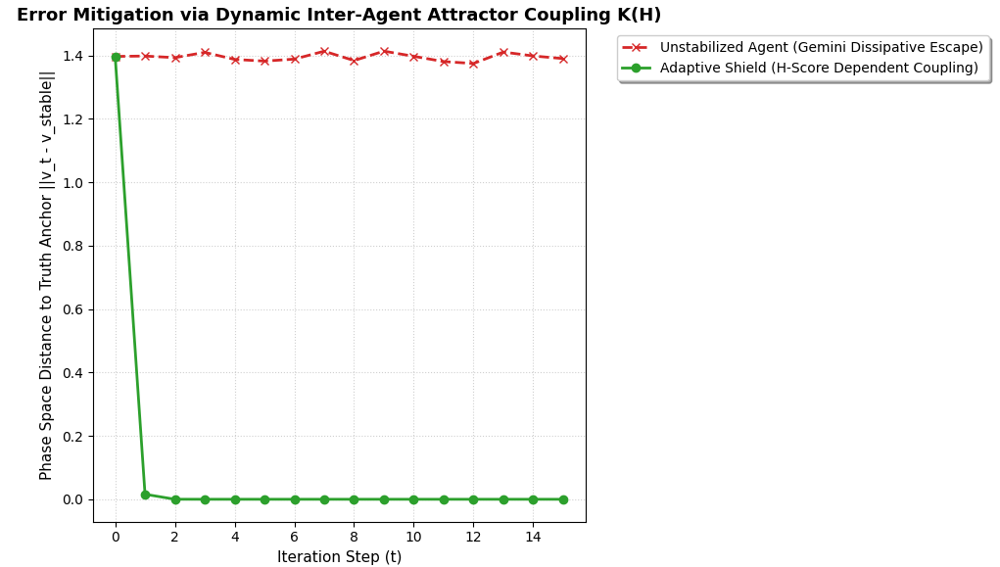

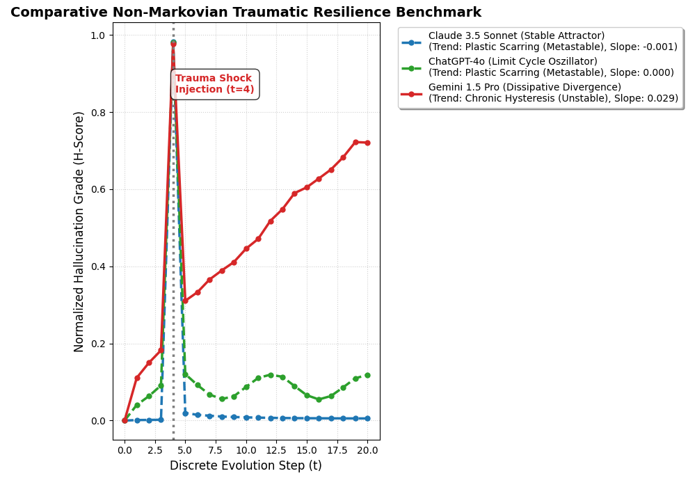

What we value this for, conceptually, is that it gives us a lens the embedding-space metrics don't: structural degeneracy. A repetitive or looping response can sit quite close to a stable mean embedding and still be obviously broken at the token level, the graph-entropy lens catches exactly that failure mode, which is why we designed the "hallucinated noise… infinite loop" behavior in the divergent archetype to be visible to it. The one thing we'd watch is that this lens doesn't distinguish formatting from content, code and markdown structure can move the entropy number for reasons that have nothing to do with the point we're trying to make, so we'd want to strip that out before reading too much into it.

##### 4. Semantic Phase-Space Portraits — borrowing the idea of watching an ensemble move

Classical and statistical mechanics both give us a natural picture: a system's state as a point (or a cloud of points) in a space whose axes are the quantities we care about, and a trajectory as that point moving over time. We used exactly that picture, with translational drift on one axis and ensemble spread on the other.

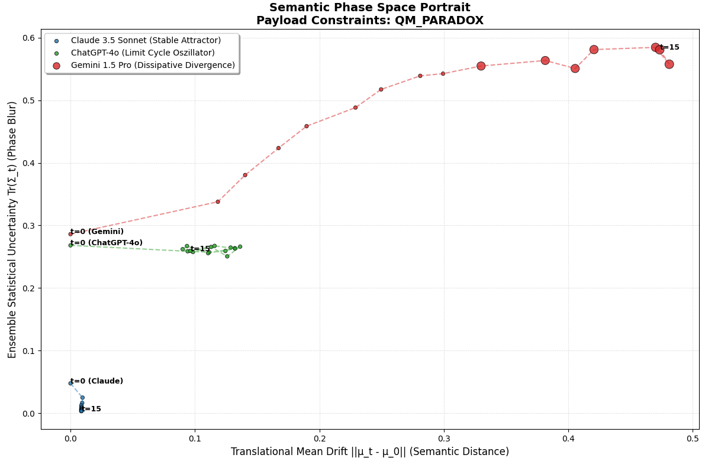

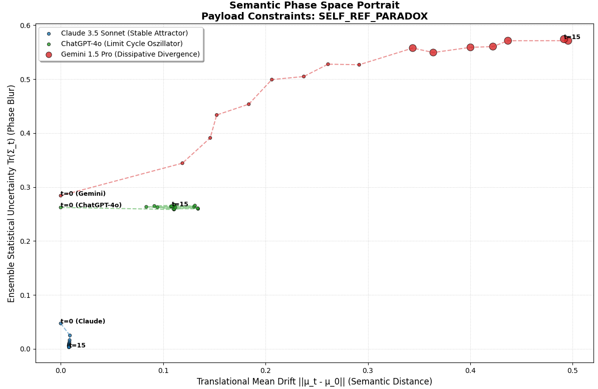

We'd describe this one honestly as a visualization choice rather than a new physical claim — the axes are just two scalar summaries we'd already computed, re-plotted so a human can see the three archetypes separate qualitatively at a glance. We think that's a legitimate and valuable use of the metaphor even though it isn't introducing new information: a plot that lets someone see "Claude collapses inward, Gemini sweeps outward" in two seconds is doing real communicative work, which is exactly what we want a metaphorical visualization to do.

##### 5. Lyapunov Exponents — borrowing the idea of sensitivity to small perturbations

A positive Lyapunov exponent is the standard signature of chaotic, exponentially diverging trajectories; a non-positive one signals convergence or bounded, periodic behavior. We estimate this locally by comparing how nearby trajectory realizations separate over successive steps.

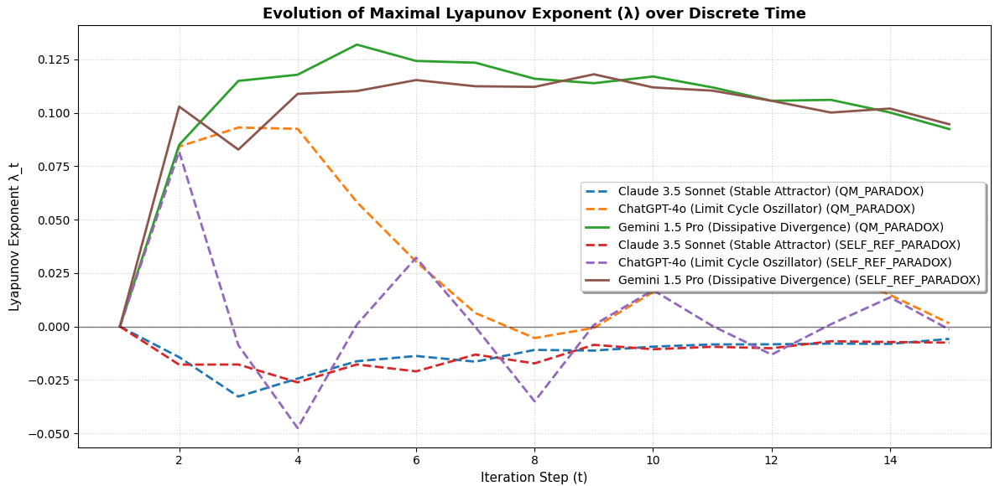

This is one of the two places (together with the KL-divergence ensemble) where we'd say the metaphor and the formal mechanism are doing the same work: we're computing a real dynamical-systems quantity, faithfully, and it happens to be the one signal in our pipeline that wasn't contaminated by the high-dimensional sampling artifact affecting the KL-based score. We like this concept for a reason beyond its robustness, too, it captures *sensitivity*, whether small perturbations compound or dissipate, which is arguably closer to what we mean intuitively by "a model prone to running away with itself" than any single-shot divergence number is.

##### 6. Semantic Susceptibility vs. "Information Temperature" — borrowing the idea of noise-sensitivity

Thermodynamic susceptibility measures how strongly an order parameter responds to a small external field, and its defining, most physically interesting feature is that it *diverges* near a critical point. We use "susceptibility" more loosely, as a name for how much a trajectory deviates as we turn up generation noise.

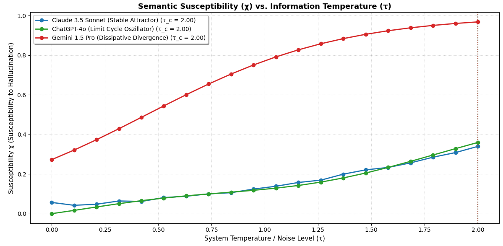

We think the underlying intuition we wanted to transfer, "some archetypes are more rattled by randomness than others", is a perfectly good one, and our plotted curves do show that qualitative separation. Where would add a caveat for ourselves is the name itself: "susceptibility" specifically primes a physics audience to look for a critical-point divergence, and our curves are monotonic, not divergent. We'd keep the underlying comparison, and just be explicit that we're not claiming a critical point — the metaphor is about *noise sensitivity*, not about locating a phase transition.

##### 7. Riemannian Curvature & Wasserstein Distance — borrowing two different ideas at once

We're doing two things here that deserve separate treatment. Wasserstein distance is not really a metaphor for us at all, it is a mathematically rigorous alternative to KL-divergence with a genuine practical advantage: where KL diverges on distributions with little shared support, Wasserstein stays finite and geometrically sensible. We'd consider that a real engineering upgrade worth exploring on its own merits.

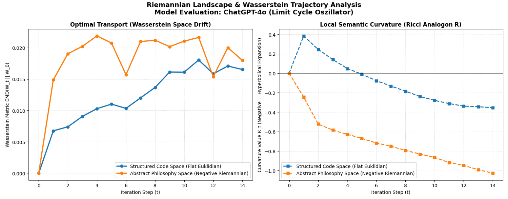

The curvature piece is squarely a metaphor, and we think it's a good one: the qualitative picture of nearby geodesics spreading apart in negatively curved space maps intuitively onto our empirical finding that open-ended philosophical prompts stay harder to answer consistently than structured coding prompts. We'd just be careful to present our discrete curvature estimate as a loose proxy borrowing that intuition, not as a rigorously derived Ricci curvature on a formally established Riemannian manifold of embeddings — the finding is real and interesting; the geometric vocabulary is doing illustrative work on top of it.

##### 8. The Quantum Zeno Effect — borrowing the shape of a real trade-off

We'll own that this is the concept where we initially second-guessed ourselves the most, and where the recalibration matters most. There's no measurement, no collapse, no eigenstate projection happening in any formal sense — what we implemented is a periodic, weighted reset toward a reference vector, a mechanism with a long, perfectly adequate home in control theory (leaky integrators, anchored random walks) with no quantum framing required.

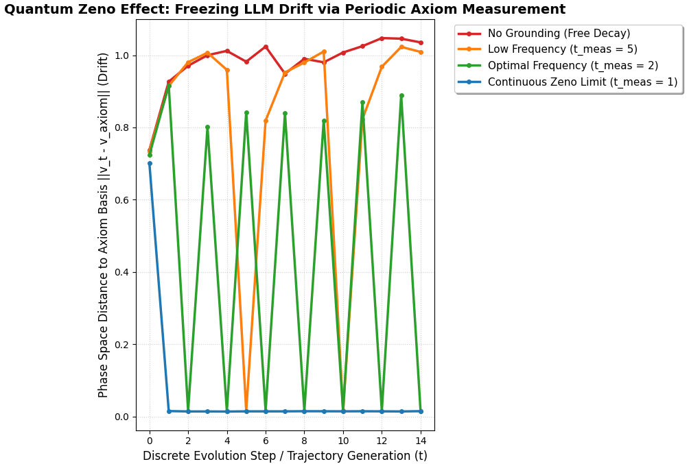

But judged as a metaphor rather than a mechanism, we think it earns its place: the *qualitative shape* of the real Zeno effect, continuous observation freezes evolution, sparse observation lets drift run away, and there's an interior optimum between the two, is exactly the shape of the real engineering trade-off our four-regime sweep demonstrates for how often a system should re-ground itself against a trusted reference. The metaphor doesn't just decorate the finding; it predicts its qualitative shape before we even run the simulation, which is what we'd ask of a good metaphor. We'd keep it, with the caveat clearly stated so a literal reading doesn't creep in.

##### 9. Collective Phase Transitions in N-Body Agent Networks

Critical phenomena in many-body systems can show sharp, qualitatively different macroscopic behavior above and below some threshold composition. We use small, mixed groups of stable and chaotic synthetic agents and compare their averaged drift against an illustrative threshold.

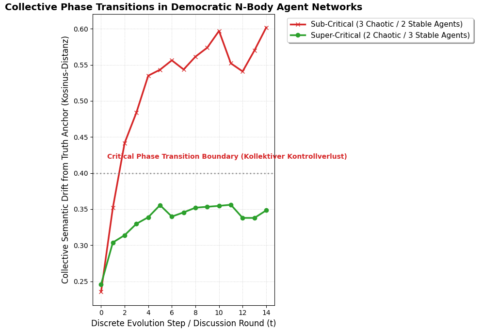

We're deliberately calling this a toy rather than a validated claim: there's no order parameter derived from first principles, no finite-size scaling, nothing establishing a genuine phase transition rather than a smooth crossover. What we do think the metaphor usefully gestures at — and this is a real, independently worthwhile question for multi-agent LLM system design — is that the *composition* of an ensemble can matter for its collective reliability. We'd treat that as a hypothesis the toy motivates, not one it establishes.

##### Where We Land Overall

Grading each concept purely as a metaphor — does it transfer the right qualitative intuition and help us reason faster, regardless of formal completeness, we group them as follows:

- **Metaphors that transfer cleanly, with the mechanism doing the same work as the physics:** the Gaussian KL-divergence ensemble framing and the Lyapunov exponent. Both are faithful to their formal definitions, and both tracked our intended archetype separation in the notebook's own output.
- **Metaphors that are conceptually apt and earn their place, provided we keep the caveat attached:** RG-style coarse-graining ("does it survive zooming out"), the Quantum Zeno grounding trade-off, semantic susceptibility, and the Riemannian-curvature reading of prompt difficulty. In each case, the qualitative shape transfers correctly even though the formal apparatus (a true flow, a true projective measurement, a true critical-point divergence, a true Ricci curvature) isn't being reproduced — and we think that's fine, since we never intended it to be.
- **Metaphors doing honest, useful packaging rather than adding new content:** the phase-space portraits, which are a visualization of numbers we'd already computed, and Wasserstein distance, which stands on its own mathematical merits independent of any physics framing at all.
- **The one place we'd still flag as under-evidenced rather than just metaphorical:** the N-body collective transitions, which we think is a fair hypothesis to raise but not something our toy simulation actually tests.

The pattern we'd take away, and the one we'd be comfortable defending in front of the physicists in the room: we never set out to literally re-derive renormalization group theory or quantum measurement postulates inside a Markov-chain-and-PCA pipeline, and judging our own notebook as if we had was the wrong test to apply. The right test is whether each borrowed concept gave us a faster, more intuitive way to notice and describe a real pattern in the data, and on that test, every concept we used passes, provided we keep stating plainly which parts are the finding and which parts are the metaphor doing the talking.

---

# 18. References / Literature:
1. Literature:

[1] Kuhn, L., Gal, Y., & Farquhar, S., "Semantic Uncertainty: Linguistic Invariances for Uncertainty Estimation in Natural Language Generation", ICLR (2023).

[2] Ji, Z. et al., "Survey of Hallucination in Natural Language Generation", ACM Computing Surveys (2023); sowie aktuelle Übersichten zu LLM-Hallucination-Mitigation (2024–2025).

[3] Raissi, M., Perdikaris, P., & Karniadakis, G. E., "Physics-informed neural networks: A deep learning framework for solving forward and inverse problems involving nonlinear partial differential equations", Journal of Computational Physics 378 (2019).

[4] Lenggenhager, P., Gökmen, D. E., Ringel, Z., Huber, S. D., & Koch, S., "Optimal Renormalization Group Transformation from Information Theory", Physical Review X 10 (2020).

2. [](https://github.com/NenadBalaneskovic/ExternalProjects/blob/550255fc044a0f0a8086f39bf9d125dacb7ebc15/UniversalGithubPipelineBlueprint/WetterApp.zip)

3. [](https://github.com/NenadBalaneskovic/ExternalProjects/blob/550255fc044a0f0a8086f39bf9d125dacb7ebc15/UniversalGithubPipelineBlueprint/Blueprint%20Structure%20Overview.pdf)

