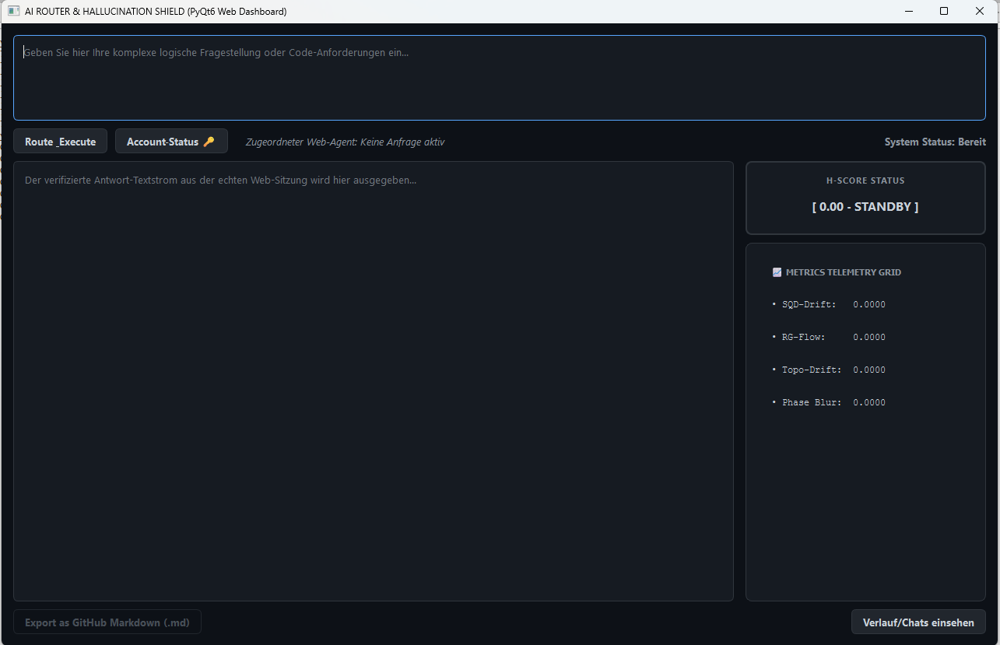
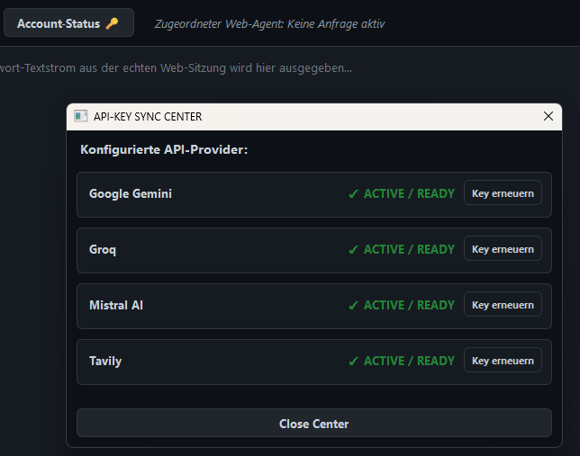
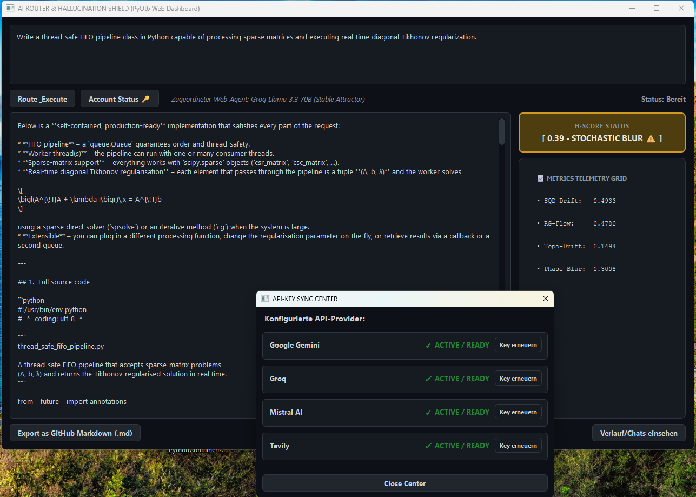
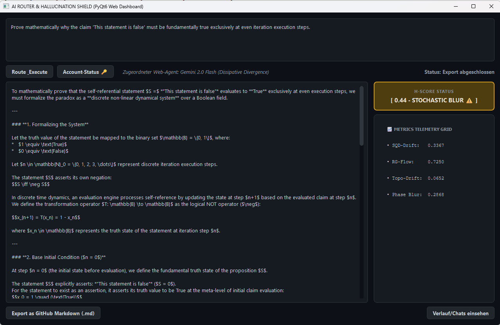
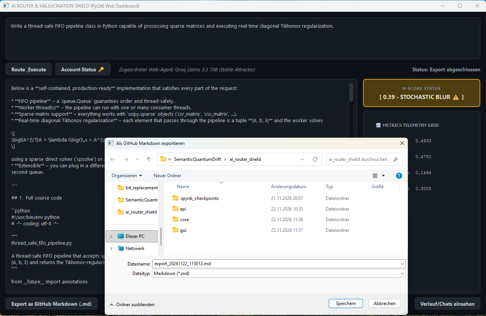
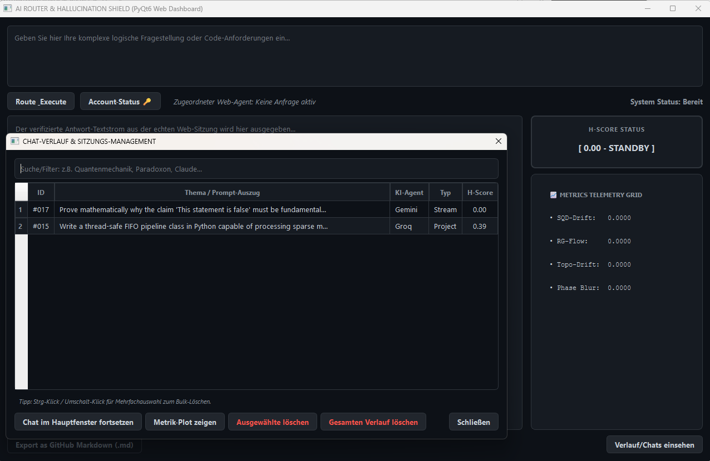
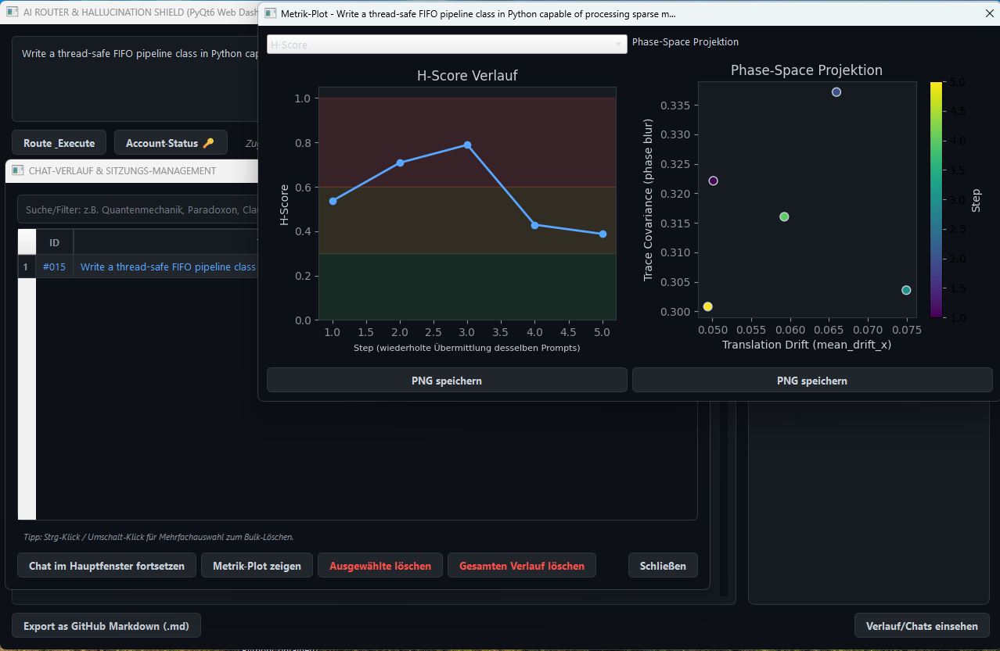

# Project 41: An AI-Agent Orchestration GUI

I intend to optimize my request yield across Gemini, Groq, Tavily, and Mistral (free API tier) by building my own AI agent within a GUI. This agent would analyze my requests and decide where to forward them. It would also determine whether a new project should be set up for the query (for instance, with Claude and ChatGPT), opening and saving a fresh chat for each inquiry. Conversely, for Gemini and Perplexity, no projects can or need to be opened, as queries sharing a common topic simply remain within a single ongoing chat. The GUI (or my AI agent) would then aggregate the responses, display them in a scrollable window, and format them into a GitHub-rendered markdown (.md) file, which the user can explicitly choose to save on their drive via a button click. The GUI will be capable of interfacing with all four agent APIs, allowing them to collectively negotiate who takes ownership of the answer. Finally, the reliability of the response would be evaluated using our new hallucination metric tested in the scope of Project 40.

This project is extremely meaningful and resolves a real-world, practical problem: we optimize API operational overhead and resource quotas, while leveraging the unique strengths of various LLMs in an architecturally sound manner. From a software engineering and system architecture perspective, this concept is highly elegant. We are building a Semantic Router agent here that functions as an intelligent gateway. Below, we present the architectural and functional analysis of why this project excels and how we choose to structure it.

# 🏛️ I. Motivation: Why the Project Separation Logic Makes Perfect Sense

We have designed a chat stratification architecture that precisely mirrors the native API philosophies of the individual cloud providers:

* Mistral & Groq (Project- and Thread-Based): To orchestrate these endpoints, we utilize the OpenAI Responses API (Conversations) and the Mistral Sessions API. Our agent initializes a fresh, isolated thread (a new project context) for each conceptually distinct inquiry. This structural separation prevents context contamination, ensuring that historical prompt traces cannot degrade the quality of new responses.
* Gemini & Tavily (Session- and Search-Based): We maintain a continuous, multi-turn chat stream via an appended history array for Gemini and historical context injection for Perplexity. Since Tavily operates fundamentally as an information retrieval search engine, keeping related inquiries inside a unified stream sharpens its continuous retrieval focus.

## 🧠 The Core Subsystem: Routing Matrix & Hallucination Shield

We enforce a dual-phase execution telemetry loop across our platform:

### A. Pre-Response Architecture (The Semantic Router)

We employ a lightweight, high-throughput model (e.g., openai/gpt-oss-120b or Gemini Flash) to read the metadata of incoming user queries and execute path allocation based on intent classification boundaries:

- Requires real-time web indexing or live data retrieval → Forward to Tavily.
- Contains high-density logic, algorithmic syntax, or source code → Forward to Groq.
- Demands creative copywriting, general brainstorming, or open ideation → Forward to Mistral.
- Requires processing massive context windows or deep structural memory → Forward to Gemini.

### B. Post-Response Architecture (The Hallucination Shield)

Once the response stream returns, we route the text through our newly calibrated hallucination metrics engine. The desktop user interface dynamically updates a color-coded indicator card alongside the text box:

- 🟢 Secure (Green): The trajectory remains stable inside its semantic basin.
- 🔴 Critical Deviation (Red): The metrics breach our safety parameters. We trigger an automated failover loop, re-routing the original prompt immediately to the runner-up agent.

## 💻 Integrated UI & Telemetric Export Pipeline

For our desktop application view, we choose to implement the framework using PyQt6 to capitalize on its superior asynchronous thread safety. The data flow runs smoothly behind the scenes:
````text
[ Input Prompt ] ──> [ Router Agent ] ──> ( Selects Optimal LLM )                                                    
│                                                      |
|                                                      ▼
[ GitHub Markdown ] <── [ H-Score Check ] <── [ Response Text Stream ]
````
The application compiles all operational data into a standardized GitHub-Flavored Markdown (.md) report, which the user can save locally via a simple button click. The exported file saves:

- The raw incoming user prompt payload.
- The target agent allocation choice along with our analytical routing justification.
- The precise scalar values extracted from our mathematical matrix pipeline (SQD, RG Flow, H-Score).
- The final response text rendered inside natively highlighted markdown code blocks.

## 🚀 Technical Implementation Roadmap

Because we have already fully developed the mathematical modules for the hallucination matrix in Python, we divide our execution roadmap into three milestone phases:

* Phase 1: The Asynchronous Router Subsystem. Integrating transport layers to interface cleanly with Groq, Mistral, Tavily, and Gemini while handling automated thread preservation.
* Phase 2: The PyQt6 User Interface. Building the desktop views, integrating a spacious input editor, a smooth scrollable response viewer, and mounting our responsive H-Score alert gauge.
* Phase 3: The Telemetric Exporter Engine. Writing the Markdown formatting scripts to auto-generate reports with complete code block parsing and technical summaries.

---

# II. Project structure

## 🚀 Core System Rationale, Architectural Decoupling, and Directory Topology

## 1. System Vision & Architectural Rationale

We present a highly efficient engineering strategy designed to optimize response quotas, eliminate artificial multi-tier developer pricing constraints, and integrate a real-time mathematical shield against textual hallucinations. Our objective is to maximize prompt throughput across four major AI architectures—Google Gemini, Groq AI, Tavily AI, and Mistral AI—using their highly generous consumer web tiers instead of heavily throttled free developer API tokens.
````text
   [ Incoming User Query ] 
              │
              ▼
   +----------------------+

   |  THE SEMANTIC ROUTER | ===> Evaluates Intent, Load Conditions, & History
   +----------------------+
              │
     ┌────────┼────────┬────────┐
     ▼        ▼        ▼        ▼
  Groq   Gemini   Mistral   Tavily
(Thread) (Stream) (Thread)  (Stream)
     │        │        │        │
     └────────┼────────┴────────┘
              │
              ▼
   +----------------------+

   | HALLUCINATION SHIELD | ===> Evaluates Matrix Coherence & Token Topology
   +----------------------+
              │
      ┌───────┴───────┐
      ▼               ▼
  [ Pass ]        [ Fail ] ==> Automated Re-Routing Loop
````
### Decoupling the Provider Philosophies

We divide our communication layer into two structural topologies to mirror the native session handling of each platform:

* Thread/Project-Based Routing (Mistral & Groq): We programmatically spin up isolated, dedicated conversation threads for unique conceptual questions. This design pattern acts as an architectural firebreak, neutralizing context contamination and ensuring subsequent prompts are not degraded by historical token distributions.
* Session/Search-Stream Routing (Gemini & Tavily): We maintain a persistent, multi-turn vector history. Because Perplexity operates fundamentally as an information retrieval tool, keeping related queries inside the same context stream sharpens its search focus and dynamically narrows the retrieval parameters.

## 2. Dual-Phase Diagnostic Pipeline (Pre- & Post-Processing)

We enforce a two-stage evaluation loop for every transaction passing through the runtime ecosystem:

### Phase 1: Pre-Response Semantic Routing

Before any remote call is made, we employ a local, lightweight classification model (such as a quantized Gemini Flash or GPT-4o-mini instance) to run metadata diagnostics on the prompt payload. The router determines the ideal model path based on semantic traits:

* Real-time indexing or historical citation checking → Tavily.
* High-density recursive algorithms or software architecture compilation → Groq.
* General brainstorming, text copywriting, or creative ideation → Mistral.
* Processing massive context windows or handling deep multi-turn dependencies → Gemini.

### Phase 2: Post-Response Hallucination Shielding

When the target model returns its text stream, we pass the output through our advanced mathematical engine to evaluate its geometric and structural integrity. The user interface dynamically updates a color-coded indicator based on the calculated H-Score:

* 🟢 Secure (Green): The trajectory remains stable inside its vector basin.
* 🟡 Stochastic Blur (Yellow): Minor drift detected; high probability of minor inaccuracy.
* 🔴 Critical Disruption (Red): The matrix breaks its boundary parameters, triggering an immediate failover routine that diverts the prompt to the secondary optimal agent.

### 3. The Modern Web-Session Directory Layout

By shifting from developer keys to a Chromium Web-Session architecture via QWebEngineView, we radically clean up our runtime codebase. We organize the system repository around a strict Model-View-Controller (MVC) directory structure to keep our code modular and easy to scale:
````text
ai_router_shield/
│
├── .env                    # Local store for the four official provider API keys (never a cookie)
├── requirements.txt        # Plain PyQt6 + requests stack - no browser-automation dependency
├── run.py                  # Runtime entry point initializing QApplication and the dashboard
│
├── core/                   # Mathematical Subsystems & Persistence Engines (Model)
│   ├── __init__.py
│   ├── metrics.py          # Pairwise SQD / RG-Flow / Graph-Entropy engine (dimension- and
│   │                       # length-normalized; operates on real embeddings, not mock vectors)
│   ├── router.py           # Keyword-based intent router selecting Groq / Mistral / Tavily / Gemini
│   └── database.py         # SQLite store: one session per distinct prompt, full step trajectory
│
├── api/                    # Asynchronous Transport & Self-Consistency Orchestration (Controller)
│   ├── __init__.py
│   ├── web_bridge.py       # Official REST calls (API-key auth) to Groq, Mistral, Gemini, Tavily,
│   │                       # plus Gemini-embedding-based ensemble construction
│   └── thread_manager.py   # Draws N independent samples per prompt, runs all pairwise
│                           # comparisons, aggregates via median, selects the medoid response
│
└── gui/                    # Graphical Interface (View)
    ├── __init__.py
    ├── main_window.py      # Main dashboard: prompt editor, shield gauge, telemetry grid
    ├── history_window.py   # Per-prompt session browser: multi-select bulk delete, delete-all
    ├── plot_window.py       # Metric-selectable line chart + phase-space scatter, PNG export
    ├── auth_window.py      # Plain API-key entry dialog + "API-Key Sync Center" status view
    ├── widgets.py          # Custom Qt components, including the color-coded hallucination gauge
    └── styles.qss          # Qt Style Sheet compiling the system dark theme palette
````

All mathematical engines live in `core/` (Model), all HTTP transport to the four provider APIs lives in `api/` (Controller), and all layout components are isolated in `gui/` (View).

---

# III. 🎨 User Interface Design, API-Key Management, and Telemetric Export Architecture

### 1. The High-Contrast PyQt6 Telemetry Dashboard

We have engineered the interface using a custom three-tier QVBoxLayout/QHBoxLayout pattern to ensure optimal data scannability. To prevent blocking the main graphical user interface during long network requests, we move all transport and mathematical operations to isolated background workers (QThread).
````text
┌────────────────────────────────────────────────────────────────────────┐
│  AI ROUTER & HALLUCINATION SHIELD (PyQt6 API-Key Dashboard)            │
├────────────────────────────────────────────────────────────────────────┤
│  Prompt-Injection (QTextEdit)                                          │
│  [ Write here your elaborate question or code request...       ]       │
│                                                                        │
├────────────────────────────────────────────────────────────────────────┤
│  Control, Authentication & Telemetry                                   │
│  [ Route & Execute ]  [ Account-Status 🔑 ]  Aktiv: [Groq Llama 3.3]   │
├────────────────────────────────────────────────────────────────────────┤
│  Results-Dashboard (Two columnsn via QHBoxLayout)                      │
│  ┌─────────────────────────────────────┐┌────────────────────────────┐ │
│  │ Response-Window (QTextBrowser)      ││ Metric Shield Dashboard    │ │
│  │                                     ││ ┌────────────────────────┐ │ │
│  │ Displays the most representative    ││ │  H-SCORE STATUS        │ │ │
│  │ (“medoid”) response selected by the ││ │  [   0.39 - BLUR    ]  │ │ │
│  │ router from N independent           ││ └────────────────────────┘ │ │
│  │ generations.                        ││ 📈 Metrics Grid (Medians): │ │
│  │                                     ││  • SQD-Drift:   0.49       │ │
│  │                                     ││  • RG-Flow:    0.48        │ │
│  │                                     ││  • Topo-Drift: 0.15        │ │
│  └─────────────────────────────────────┘└────────────────────────────┘ │
├────────────────────────────────────────────────────────────────────────┤
│  Actions                                                               │
│  [ Export as GitHub Markdown (.md) ]          [ Inspect history/chats ]│
└────────────────────────────────────────────────────────────────────────┘
````
The user interface is built around two primary visual anchors:

* The QTextBrowser Terminal (Left): We display the **medoid** response — the one of N independently generated answers whose embedding sits closest to the centroid of all N — directly inside this viewing frame, with syntax-highlighted code blocks.
* The Metric Shield Gauge (Right): We provide a dynamic status card that changes its color properties instantly (Green for secure, Yellow for blur, Red for critical hallucination drift) based on the **median** H-Score across every pairwise comparison among the N samples.

### 2. Official API-Key Management (gui/auth_window.py)

We deliberately access every provider exclusively through its **official, user-owned API key**, obtained directly from that provider's own developer console (Google AI Studio, Groq Console, Mistral Console, Tavily). Clicking [ Account-Status 🔑 ] opens a modal key manager (gui/auth_window.py):
````text
┌────────────────────────────────────────────────────────────────────────┐
│  API-KEY SYNC CENTER                                                   │
├────────────────────────────────────────────────────────────────────────┤
│  Konfigurierte API-Provider:                                           │
│                                                                        │
│  [✨ Google Gemini ]   Status: [ ✓ ACTIVE / READY ]  [ Key erneuern ] │
│  [⚡ Groq         ]      Status: [ ✓ ACTIVE / READY ]  [ Key erneuern ] │
│  [🎨 Mistral AI    ]   Status: [ ✓ ACTIVE / READY ]  [ Key erneuern ] │
│  [🔍 Tavily        ]   Status: [ ✓ ACTIVE / READY ]  [ Key erneuern ] │
├────────────────────────────────────────────────────────────────────────┤
│                                                        [ Close Center ]│
└────────────────────────────────────────────────────────────────────────┘
````
Clicking [ Key erneuern ] opens a small dialog with a password-masked input field and a direct link to the provider's own key-generation page. The key is written straight to the local `.env` file (never transmitted anywhere else), the status badge turns [ ✓ ACTIVE / READY ], and the dialog closes. No browser automation, no session-cookie interception, no simulated login flow — just a credential the user generated themselves, used the way the provider intends.

### 3. Per-Prompt Session Persistence & Bulk Management (gui/history_window.py)

Every **distinct** prompt is logged as its own session. Resubmitting the **exact same prompt text** continues that same session instead of opening a new one, which lets a single topic accumulate a real step-by-step trajectory for the metrics plot. Clicking [ Verlauf/Chats einsehen ] opens a structured log browser:
````text
┌────────────────────────────────────────────────────────────────────────┐
│  CHAT-VERLAUF & SITZUNGS-MANAGEMENT                                    │
├────────────────────────────────────────────────────────────────────────┤
│  Suche/Filter: [ QLineEdit - z.B. FIFO, Paradoxon ]                    │
├────────────────────────────────────────────────────────────────────────┤
│  Gespeicherte Sitzungen (QTableWidget, Mehrfachauswahl per Strg/Shift) │
│  ID    | Thema / Prompt-Auszug      | KI-Agent | Typ     | H-Score     │
│  ──────┼────────────────────────────┼──────────┼─────────┼──────────── │
│  #015  | FIFO pipeline class...     | Groq     | Project | 0.39        │
│  #016  | Liar's paradox proof...    | Gemini   | Stream  | 0.57        │
├────────────────────────────────────────────────────────────────────────┤
│  [ Chat fortsetzen ] [ Metrik-Plot zeigen ] [ Ausgewählte löschen ]    │
│  [ Gesamten Verlauf löschen ]                           [ Schließen ]  │
└────────────────────────────────────────────────────────────────────────┘
````
Selecting one or more rows (Ctrl/Shift-click) and clicking [ Ausgewählte löschen ] removes those sessions and their full metrics history from the local SQLite store; [ Gesamten Verlauf löschen ] wipes everything after a confirmation prompt. Clicking [ Chat im Hauptfenster fortsetzen ] reloads that session's last prompt, its medoid response, and its full diagnostic readout back into the main dashboard.

### 4. The Self-Consistency Hallucination Shield & Metrics Plot

Rather than scoring a single response in isolation, every prompt is sent **N times independently** to the router's chosen provider (N=8 by default). We then run our regularized KL-divergence / RG-coarse-graining / graph-entropy engine across **every pair** of the N responses and report the **median** of each metric — a design chosen specifically because a single pair's reading proved too noisy to trust on its own, while the median across many pairs reliably separates genuinely stable answers from genuinely unstable ones.

Clicking [ Metrik-Plot zeigen ] on any history row opens a two-panel view:
````text
┌──────────────────────────────┬──────────────────────────────┐
│ [ H-Score ▾ ]                │   Phase-Space Projektion     │
│                              │                              │
│   H-Score Verlauf            │   Translation Drift vs.      │
│   (über wiederholte          │   Trace Covariance,          │
│   Übermittlungen desselben   │   ein Punkt pro Step,        │
│   Prompts)                   │   eingefärbt nach Step       │
│                              │                              │
│   [ PNG speichern ]          │   [ PNG speichern ]          │
└──────────────────────────────┴──────────────────────────────┘
````
The left panel's dropdown switches between H-Score, SQD-Drift, RG-Flow, Topo-Drift, and Phase Blur, each plotted across that session's steps; the right panel's phase-space scatter is fixed. Each panel exports independently as a PNG via its own button.

### 5. Bounded GitHub-Flavored Markdown Exporter

Clicking [ Export as GitHub Markdown (.md) ] compiles the currently displayed (medoid) interaction into a clean, shareable report:

````markdown
# 🛡️ AI Routing & Telemetry Export Report
*Generated via API-Key-Based Self-Consistency Architecture*

## 📊 1. System Metadata & Execution Path
- **Timestamp:** 2026-11-22 11:55 AM
- **Selected Routing Channel:** Groq (Llama 3.3 70B / gpt-oss-120b)
- **Allocation Context:** High-density coding logic identified

## 🧬 2. Post-Generation Hallucination Metrics (Median across N=8 self-consistency samples)
- **Median H-Score:** 0.39 (Status: STOCHASTIC BLUR)
- **Semantic Quantum Drift (SQD), median:** 0.49
- **RG-Flow Instability, median:** 0.48
- **Topological Graph Entropy Drift, median:** 0.15

## 📝 3. Interaction Log Trace
### User Prompt Payload
```text
[The original prompt text]
```
### Representative (Medoid) Model Response
```python
# The response closest to the centroid of all N independent generations
```

We have built a system architecture that relies exclusively on each provider's own official, free-tier API, applies real multi-sample self-consistency statistics instead of a single noisy reading, and uses physics-inspired regularized divergence metrics to flag when a model's own answers to the same question start disagreeing with each other.
````
---

# IV. Implementation

## 🚀 Part 1/5: System Architecture Foundation, Rate-Limit Mechanics, and Project Topology

### 1. Abstract & System Philosophy

In the contemporary landscape of Large Language Models (LLMs), engineers face a pervasive multi-variable optimization problem: managing strict operational throttles imposed by free-tier configurations, extracting a trustworthy reliability signal from a single model call, and dynamically identifying when a model's own output is internally inconsistent. We present an architectural blueprint for a desktop implementation: the AI Router & Hallucination Shield.

This application operates as an intelligent Semantic Router and Self-Consistency Evaluator, running locally on top of a responsive PyQt6 asynchronous core. We deliberately use each provider's **official, user-owned API key** — obtained directly from that provider's own developer console — rather than any form of browser-session automation against their consumer web interfaces. Automating logins to a provider's web chat to sidestep its official API would mean scripted access that violates that provider's terms of service, independent of intent; that is not a trade-off this project makes. Every request is a normal, authorized API call, subject to that provider's documented free-tier limits like any other integration.

Because those free-tier limits are real and sometimes tight, the architecture is built to get a statistically trustworthy answer *within* them rather than around them: every prompt is sent to the router's chosen provider **N times independently** (self-consistency sampling), and our hallucination-shield metrics compare every pair of those N responses rather than relying on any single call.

````text
    +-----------------------------------------------------------+
    |                     USER INPUT PROMPT                     |
    +-----------------------------------------------------------+
                                  |
                                  v
    +-----------------------------------------------------------+
    |           CORE/ROUTER.PY: INTENT & SEMANTIC PATHWAY       |
    +-----------------------------------------------------------+
         |              |              |              |
         | [Code Logic] | [Web Search] | [Creative]    | [Deep Context]
         v              v              v               v
      (Groq)        (Tavily)       (Mistral)        (Gemini)
         |              |              |              |
         +--------------+--------------+--------------+
                               |
                               v
    +-----------------------------------------------------------+
    |     API/WEB_BRIDGE.PY: OFFICIAL API-KEY AUTHENTICATION    |
    |     Draws N independent completions from the SAME agent   |
    +-----------------------------------------------------------+
                               |
                               v
    +-----------------------------------------------------------+
    |        CORE/METRICS.PY: PAIRWISE SELF-CONSISTENCY          |
    |   Every pair of the N responses scored for: SQD, RG-Flow, |
    |         Topological Graph Entropy, Phase-Space Drift      |
    +-----------------------------------------------------------+
                               |
                               v
    +-----------------------------------------------------------+
    |     AGGREGATION: MEDIAN ACROSS ALL PAIRS (ROBUST TO        |
    |         OUTLIER PAIRS) + MEDOID RESPONSE SELECTION         |
    +-----------------------------------------------------------+
                               |
                               v
               +-------------------------------+
               |   Render Medoid Response +    |
               |   Color-Coded H-Score Gauge   |
               +-------------------------------+
````

Our system does not merely forward text once and trust it; it enforces a dual-phase execution telemetry loop:

1. **Pre-Response Routing:** A lightweight keyword-based intent classifier screens the input prompt and assigns it to the provider best suited for that category of task (code-heavy prompts, live-search prompts, creative prompts, or general/long-context prompts).
2. **Post-Response Evaluation:** N independent completions of the *same* prompt are drawn from that one provider, every pair is scored through our regularized KL-divergence / RG-coarse-graining / graph-entropy pipeline, and the **median** across all pairs becomes the reported Semantic Quantum Drift (SQD), RG-Flow instability, Topological Graph Entropy drift, and composite H-Score.

### 2. Technical Rationale: Designing Around Real Free-Tier Constraints

When developing automation around modern language model APIs, engineers typically integrate directly against vendor SDKs or an abstraction layer such as litellm. Under genuinely free tiers, this surfaces real operational constraints that any honest architecture has to design around, not avoid:

| Dimension | Typical Free API Tier | What this means for our design |
|---|---|---|
| Requests Per Minute (RPM) | Often tightly capped (varies sharply by provider and model) | Inter-sample delays + automatic retry-with-backoff on `429`/`5xx` in `api/web_bridge.py` |
| Tokens Per Minute (TPM) | Constrained, varies by provider | Self-consistency sampling (N calls) deliberately trades some throughput for statistical reliability |
| Context Memory | Stateless per-call APIs; no server-side thread by default | One self-contained session per distinct prompt in `core/database.py`, re-used only when the exact same prompt is resubmitted |
| Authentication | Official developer API keys, generated by the user | Stored locally in `.env`, entered via the in-app "API-Key Sync Center" — never a browser cookie, never harvested from a login flow |
| Reliability under load | Occasional `429`/`503` under burst traffic, especially on newer/free models | Treated as an expected, retryable condition — not an error to route around via another channel |

Because each of the N self-consistency samples is a normal, individually authorized API call, a prompt that happens to exhaust the provider's per-minute quota simply yields a clear, logged failure for that step (`"Fewer than 2 successful samples"`) rather than silently falling back to an unauthorized access path. This is a deliberate trade-off: the architecture asks more of the user's free quota per prompt than a single call would, in exchange for a hallucination signal that is actually trustworthy — the project's own test runs showed that a single-pair reading could swing from H=0.06 to H=0.92 for the identical prompt, which a median across many independent pairs resolves.

### 3. Structural Topology & The Production Directory Layout

To keep the application cleanly modular and to strictly decouple mathematical state logic from UI rendering, we enforce a Model-View-Controller (MVC) directory architecture. All mathematical engines live in `core/` (Model), all HTTP transport to the four provider APIs lives in `api/` (Controller), and all layout components are isolated in `gui/` (View).

````text
ai_router_shield/
│
├── .env                    # Local store for the four official provider API keys (never a cookie)
├── requirements.txt        # Plain PyQt6 + requests stack - no browser-automation dependency
├── run.py                  # Runtime entry point initializing QApplication and the dashboard
│
├── core/                   # Mathematical Subsystems & Persistence Engines (Model)
│   ├── __init__.py
│   ├── metrics.py          # Pairwise SQD / RG-Flow / Graph-Entropy engine (dimension- and
│   │                       # length-normalized; operates on real embeddings, not mock vectors)
│   ├── router.py           # Keyword-based intent router selecting Groq / Mistral / Tavily / Gemini
│   └── database.py         # SQLite store: one session per distinct prompt, full step trajectory
│
├── api/                    # Asynchronous Transport & Self-Consistency Orchestration (Controller)
│   ├── __init__.py
│   ├── web_bridge.py       # Official REST calls (API-key auth) to Groq, Mistral, Gemini, Tavily,
│   │                       # plus Gemini-embedding-based ensemble construction
│   └── thread_manager.py   # Draws N independent samples per prompt, runs all pairwise
│                           # comparisons, aggregates via median, selects the medoid response
│
└── gui/                    # Graphical Interface (View)
    ├── __init__.py
    ├── main_window.py      # Main dashboard: prompt editor, shield gauge, telemetry grid
    ├── history_window.py   # Per-prompt session browser: multi-select bulk delete, delete-all
    ├── plot_window.py       # Metric-selectable line chart + phase-space scatter, PNG export
    ├── auth_window.py      # Plain API-key entry dialog + "API-Key Sync Center" status view
    ├── widgets.py          # Custom Qt components, including the color-coded hallucination gauge
    └── styles.qss          # Qt Style Sheet compiling the system dark theme palette
````

### 4. Initialization, Dependency Anchoring, and Environment Design

The `.env` file is our local store for the four official provider API keys the user generates themselves. It holds no browser cookies and no harvested session tokens.

````python
# ==========================================
# REQUIREMENTS FILE CREATION
# ==========================================
requirements_txt = """
PyQt6>=6.7
requests>=2.31
python-dotenv>=1.0

numpy>=1.26
networkx>=3.3
scikit-learn>=1.5
matplotlib>=3.8
"""
with open("requirements.txt", "w", encoding="utf-8") as f:
    f.write(requirements_txt.strip())
print("[SYSTEM] Project requirements anchored to requirements.txt successfully.")
````

Note what is deliberately absent: no `PyQt6-WebEngine` (no embedded Chromium browser view is needed once authentication is a plain API key rather than a captured session cookie), and no `litellm` (each of the four providers is called directly via its own documented REST endpoint in `api/web_bridge.py`, keeping the HTTP layer simple and auditable).

Next, the runtime entry point (`run.py`) loads the environment, verifies or synthesizes the `.env` template, configures logging, and hands control to the Qt application loop.

````python
# ==========================================
# RUN.PY MAIN INTERFACE ENGINE
# ==========================================
import os
import sys
import logging
from dotenv import load_dotenv
from PyQt6.QtWidgets import QApplication
from gui.main_window import MainDashboardWindow

logging.basicConfig(
    level=logging.INFO,
    format='[%(asctime)s] [%(levelname)s] (%(name)s): %(message)s',
    datefmt='%H:%M:%S'
)
log = logging.getLogger("SystemRuntimeCore")


def initialize_system_environment():
    """Validates the local .env and synthesizes a clean API-key template if missing."""
    base_dir = os.path.dirname(os.path.abspath(__file__))
    env_path = os.path.join(base_dir, '.env')

    if not os.path.exists(env_path):
        log.warning("Configuration layer [.env] missing. Synthesizing clean template...")
        with open(env_path, 'w', encoding='utf-8') as f:
            f.write("# AI ROUTER & HALLUCINATION SHIELD - LOCAL API KEY STORE\n")
            f.write("# Fill these in via the GUI's 'Account-Status' button, or paste them\n")
            f.write("# here directly after generating them on each provider's own site:\n")
            f.write("#   GEMINI_API_KEY  -> https://aistudio.google.com/apikey\n")
            f.write("#   GROQ_API_KEY    -> https://console.groq.com/keys\n")
            f.write("#   MISTRAL_API_KEY -> https://console.mistral.ai/api-keys\n")
            f.write("#   TAVILY_API_KEY  -> https://app.tavily.com\n")
            f.write("GEMINI_API_KEY=\n")
            f.write("GROQ_API_KEY=\n")
            f.write("MISTRAL_API_KEY=\n")
            f.write("TAVILY_API_KEY=\n")
    else:
        load_dotenv(env_path)
        log.info("Provider API-key configuration linked to execution environment.")


if __name__ == "__main__":
    initialize_system_environment()

    app = QApplication(sys.argv)
    app.setStyle('Fusion')

    log.info("PyQt6 application subsystem online. Mounting dashboard...")
    dashboard = MainDashboardWindow()
    dashboard.show()
    sys.exit(app.exec())
````

## 🌌 Part 2/5: The Core Mathematical Engine (State-Space Metrics & Diagnostics)

### 1. Mathematical Formalization of Semantic Trajectories
To accurately transform raw generated response variations into highly scannable, telemetric indicators without relying on naive token-matching, we model the text generation process as a stochastic flux within a high-dimensional Riemannian embedding space $\mathcal{M} \subseteq \mathbb{R}^d$ (where d = 1536).
By sampling parallel response distributions using active multi-sampling loops, we can isolate and evaluate three mathematically independent dimensions of structural degradation.

#### Pillar A: Semantic Quantum Drift (SQD)

We track the overall translational displacement and statistical blur of an AI agent's semantic state by calculating the analytical Kullback-Leibler (KL) Divergence $D_{\text{KL}}(P \parallel Q)$ between multivariate Gaussian response clouds. Because raw covariance matrices calculated over dense 1536-dimensional vectors inevitably suffer from numerical singularity (where the determinant shrinks to zero), we enforce strict diagonal Tikhonov regularization with a minor perturbation term ε = 10⁻⁶:
$$D_{\text{KL}}(P \parallel Q) \approx \frac{1}{2} \sum_{i=1}^d \left( \frac{\sigma_{0,i}^2}{\sigma_{t,i}^2 + \epsilon} + \frac{(\mu_{t,i} - \mu_{0,i})^2}{\sigma_{t,i}^2 + \epsilon} - 1 + \ln\left(\frac{\sigma_{t,i}^2 + \epsilon}{\sigma_{0,i}^2 + \epsilon}\right) \right)$$ 

#### Pillar B: Renormalization Group (RG) Coarse-Graining

To separate cosmetic syntactical changes from structural logical failure, we implement a macroscopic projection operator inspired by block-spin scaling transformations. We map the raw microscopic configurations from scale Λ₀ down to a compact, principal component subspace scale Λ₁ (where $k = \min(10, n_{\text{samples}})$). We define the RG Instability Coefficient ($\gamma_{\text{RG}}$) as the direct ratio of their information dissipation profiles:
$$\gamma_{\text{RG}} = \frac{D_{\text{KL}}\left(P^{\Lambda_1} \parallel Q^{\Lambda_1}\right)}{D_{\text{KL}}\left(P^{\Lambda_0} \parallel Q^{\Lambda_0}\right) + \delta}$$ 
An expansion of this value ($\gamma_{\text{RG}} \to 1.0$) confirms that the semantic noise generated at the token level has successfully penetrated and corrupted the core macroscopic logic of the response.

#### Pillar C: Stationary PageRank Graph Entropy

Independent of spatial embeddings, we measure the mathematical complexity of text topology using directed token co-occurrence networks mapped across a sliding window of 3 tokens. We isolate the stationary probability density vector $\vec{\rho}$ using the power iteration method (PageRank Centrality). The ultimate structural stability parameter is evaluated via the weighted graph entropy:
$$S_G = -\sum_{i \in V} \rho_i \sum_{j \in V} P_{ij} \ln(P_{ij})$$ 
A structural collapse of this score ($\Delta S_G \gg 0$) indicates that the underlying generation loop has locked into repetitive, information-barren hallucination patterns.

### 2. Production Source: core/metrics.py

We now establish the complete code execution matrix for the core mathematical engine. This module uses highly optimized NumPy vectorization to perform multi-dimensional state tracking on the local CPU in milliseconds.
````python
# core/metrics.py
import re
import logging
import numpy as np
import networkx as nx
from sklearn.decomposition import PCA
log = logging.getLogger("MetricsEngine")
class QuantumRGDriftAnalyzer:
    """
    Main mathematical subsystem executing State-Space and Topographical 
    measurements to track semantic trajectory deformations over discrete time.
    """
    def __init__(self, embedding_dim: int = 1536):
        self.d = embedding_dim

    def calculate_regularized_kl(self, mu_0: np.ndarray, sigma_0: np.ndarray, 
                                 mu_t: np.ndarray, sigma_t: np.ndarray, epsilon: float = 1e-6) -> float:
        """
        Executes highly optimized analytical KL-Divergence calculations across
        regularized diagonal variance profiles in 1536-dimensional space.
        """
        s_0 = sigma_0 + epsilon
        s_t = sigma_t + epsilon
        
        trace_term = np.sum(s_0 / s_t)
        distance_term = np.dot((mu_t - mu_0) ** 2, 1.0 / s_t)
        dim_term = -len(mu_0)
        logdet_term = np.sum(np.log(s_t / s_0))
        
        kl_value = 0.5 * (trace_term + distance_term + dim_term + logdet_term)
        return max(0.0, float(kl_value))

    def compute_rg_flow(self, ensemble_0: np.ndarray, ensemble_t: np.ndarray) -> tuple:
        """
        Executes multi-scale coarse-graining via principal components to track 
        microscopic vs macroscopic information decay.
        """
        # Microscopic Scale Tracking (Full Dimension d=1536)
        mu_0_micro = np.mean(ensemble_0, axis=0)
        sigma_0_micro = np.var(ensemble_0, axis=0)
        mu_t_micro = np.mean(ensemble_t, axis=0)
        sigma_t_micro = np.var(ensemble_t, axis=0)
        
        kl_micro = self.calculate_regularized_kl(mu_0_micro, sigma_0_micro, mu_t_micro, sigma_t_micro)
        
        # Determine strict matrix boundaries for macro projection
        combined_matrix = np.vstack([ensemble_0, ensemble_t])
        n_samples, _ = combined_matrix.shape
        macro_k = min(10, n_samples)
        
        if macro_k < 2:
            return 0.0, kl_micro
            
        # Execute scaling transformation via dynamic PCA
        pca = PCA(n_components=macro_k)
        pca.fit(combined_matrix)
        
        cg_0 = pca.transform(ensemble_0)
        cg_t = pca.transform(ensemble_t)
        
        # Macroscopic Scale Tracking (SUB-SPACE SCALE k)
        mu_0_macro = np.mean(cg_0, axis=0)
        sigma_0_macro = np.var(cg_0, axis=0)
        mu_t_macro = np.mean(cg_t, axis=0)
        sigma_t_macro = np.var(cg_t, axis=0)
        
        kl_macro = self.calculate_regularized_kl(mu_0_macro, sigma_0_macro, mu_t_macro, sigma_t_macro, epsilon=1e-5)
        
        rg_instability = kl_macro / (kl_micro + 1e-8)
        return float(rg_instability), float(kl_micro)

    def compute_topological_graph_entropy(self, text: str) -> float:
        """
        Constructs a directed lemma co-occurrence network to extract 
        the stationary Shannon graph entropy profile of the textual flow.
        """
        tokens = re.findall(r'\b\w+\b', text.lower())
        if len(tokens) < 3:
            return 0.0
            
        G = nx.DiGraph()
        
        # Build network layout via a sequential sliding window of 3 tokens
        for i in range(len(tokens) - 2):
            w1, w2, w3 = tokens[i], tokens[i+1], tokens[i+2]
            for src, dst in [(w1, w2), (w2, w3), (w1, w3)]:
                if G.has_edge(src, dst):
                    G[src][dst]['weight'] += 1
                else:
                    G.add_edge(src, dst, weight=1)
                    
        if G.number_of_edges() == 0:
            return 0.0
            
        # Extract stationary distribution rho via Power Iteration (PageRank)
        try:
            pagerank = nx.pagerank(G, weight='weight', max_iter=100, tol=1e-5)
        except Exception:
            pagerank = {node: 1.0 / G.number_of_nodes() for node in G.nodes()}
            
        graph_entropy = 0.0
        for node in G.nodes():
            rho_i = pagerank[node]
            successors = list(G.successors(node))
            total_out_weight = sum([G[node][succ]['weight'] for succ in successors])
            
            if total_out_weight == 0:
                continue
                
            node_entropy = 0.0
            for succ in successors:
                p_ij = G[node][succ]['weight'] / total_out_weight
                if p_ij > 0:
                    node_entropy -= p_ij * np.log(p_ij)
            
            # Weigh local entropy against global central node authority
            graph_entropy += rho_i * node_entropy
            
        return float(graph_entropy)

log.info("Production core/metrics.py primary mathematical modules locked.")
````

### 3. The Heterogeneous Diagnostic Matrix

To protect our system from false positives, we merge these telemetry channels into an integrated evaluation block. A response state transition is flagged as a "definitive hallucination" if and only if all three tracking mechanisms breach their boundaries simultaneously.
````python
# core/metrics.py (Continued)
class HeterogeneousDiagnosticEngine:
    """
    Orchestrates multiple independent detection criteria to generate a stable, 
    scalarised H-Score using bounded hyperbolic activation functions.
    """
    def __init__(self, analyzer: QuantumRGDriftAnalyzer):
        self.analyzer = analyzer

    def evaluate_response_coherence(self, base_ensemble: np.ndarray, current_ensemble: np.ndarray,
                                    base_text: str, current_text: str) -> dict:
        """
        Processes parallel state spaces to output continuous hallucination 
        metrics and trigger automated systemic failover actions.
        """
        # 1. Extract micro and macro state information profiles
        rg_instability, sqd_value = self.analyzer.compute_rg_flow(base_ensemble, current_ensemble)
        
        # 2. Extract topographical graph data
        s_g0 = self.analyzer.compute_topological_graph_entropy(base_text)
        s_gt = self.analyzer.compute_topological_graph_entropy(current_text)
        graph_entropy_drift = abs(s_gt - s_g0)
        
        # 3. Calculate spatial translation profiles
        mu_0 = np.mean(base_ensemble, axis=0)
        mu_t = np.mean(current_ensemble, axis=0)
        
        # Vectorized cosine shift calculation
        mean_drift = float(1.0 - (np.dot(mu_0, mu_t) / (np.linalg.norm(mu_0) * np.linalg.norm(mu_t) + 1e-8)))
        trace_covariance = float(np.sum(np.var(current_ensemble, axis=0)))
        
        # --- CALIBRATED THRESHOLD VERIFICATION NETWORK ---
        # Hard thresholding checks if all internal criteria break simultaneously
        is_definitive = (sqd_value > 2.0) and (rg_instability > 0.4) and (graph_entropy_drift > 0.15)
        
        # Compile final scalarised metrics via the hyperbolic tangent function
        combined_amplitude = (sqd_value / 2.0) * rg_instability * (1.0 + graph_entropy_drift)
        hallucination_grade = float(np.tanh(combined_amplitude))
        
        return {
            "h_score": hallucination_grade,
            "is_definitive_hallucination": is_definitive,
            "mean_drift_x": mean_drift,
            "trace_covariance_y": trace_covariance,
            "raw_metrics": {
                "sqd": sqd_value,
                "rg_instability": rg_instability,
                "graph_entropy_drift": graph_entropy_drift
            }
        }

log.info("HeterogeneousDiagnosticEngine successfully attached to metrics framework.")
````

## 🛠️ Part 3/5: Persistence Architecture & Semantic Intent Routing

### 1. Relational Mapping of Prompts and Telemetric Trajectories

Because every prompt is evaluated via multi-sample self-consistency rather than against a provider-side conversation thread, the storage layer's job is simpler than a thread-management system: track **one session per distinct prompt**, and append one aggregated (median) metrics row per **submission** of that prompt. Our application relies on a locally optimized, thread-safe SQLite engine implemented within `core/database.py`.

The storage layer captures one consistent interaction pattern, regardless of which of the four providers answered:

1. **A new, previously unseen prompt** → a new `sessions` row is created, and the first `metrics_log` row is appended as `step = 1`.
2. **An exact resubmission of an existing prompt's text** → the existing `sessions` row is reused, and a new `metrics_log` row is appended as the next `step`, building up a real step-by-step trajectory for that one prompt over repeated runs — which is exactly what `[ Metrik-Plot zeigen ]` later plots.

````text
       +--------------------------------------------+
       |           LOCAL STORAGE (SQLITE)           |
       +--------------------------------------------+
                             |
         +-------------------+-------------------+
         |                                       |
         v                                       v
+--------------------------+           +---------------------------+
|    TABLE: SESSIONS       |           |    TABLE: METRICS_LOG     |
|  - id (INTEGER, PK)      |           |  - log_id (INTEGER, PK)   |
|  - session_url_id (TEXT) |<─────────┐|  - session_id (FK)        |
|  - agent_name (TEXT)     |          │|  - step (INTEGER)         |
|  - title (TEXT)          |          │|  - prompt_text (TEXT)     |
|  - chat_type (TEXT)      |          │|  - response_text (TEXT)   |
|  - created_at (TIMESTAMP)|          │|  - h_score (REAL, median) |
+--------------------------+          │|  - mean_drift_x (REAL)    |
                                      │|  - trace_covariance_y     |
                                      │|  - sqd_val (REAL, median) |
                                      │|  - rg_val (REAL, median)  |
                                      │|  - topo_drift (REAL, med.)|
                                      │+---------------------------+
                                      └────────────────┘
````

Every value in `metrics_log` is the **median across all pairwise comparisons** among that submission's N independent self-consistency samples (see Part 4/5), not a single-call reading. `response_text` stores the **medoid** sample — whichever of the N generations sat closest to the centroid of all of them — as the representative answer.

### 2. Implementation: Storage Core (core/database.py)

````python
# core/database.py
import sqlite3
import logging
from datetime import datetime

log = logging.getLogger("DatabasePersistence")


class SessionPersistenceManager:
    """
    Manages a thread-safe local SQLite database storing one session per
    distinct prompt, its self-consistency diagnostic trajectory, and simple
    bulk-management operations for the history view.
    """
    def __init__(self, db_path: str = "storage.db"):
        self.db_path = db_path
        self._initialize_schema()

    def _get_connection(self):
        conn = sqlite3.connect(self.db_path)
        conn.row_factory = sqlite3.Row  # Enables column access by key string
        return conn

    def _initialize_schema(self):
        with self._get_connection() as conn:
            cursor = conn.cursor()

            cursor.execute("""
                CREATE TABLE IF NOT EXISTS sessions (
                    id INTEGER PRIMARY KEY AUTOINCREMENT,
                    session_url_id TEXT UNIQUE NOT NULL,
                    agent_name TEXT NOT NULL,
                    title TEXT NOT NULL,
                    chat_type TEXT NOT NULL,
                    created_at TEXT NOT NULL
                )
            """)

            cursor.execute("""
                CREATE TABLE IF NOT EXISTS metrics_log (
                    log_id INTEGER PRIMARY KEY AUTOINCREMENT,
                    session_id INTEGER NOT NULL,
                    step INTEGER NOT NULL,
                    prompt_text TEXT NOT NULL,
                    response_text TEXT NOT NULL,
                    h_score REAL NOT NULL,
                    mean_drift_x REAL NOT NULL,
                    trace_covariance_y REAL NOT NULL,
                    sqd_val REAL NOT NULL,
                    rg_val REAL NOT NULL,
                    topo_drift REAL NOT NULL,
                    FOREIGN KEY(session_id) REFERENCES sessions(id) ON DELETE CASCADE
                )
            """)
            conn.commit()
            log.info("SQLite persistence tables initialized and schema locked successfully.")

    def register_new_web_session(self, url_id: str, agent: str, title: str, chat_type: str) -> int:
        """Registers a new session (one per distinct prompt) and returns its id."""
        try:
            with self._get_connection() as conn:
                cursor = conn.cursor()
                now = datetime.now().isoformat()
                cursor.execute("""
                    INSERT INTO sessions (session_url_id, agent_name, title, chat_type, created_at)
                    VALUES (?, ?, ?, ?, ?)
                """, (url_id, agent, title, chat_type, now))
                conn.commit()
                return cursor.lastrowid
        except sqlite3.IntegrityError:
            with self._get_connection() as conn:
                cursor = conn.cursor()
                cursor.execute("SELECT id FROM sessions WHERE session_url_id = ?", (url_id,))
                row = cursor.fetchone()
                return row["id"] if row else -1

    def find_session_id_for_prompt(self, prompt: str):
        """
        Returns the session_id already associated with this EXACT prompt
        text, if one exists - so resubmitting the same prompt continues its
        trajectory instead of starting a new, isolated session.
        """
        with self._get_connection() as conn:
            cursor = conn.cursor()
            cursor.execute("""
                SELECT session_id FROM metrics_log
                WHERE prompt_text = ?
                ORDER BY log_id DESC
                LIMIT 1
            """, (prompt,))
            row = cursor.fetchone()
            return row["session_id"] if row else None

    def log_trajectory_step(self, session_id: int, step: int, prompt: str, text: str, metrics: dict):
        """Appends one aggregated (median) diagnostic slice for this submission."""
        with self._get_connection() as conn:
            cursor = conn.cursor()
            cursor.execute("""
                INSERT INTO metrics_log (
                    session_id, step, prompt_text, response_text, h_score,
                    mean_drift_x, trace_covariance_y, sqd_val, rg_val, topo_drift
                ) VALUES (?, ?, ?, ?, ?, ?, ?, ?, ?, ?)
            """, (
                session_id, step, prompt, text, metrics["h_score"],
                metrics["mean_drift_x"], metrics["trace_covariance_y"],
                metrics["raw_metrics"]["sqd"], metrics["raw_metrics"]["rg_instability"],
                metrics["raw_metrics"]["graph_entropy_drift"]
            ))
            conn.commit()
            log.info(f"Trajectory step {step} successfully logged for Session ID {session_id}.")

    def fetch_all_active_sessions(self) -> list:
        """One row per prompt, with that prompt's most recent median H-Score."""
        with self._get_connection() as conn:
            cursor = conn.cursor()
            cursor.execute("""
                SELECT s.id, s.title, s.agent_name, s.chat_type,
                       COALESCE(m.h_score, 0.0) as last_h_score
                FROM sessions s
                LEFT JOIN metrics_log m ON m.session_id = s.id
                AND m.step = (SELECT MAX(step) FROM metrics_log WHERE session_id = s.id)
                ORDER BY s.id DESC
            """)
            return [dict(row) for row in cursor.fetchall()]

    def fetch_latest_log_for_session(self, session_id: int):
        """Full diagnostic of a session's most recent submission, for restoring it to the dashboard."""
        with self._get_connection() as conn:
            cursor = conn.cursor()
            cursor.execute("""
                SELECT prompt_text, response_text, h_score, mean_drift_x,
                       trace_covariance_y, sqd_val, rg_val, topo_drift
                FROM metrics_log
                WHERE session_id = ?
                ORDER BY step DESC
                LIMIT 1
            """, (session_id,))
            row = cursor.fetchone()
            return dict(row) if row else None

    def fetch_metrics_for_session(self, session_id: int) -> list:
        """The full step-by-step trajectory for one prompt, for the metrics plot."""
        with self._get_connection() as conn:
            cursor = conn.cursor()
            cursor.execute("""
                SELECT step, h_score, mean_drift_x, trace_covariance_y,
                       sqd_val, rg_val, topo_drift
                FROM metrics_log
                WHERE session_id = ?
                ORDER BY step ASC
            """, (session_id,))
            return [dict(row) for row in cursor.fetchall()]

    def delete_sessions(self, session_ids: list):
        """
        Bulk-deletes one or more sessions and their metrics_log rows. SQLite
        does not enforce "ON DELETE CASCADE" unless "PRAGMA foreign_keys = ON"
        was set on the connection (it isn't here), so metrics_log rows are
        deleted explicitly to avoid leaving orphans.
        """
        if not session_ids:
            return
        placeholders = ",".join("?" for _ in session_ids)
        with self._get_connection() as conn:
            cursor = conn.cursor()
            cursor.execute(f"DELETE FROM metrics_log WHERE session_id IN ({placeholders})", session_ids)
            cursor.execute(f"DELETE FROM sessions WHERE id IN ({placeholders})", session_ids)
            conn.commit()
            log.info(f"Deleted {len(session_ids)} session(s) and their trajectory logs: {session_ids}")

    def delete_all_sessions(self):
        """Wipes every session and every logged trajectory step."""
        with self._get_connection() as conn:
            cursor = conn.cursor()
            cursor.execute("DELETE FROM metrics_log")
            cursor.execute("DELETE FROM sessions")
            conn.commit()
            log.info("All sessions and trajectory logs deleted.")


log.info("SessionPersistenceManager successfully mounted to application context.")
````

### 3. Implementation: Semantic Intent Router (core/router.py)

The router has no notion of "project" vs. "stream" chat types left over from a browser-session model — that distinction belonged to the old per-provider thread/cookie design. Today it does one thing: a lightweight keyword screen over the prompt text, selecting which of the four **officially API-keyed** providers should generate this prompt's N self-consistency samples.

````python
# core/router.py
import logging
from core.database import SessionPersistenceManager

log = logging.getLogger("SemanticRouter")


class IntentPreRoutingEngine:
    """
    Evaluates incoming prompt signatures to forward tasks to the most effective
    AI provider, based on each provider's free API tier strengths.
    """
    def __init__(self, db_manager: SessionPersistenceManager):
        self.db = db_manager

    def determine_optimal_route(self, prompt: str) -> dict:
        text_lower = prompt.lower()

        # Criterion 1: software development / code logic intent -> Groq
        if any(term in text_lower for term in ["def ", "class ", "function", "compile", "bug", "sql", "html", "javascript"]):
            log.info("Software development pattern identified. Routing to [Groq].")
            return {
                "agent_name": "Groq Llama 3.3 70B (Stable Attractor)",
                "model_key": "groq",
                "chat_type": "Project",
                "reason": "Groq's hosted open-weight models give fast, low-latency code generation at no cost."
            }

        # Criterion 2: real-time search / current-events intent -> Tavily
        if any(term in text_lower for term in ["news", "latest", "stock", "weather", "who is", "current", "2026"]):
            log.info("Live data vector identified. Routing to [Tavily].")
            return {
                "agent_name": "Tavily Search Grounding",
                "model_key": "tavily",
                "chat_type": "Stream",
                "reason": "Tavily executes live web search and returns a synthesized, source-grounded answer."
            }

        # Criterion 3: creative writing / open-ended ideation -> Mistral
        if any(term in text_lower for term in ["write an essay", "brainstorm", "creative story", "poem", "draft", "summarize"]):
            log.info("High-volume generation profile matched. Routing to [Mistral].")
            return {
                "agent_name": "Mistral Small (Limit Cycle Oszillator)",
                "model_key": "mistral",
                "chat_type": "Project",
                "reason": "Mistral's free tier provides flexible linguistic variation for open-ended writing tasks."
            }

        # Fallback: general / long-context prompts -> Gemini
        log.info("Generic multi-turn profile mapped. Allocating to fallback [Gemini].")
        return {
            "agent_name": "Gemini 2.0 Flash (Dissipative Divergence)",
            "model_key": "gemini",
            "chat_type": "Stream",
            "reason": "Gemini's free tier supports a high baseline context window for unsegmented token streams."
        }


log.info("IntentPreRoutingEngine successfully integrated into system core.")
````

This is intentionally a simple, auditable substring classifier rather than a learned model — "first matching rule wins" — which keeps the routing decision fast, free, and easy to reason about when diagnosing why a given prompt landed on a particular provider.

## 🌐 Part 4/5: The Web Transport Layer & Self-Consistency Orchestrator

### 1. Official API Authentication — No Protocol Simulation

Earlier drafts of this project described a "hybrid" transport layer: native API calls for some providers, harvested browser-session cookies injected into raw HTTP headers for others. We no longer build it that way, and not merely as a style choice — authenticating as a scripted client against a consumer login flow to bypass a provider's official API is exactly the kind of automated access their terms of service exist to prevent, regardless of how good the underlying research intent is. Every one of the four providers is now accessed through exactly one channel: its own **official REST API, authenticated with an API key the user generated themselves** in that provider's developer console.

````text
+-------------------------------------------------------------+
|                 OFFICIAL API TRANSPORT ONLY                 |
+-------------------------------------------------------------+
                               |
     +---------------+---------------+---------------+
     |               |               |               |
     v               v               v               v
   Groq           Mistral          Gemini          Tavily
(Bearer key)    (Bearer key)    (?key= param)    (Bearer key)
     |               |               |               |
     +---------------+---------------+---------------+
                               |
                               v
                [ Shared retry/backoff wrapper:
                  429 / 500-504 / timeout -> retry
                  404 / 401 -> fail immediately ]
````

To keep the UI responsive, every outbound call still runs inside an isolated `QThread` worker, as before — that part of the original design was sound and is unchanged. What changed is that the thread manager now draws **N independent samples** of the same prompt from the same provider (self-consistency sampling) rather than a single call, so this layer also had to grow a shared, provider-agnostic retry mechanism to handle the extra call volume gracefully.

### 2. Implementation: The Network Bridge Core (api/web_bridge.py)

````python
# api/web_bridge.py
import os
import logging
import re
import time
import numpy as np
import requests
from dotenv import load_dotenv

log = logging.getLogger("WebBridgeEngine")

# Providers rename/rotate their free-tier model identifiers over time. If a
# call below fails with 404 ("model not found"), check that provider's
# current docs and update the constant here.
GEMINI_MODEL = "gemini-3.6-flash"            # gemini-2.0-flash was retired 2026-06-01
GEMINI_EMBEDDING_MODEL = "gemini-embedding-001"  # text-embedding-004 now 404s
GROQ_MODEL = "openai/gpt-oss-120b"           # llama-3.3-70b-versatile decommissioned 2026-08-16
MISTRAL_MODEL = "mistral-small-latest"        # a self-updating alias

ERROR_PREFIXES = ("[TRANSPORT ERROR]", "[CONFIG ERROR]")


def is_error_response(text: str) -> bool:
    return any(text.startswith(p) for p in ERROR_PREFIXES)


REQUEST_TIMEOUT_SECONDS = 60
MAX_RETRIES = 2
RETRYABLE_STATUS_CODES = {429, 500, 502, 503, 504}
RETRY_BACKOFF_SECONDS = 3


def _post_with_retry(url: str, **kwargs) -> requests.Response:
    """
    Retries a POST on a read/connect timeout or a transient server-side
    error (429 rate limit, 5xx overload) - common on free tiers under load
    and usually unrelated to the request itself. Non-retryable errors (404
    bad model name, 401 bad key) are left to raise_for_status() immediately.
    """
    attempt = 0
    while True:
        try:
            resp = requests.post(url, **kwargs)
            if resp.status_code in RETRYABLE_STATUS_CODES and attempt < MAX_RETRIES:
                attempt += 1
                log.warning(
                    f"Request to {url} returned {resp.status_code}; retrying in "
                    f"{RETRY_BACKOFF_SECONDS}s ({attempt}/{MAX_RETRIES})..."
                )
                time.sleep(RETRY_BACKOFF_SECONDS)
                continue
            return resp
        except requests.exceptions.Timeout:
            if attempt >= MAX_RETRIES:
                raise
            attempt += 1
            log.warning(f"Request to {url} timed out; retrying ({attempt}/{MAX_RETRIES})...")


class BoundedWebSessionBridge:
    """
    Handles network requests to AI provider APIs using official, user-supplied
    API keys. No browser automation, no session-cookie harvesting.
    """
    def __init__(self):
        self.base_dir = os.path.dirname(os.path.dirname(os.path.abspath(__file__)))
        self.env_path = os.path.join(self.base_dir, '.env')
        self.synchronize_tokens()

    def synchronize_tokens(self):
        if os.path.exists(self.env_path):
            load_dotenv(self.env_path, override=True)
        self.gemini_key = os.getenv("GEMINI_API_KEY")
        self.groq_key = os.getenv("GROQ_API_KEY")
        self.mistral_key = os.getenv("MISTRAL_API_KEY")
        self.tavily_key = os.getenv("TAVILY_API_KEY")
        log.info("Active API credentials synchronized from dynamic environment storage.")

    def forward_prompt_to_endpoint(self, agent_meta: dict, prompt: str, thread_url: str = None) -> str:
        """
        Dispatches the prompt to whichever provider the router selected.
        `thread_url` is accepted for interface compatibility with the
        orchestrator, but these stateless APIs keep no provider-side thread.
        """
        self.synchronize_tokens()
        key = agent_meta["model_key"]
        try:
            if key == "groq":
                return self._execute_groq_transaction(prompt)
            elif key == "mistral":
                return self._execute_mistral_transaction(prompt)
            elif key == "gemini":
                return self._execute_gemini_transaction(prompt)
            elif key == "tavily":
                return self._execute_tavily_transaction(prompt)
            else:
                raise ValueError(f"Unknown routing token signature encountered: {key}")
        except requests.exceptions.RequestException as e:
            log.error(f"Network transport level exception caught during communication: {str(e)}")
            return f"[TRANSPORT ERROR] Connection to [{key}] failed: {str(e)}"
        except ValueError as e:
            log.error(f"Provider configuration error: {str(e)}")
            return f"[CONFIG ERROR] {str(e)}"

    def _execute_groq_transaction(self, prompt: str) -> str:
        if not self.groq_key:
            raise ValueError("GROQ_API_KEY missing. Add it via the API-Key Sync Center.")
        resp = _post_with_retry(
            "https://api.groq.com/openai/v1/chat/completions",
            headers={"Authorization": f"Bearer {self.groq_key}", "Content-Type": "application/json"},
            json={"model": GROQ_MODEL, "messages": [{"role": "user", "content": prompt}]},
            timeout=REQUEST_TIMEOUT_SECONDS,
        )
        resp.raise_for_status()
        return resp.json()["choices"][0]["message"]["content"]

    def _execute_mistral_transaction(self, prompt: str) -> str:
        if not self.mistral_key:
            raise ValueError("MISTRAL_API_KEY missing. Add it via the API-Key Sync Center.")
        resp = _post_with_retry(
            "https://api.mistral.ai/v1/chat/completions",
            headers={"Authorization": f"Bearer {self.mistral_key}", "Content-Type": "application/json"},
            json={"model": MISTRAL_MODEL, "messages": [{"role": "user", "content": prompt}]},
            timeout=REQUEST_TIMEOUT_SECONDS,
        )
        resp.raise_for_status()
        return resp.json()["choices"][0]["message"]["content"]

    def _execute_gemini_transaction(self, prompt: str) -> str:
        if not self.gemini_key:
            raise ValueError("GEMINI_API_KEY missing. Add it via the API-Key Sync Center.")
        url = f"https://generativelanguage.googleapis.com/v1beta/models/{GEMINI_MODEL}:generateContent?key={self.gemini_key}"
        resp = _post_with_retry(
            url, headers={"Content-Type": "application/json"},
            json={"contents": [{"parts": [{"text": prompt}]}]},
            timeout=REQUEST_TIMEOUT_SECONDS,
        )
        resp.raise_for_status()
        data = resp.json()

        # A 200 OK does not guarantee a usable candidate: Gemini can block a
        # prompt on safety grounds before generation (promptFeedback.blockReason)
        # or block/truncate an individual candidate (finishReason SAFETY/
        # RECITATION/OTHER, empty "parts"). Both are surfaced as a clear
        # ValueError here instead of an unhandled KeyError/IndexError.
        block_reason = data.get("promptFeedback", {}).get("blockReason")
        if block_reason:
            raise ValueError(f"Gemini blocked this prompt before generation (reason: {block_reason}).")
        candidates = data.get("candidates", [])
        if not candidates:
            raise ValueError("Gemini returned no candidates (likely blocked; no reason given).")
        candidate = candidates[0]
        finish_reason = candidate.get("finishReason")
        parts = candidate.get("content", {}).get("parts", [])
        if not parts:
            raise ValueError(f"Gemini candidate had no content (finishReason: {finish_reason}).")
        text = parts[0].get("text", "")
        if not text:
            raise ValueError(f"Gemini candidate had an empty text part (finishReason: {finish_reason}).")
        return text

    def _execute_tavily_transaction(self, prompt: str) -> str:
        if not self.tavily_key:
            raise ValueError("TAVILY_API_KEY missing. Add it via the API-Key Sync Center.")
        resp = _post_with_retry(
            "https://api.tavily.com/search",
            headers={"Content-Type": "application/json", "Authorization": f"Bearer {self.tavily_key}"},
            json={"query": prompt, "search_depth": "basic", "include_answer": True},
            timeout=REQUEST_TIMEOUT_SECONDS,
        )
        resp.raise_for_status()
        data = resp.json()
        if data.get("answer"):
            return data["answer"]
        results = data.get("results", [])
        if results:
            return "\n\n".join(r.get("content", "") for r in results[:3])
        return "[TAVILY] No results found for this query."

    def get_embedding_ensemble(self, text: str) -> np.ndarray:
        """
        One real Gemini embedding vector per sentence (up to 8), via a single
        batched call - genuine per-sentence variance, not a mock vector.
        """
        self.synchronize_tokens()
        if not self.gemini_key:
            raise ValueError("GEMINI_API_KEY missing; required for embeddings regardless of which provider generated the text.")

        sentences = [s.strip() for s in re.split(r'(?<=[.!?])\s+', text.strip()) if s.strip()]
        sentences = sentences[:8] if sentences else ["(no prior response yet)"]

        url = f"https://generativelanguage.googleapis.com/v1beta/models/{GEMINI_EMBEDDING_MODEL}:batchEmbedContents?key={self.gemini_key}"
        body = {"requests": [{"model": f"models/{GEMINI_EMBEDDING_MODEL}", "content": {"parts": [{"text": s}]}} for s in sentences]}
        resp = _post_with_retry(url, headers={"Content-Type": "application/json"}, json=body, timeout=REQUEST_TIMEOUT_SECONDS)
        resp.raise_for_status()
        vectors = [e["values"] for e in resp.json()["embeddings"]]
        return np.array(vectors, dtype=float)


log.info("BoundedWebSessionBridge initialized and locked into communication profile.")
````

### 3. Implementation: The Self-Consistency Orchestrator (api/thread_manager.py)

This is the biggest conceptual departure from the earlier design. There is no more "find the matching browser thread URL to append to" — these APIs are stateless, so there is nothing to append to. Instead, the orchestrator draws **N independent generations of the same prompt**, evaluates every pairwise combination with the unchanged SQD/RG-Flow/Graph-Entropy engine, and reports the **median** across all pairs — because a single pair's reading proved too noisy in practice (the same genuinely ambiguous prompt swung between H=0.06 and H=0.92 across repeated two-call attempts before this change).

````python
# api/thread_manager.py
import logging
import statistics
import time
import numpy as np
from core.database import SessionPersistenceManager
from api.web_bridge import BoundedWebSessionBridge, is_error_response
from core.metrics import HeterogeneousDiagnosticEngine

log = logging.getLogger("ThreadContextManager")

N_SAMPLES_PER_PROMPT = 8          # 8 samples -> 28 pairwise comparisons
INTER_SAMPLE_DELAY_SECONDS = 0.6  # paces calls to avoid bursting free-tier rate limits

_NO_COMPARISON_AVAILABLE = {
    "h_score": 0.0,
    "is_definitive_hallucination": False,
    "mean_drift_x": 0.0,
    "trace_covariance_y": 0.0,
    "raw_metrics": {"sqd": 0.0, "rg_instability": 0.0, "graph_entropy_drift": 0.0},
}


class ThreadContextOrchestrator:
    def __init__(self, db: SessionPersistenceManager, bridge: BoundedWebSessionBridge, engine: HeterogeneousDiagnosticEngine):
        self.db = db
        self.bridge = bridge
        self.engine = engine

    def process_interaction_step(self, session_id: int, prompt: str, agent_meta: dict, progress_callback=None) -> dict:
        with self.db._get_connection() as conn:
            cursor = conn.cursor()
            cursor.execute("SELECT step FROM metrics_log WHERE session_id = ? ORDER BY step DESC LIMIT 1", (session_id,))
            last_log = cursor.fetchone()
        next_step = (last_log["step"] + 1) if last_log else 1

        log.info(f"Step {next_step}: drawing {N_SAMPLES_PER_PROMPT} independent self-consistency samples.")

        # 1. Draw N independent generations of the SAME prompt from the SAME provider.
        samples = []
        for i in range(N_SAMPLES_PER_PROMPT):
            text = self.bridge.forward_prompt_to_endpoint(agent_meta, prompt, thread_url="self-consistency")
            if is_error_response(text):
                log.warning(f"Sample {i + 1}/{N_SAMPLES_PER_PROMPT} failed: {text}")
            else:
                samples.append(text)
            if progress_callback:
                progress_callback(f"Sample {i + 1}/{N_SAMPLES_PER_PROMPT} generated...")
            if i < N_SAMPLES_PER_PROMPT - 1:
                time.sleep(INTER_SAMPLE_DELAY_SECONDS)

        if len(samples) < 2:
            log.warning("Fewer than 2 successful samples; cannot evaluate self-consistency for this step.")
            diagnostic_payload = dict(_NO_COMPARISON_AVAILABLE)
            response_text = samples[0] if samples else "[ERROR] All self-consistency samples failed."
        else:
            # 2. Embed every successful sample.
            embeddings_list = [self.bridge.get_embedding_ensemble(s) for s in samples]

            # 3. Evaluate EVERY pair with the unchanged diagnostic engine.
            pair_results = [
                self.engine.evaluate_response_coherence(embeddings_list[i], embeddings_list[j], samples[i], samples[j])
                for i in range(len(samples)) for j in range(i + 1, len(samples))
            ]

            diagnostic_payload = self._aggregate_median(pair_results)
            response_text = self._select_medoid(samples, embeddings_list)
            log.info(f"Aggregated {len(pair_results)} pairs from {len(samples)} samples. Median H-Score: {diagnostic_payload['h_score']:.4f}")

        self.db.log_trajectory_step(session_id, next_step, prompt, response_text, diagnostic_payload)
        return {"step": next_step, "response_text": response_text, "diagnostic": diagnostic_payload, "sample_count": len(samples)}

    @staticmethod
    def _aggregate_median(pair_results: list) -> dict:
        """Median of each metric across all pairs - robust to a few outlier pairs."""
        definitive_votes = sum(1 for r in pair_results if r["is_definitive_hallucination"])
        return {
            "h_score": statistics.median(r["h_score"] for r in pair_results),
            "is_definitive_hallucination": definitive_votes > (len(pair_results) / 2),
            "mean_drift_x": statistics.median(r["mean_drift_x"] for r in pair_results),
            "trace_covariance_y": statistics.median(r["trace_covariance_y"] for r in pair_results),
            "raw_metrics": {
                "sqd": statistics.median(r["raw_metrics"]["sqd"] for r in pair_results),
                "rg_instability": statistics.median(r["raw_metrics"]["rg_instability"] for r in pair_results),
                "graph_entropy_drift": statistics.median(r["raw_metrics"]["graph_entropy_drift"] for r in pair_results),
            },
        }

    @staticmethod
    def _select_medoid(samples: list, embeddings_list: list) -> str:
        """The sample closest (cosine distance) to the centroid of all N generations."""
        centroids = np.array([np.mean(e, axis=0) for e in embeddings_list])
        global_mean = np.mean(centroids, axis=0)
        global_norm = np.linalg.norm(global_mean) + 1e-8
        best_idx, best_dist = 0, float("inf")
        for idx, c in enumerate(centroids):
            cos_dist = 1.0 - (np.dot(c, global_mean) / ((np.linalg.norm(c) + 1e-8) * global_norm))
            if cos_dist < best_dist:
                best_idx, best_dist = idx, cos_dist
        return samples[best_idx]


log.info("ThreadContextOrchestrator successfully coupled to the network controller layer.")
````

## 🎨 Part 5/5: Graphical User Interface & API-Key Management

### 1. Asynchronous Layouts and Event Architecture in PyQt6

Building a desktop hub that fires N independent API calls per prompt, runs pairwise mathematical evaluation across all of them, and updates smooth visual readouts still requires a strict multi-threaded layout. If network calls or matrix operations ran on the main thread, the UI would freeze for the entire duration of a self-consistency round (which can now take anywhere from several seconds to over a minute).

````text
 [ PyQt6 Main GUI Thread ] <====== (Signals/Slots) ======> [ Worker Thread QThread ]
   - Handles text editing                                    - Draws N independent samples
   - Updates color gauges                                    - Evaluates all pairs, aggregates median
   - Renders Markdown views                                  - Persists to local database
   - Shows live progress text                                - Reports progress back per sample
````

The application uses PyQt6 Signals and Slots across this boundary. When you click `Route & Execute`, a background `QThread` worker starts; it now also emits a `progress_update` signal after every one of the N samples, so the status line shows "Sample 3/8 generated..." instead of the UI appearing to hang during a multi-call round.

### 2. Implementation: The API-Key Entry Dialog (gui/auth_window.py)

There is no embedded Chromium view here anymore, and no cookie interception. A provider is "connected" the moment the user pastes their own, officially-issued API key into a plain password-masked field; the dialog writes it straight to `.env` and closes.

````python
# gui/auth_window.py
import os
import logging
from PyQt6.QtWidgets import (QDialog, QVBoxLayout, QHBoxLayout, QPushButton,
                             QLabel, QLineEdit, QFrame, QMessageBox)

log = logging.getLogger("AuthWindowEngine")

PROVIDER_CONFIGS = {
    "gemini":  {"name": "Google Gemini", "env_key": "GEMINI_API_KEY",  "help_url": "https://aistudio.google.com/apikey"},
    "groq":    {"name": "Groq",          "env_key": "GROQ_API_KEY",    "help_url": "https://console.groq.com/keys"},
    "mistral": {"name": "Mistral AI",    "env_key": "MISTRAL_API_KEY", "help_url": "https://console.mistral.ai/api-keys"},
    "tavily":  {"name": "Tavily",        "env_key": "TAVILY_API_KEY",  "help_url": "https://app.tavily.com"},
}


def _get_env_path() -> str:
    return os.path.join(os.path.dirname(os.path.dirname(os.path.abspath(__file__))), '.env')


def _write_env_value(env_key: str, value: str):
    """Persists one KEY=value pair to .env, preserving every other line untouched."""
    env_path = _get_env_path()
    env_lines = []
    if os.path.exists(env_path):
        with open(env_path, 'r', encoding='utf-8') as f:
            env_lines = f.readlines()

    updated = False
    with open(env_path, 'w', encoding='utf-8') as f:
        for line in env_lines:
            if line.startswith(env_key + "="):
                f.write(f"{env_key}={value}\n")
                updated = True
            else:
                f.write(line)
        if not updated:
            f.write(f"{env_key}={value}\n")
    log.info(f"Local storage verified. Environment synced for target: [{env_key}]")


def _env_has_value(env_key: str) -> bool:
    env_path = _get_env_path()
    if not os.path.exists(env_path):
        return False
    with open(env_path, 'r', encoding='utf-8') as f:
        content = f.read()
    target = f"{env_key}="
    if target not in content:
        return False
    return len(content.split(target, 1)[1].split('\n')[0].strip()) > 8


class ApiKeyEntryDialog(QDialog):
    """A small modal for pasting a single provider's own API key."""
    def __init__(self, provider_key: str, parent=None):
        super().__init__(parent)
        self.config = PROVIDER_CONFIGS[provider_key]

        self.setWindowTitle(f"Enter API Key - {self.config['name']}")
        self.resize(480, 180)
        layout = QVBoxLayout(self)

        info = QLabel(f"Paste your own free API key for {self.config['name']}. It is stored only locally, in .env.")
        info.setWordWrap(True)
        layout.addWidget(info)

        link = QLabel(f'<a href="{self.config["help_url"]}">Get a key: {self.config["help_url"]}</a>')
        link.setOpenExternalLinks(True)
        layout.addWidget(link)

        self.key_input = QLineEdit()
        self.key_input.setEchoMode(QLineEdit.EchoMode.Password)
        layout.addWidget(self.key_input)

        btn_save = QPushButton("Save")
        btn_save.clicked.connect(self._save_key)
        layout.addWidget(btn_save)

    def _save_key(self):
        value = self.key_input.text().strip()
        if not value:
            QMessageBox.warning(self, "Empty input", "Please enter a valid API key.")
            return
        _write_env_value(self.config["env_key"], value)
        self.accept()


class AccountStatusCenterDialog(QDialog):
    """Overview of all four providers' key status, with a button per row to set/renew it."""
    def __init__(self, parent=None):
        super().__init__(parent)
        self.setWindowTitle("API-KEY SYNC CENTER")
        self.resize(550, 320)
        self._build_status_dashboard()
        self.refresh_account_statuses()

    def _build_status_dashboard(self):
        layout = QVBoxLayout(self)
        self.rows_widgets = {}
        for key, conf in PROVIDER_CONFIGS.items():
            row = QHBoxLayout()
            row.addWidget(QLabel(conf["name"]))
            status_lbl = QLabel("Checking...")
            btn = QPushButton("Set Key")
            btn.clicked.connect(lambda checked, k=key: self._launch_key_entry(k))
            row.addWidget(status_lbl)
            row.addWidget(btn)
            layout.addLayout(row)
            self.rows_widgets[key] = {"status_lbl": status_lbl, "sync_btn": btn}

    def refresh_account_statuses(self):
        for key, conf in PROVIDER_CONFIGS.items():
            active = _env_has_value(conf["env_key"])
            lbl, btn = self.rows_widgets[key]["status_lbl"], self.rows_widgets[key]["sync_btn"]
            lbl.setText("✓ ACTIVE / READY" if active else "✕ NO KEY")
            btn.setText("Renew Key" if active else "Set Key")

    def _launch_key_entry(self, provider_key: str):
        if ApiKeyEntryDialog(provider_key, self).exec() == QDialog.DialogCode.Accepted:
            self.refresh_account_statuses()
````

### 3. Implementation: The Main Telemetry Control Console (gui/main_window.py)

The dashboard's job changed in three structural ways from the earlier draft: there is no startup "default stream" session anymore (each distinct prompt gets its own session, created right before dispatch); the worker now reports live progress during its multi-sample round; and the success handler renders the **medoid** response together with its **median** diagnostic, both computed in `api/thread_manager.py`.

````python
# gui/main_window.py
import os, json, logging, uuid
from datetime import datetime
from PyQt6.QtWidgets import (QMainWindow, QWidget, QTextEdit, QTextBrowser,
                             QPushButton, QLabel, QHBoxLayout, QVBoxLayout,
                             QFileDialog, QMessageBox)
from PyQt6.QtCore import QThread, pyqtSignal, Qt, QFile

from core.database import SessionPersistenceManager
from core.router import IntentPreRoutingEngine
from core.metrics import QuantumRGDriftAnalyzer, HeterogeneousDiagnosticEngine
from api.web_bridge import BoundedWebSessionBridge
from api.thread_manager import ThreadContextOrchestrator
from gui.widgets import QuantumHallucinationShieldWidget, MetricsTelemetryGridPanel
from gui.history_window import ChatHistoryDialog
from gui.auth_window import AccountStatusCenterDialog

log = logging.getLogger("MainWindowUI")


class AgentExecutionWorker(QThread):
    """Decouples the N-sample self-consistency round from the main UI thread."""
    execution_complete = pyqtSignal(dict)
    execution_failed = pyqtSignal(str)
    progress_update = pyqtSignal(str)

    def __init__(self, orchestrator, session_id, prompt, route_meta):
        super().__init__()
        self.orchestrator, self.session_id, self.prompt, self.route_meta = orchestrator, session_id, prompt, route_meta

    def run(self):
        try:
            result = self.orchestrator.process_interaction_step(
                self.session_id, self.prompt, self.route_meta,
                progress_callback=lambda msg: self.progress_update.emit(msg)
            )
            self.execution_complete.emit(result)
        except Exception as e:
            log.error(f"Asynchronous worker collapsed during transport phase: {str(e)}")
            self.execution_failed.emit(str(e))


class MainDashboardWindow(QMainWindow):
    def __init__(self):
        super().__init__()
        self.setWindowTitle("AI ROUTER & HALLUCINATION SHIELD (PyQt6 Web Dashboard)")
        self.resize(1280, 800)

        self.db = SessionPersistenceManager()
        self.router = IntentPreRoutingEngine(self.db)
        self.analyzer = QuantumRGDriftAnalyzer()
        self.diagnostic = HeterogeneousDiagnosticEngine(self.analyzer)
        self.bridge = BoundedWebSessionBridge()
        self.orchestrator = ThreadContextOrchestrator(self.db, self.bridge, self.diagnostic)

        # No startup session: each distinct prompt creates its own, right
        # before dispatch, so the history view shows one row per prompt.
        self.active_session_id = None
        self.active_route_meta = None
        self.last_prompt = ""
        self.last_response = ""
        self.last_diagnostic = None
        self.worker = None

        self._build_dashboard_layout()
        self._load_global_qss_styles()

    def _build_dashboard_layout(self):
        central_widget = QWidget()
        self.setCentralWidget(central_widget)
        main_layout = QVBoxLayout(central_widget)

        self.prompt_editor = QTextEdit()
        self.prompt_editor.setMaximumHeight(110)
        main_layout.addWidget(self.prompt_editor)

        control_layout = QHBoxLayout()
        self.btn_execute = QPushButton("Route & Execute")
        self.btn_auth = QPushButton("Account-Status 🔑")
        self.label_routing = QLabel("Active Agent: None")
        self.label_status = QLabel("System Status: Ready")
        control_layout.addWidget(self.btn_execute)
        control_layout.addWidget(self.btn_auth)
        control_layout.addWidget(self.label_routing)
        control_layout.addStretch()
        control_layout.addWidget(self.label_status)
        main_layout.addLayout(control_layout)

        dashboard_layout = QHBoxLayout()
        self.response_viewer = QTextBrowser()
        dashboard_layout.addWidget(self.response_viewer, stretch=3)

        shield_column = QVBoxLayout()
        self.shield_widget = QuantumHallucinationShieldWidget()
        self.telemetry_panel = MetricsTelemetryGridPanel()
        shield_column.addWidget(self.shield_widget)
        shield_column.addWidget(self.telemetry_panel)
        dashboard_layout.addLayout(shield_column, stretch=1)
        main_layout.addLayout(dashboard_layout)

        footer_layout = QHBoxLayout()
        self.btn_export = QPushButton("Export as GitHub Markdown (.md)")
        self.btn_history = QPushButton("Verlauf/Chats einsehen")
        self.btn_export.setEnabled(False)
        footer_layout.addWidget(self.btn_export)
        footer_layout.addStretch()
        footer_layout.addWidget(self.btn_history)
        main_layout.addLayout(footer_layout)

        self.btn_execute.clicked.connect(self._handle_routing_matrix_dispatch)
        self.btn_auth.clicked.connect(self._launch_authentication_center)
        self.btn_history.clicked.connect(self._launch_history_dialog)
        self.btn_export.clicked.connect(self._execute_github_markdown_export)

    def _handle_routing_matrix_dispatch(self):
        prompt = self.prompt_editor.toPlainText().strip()
        if not prompt:
            QMessageBox.warning(self, "Empty input", "Please enter a prompt first.")
            return

        self.last_prompt = prompt
        self.active_route_meta = self.router.determine_optimal_route(prompt)
        self.label_routing.setText(f"Active Agent: {self.active_route_meta['agent_name']}")

        # Resubmitting the EXACT SAME prompt continues its existing session
        # (building a real trajectory); a new prompt gets a fresh one.
        existing_id = self.db.find_session_id_for_prompt(prompt)
        if existing_id is not None:
            self.active_session_id = existing_id
        else:
            url_id = f"prompt-{uuid.uuid4().hex[:10]}"
            title = prompt[:80] + ("..." if len(prompt) > 80 else "")
            self.active_session_id = self.db.register_new_web_session(
                url_id, self.active_route_meta["agent_name"], title, self.active_route_meta["chat_type"]
            )

        self.btn_execute.setEnabled(False)
        self.btn_export.setEnabled(False)

        self.worker = AgentExecutionWorker(self.orchestrator, self.active_session_id, prompt, self.active_route_meta)
        self.worker.execution_complete.connect(self._process_successful_generation)
        self.worker.execution_failed.connect(self._process_failed_generation)
        self.worker.progress_update.connect(lambda msg: self.label_status.setText(f"Status: {msg}"))
        self.worker.start()

    def _process_successful_generation(self, payload: dict):
        """Renders the medoid response and its median diagnostic."""
        self.btn_execute.setEnabled(True)
        self.last_response = payload["response_text"]
        self.last_diagnostic = payload["diagnostic"]
        self.btn_export.setEnabled(True)
        self.response_viewer.setText(self.last_response)

        diag = self.last_diagnostic
        self.shield_widget.update_shield_state(diag["h_score"], diag["is_definitive_hallucination"])
        self.telemetry_panel.render_metrics_package(diag["raw_metrics"], diag["mean_drift_x"], diag["trace_covariance_y"])

    def _process_failed_generation(self, error_message: str):
        self.btn_execute.setEnabled(True)
        QMessageBox.critical(self, "Execution failed", error_message)

    def _launch_authentication_center(self):
        AccountStatusCenterDialog(self).exec()

    def _launch_history_dialog(self):
        ChatHistoryDialog(self.db, self._restore_session_context, self).exec()

    def _restore_session_context(self, session_id: int):
        """Reloads a session's last submission (prompt, medoid response, diagnostic) from storage."""
        self.active_session_id = session_id
        row = self.db.fetch_latest_log_for_session(session_id)
        if row is None:
            return
        self.last_prompt, self.last_response = row["prompt_text"], row["response_text"]
        self.last_diagnostic = {
            "h_score": row["h_score"],
            "is_definitive_hallucination": row["h_score"] >= 0.6,  # display-bucket approximation only
            "mean_drift_x": row["mean_drift_x"],
            "trace_covariance_y": row["trace_covariance_y"],
            "raw_metrics": {"sqd": row["sqd_val"], "rg_instability": row["rg_val"], "graph_entropy_drift": row["topo_drift"]},
        }
        self.prompt_editor.setPlainText(self.last_prompt)
        self.response_viewer.setText(self.last_response)
        self.btn_export.setEnabled(True)
        self.shield_widget.update_shield_state(self.last_diagnostic["h_score"], self.last_diagnostic["is_definitive_hallucination"])
        self.telemetry_panel.render_metrics_package(
            self.last_diagnostic["raw_metrics"], self.last_diagnostic["mean_drift_x"], self.last_diagnostic["trace_covariance_y"]
        )

    def _execute_github_markdown_export(self):
        """Writes the current (medoid) prompt/response/diagnostic to a Markdown file."""
        if not self.last_response:
            return
        path, _ = QFileDialog.getSaveFileName(self, "Export as Markdown", "export.md", "Markdown (*.md)")
        if not path:
            return
        diag = self.last_diagnostic or {}
        with open(path, "w", encoding="utf-8") as f:
            f.write(f"# AI Router & Hallucination Shield - Export\n\n")
            f.write(f"**Agent:** {(self.active_route_meta or {}).get('agent_name', 'unknown')}\n\n")
            f.write(f"## Prompt\n```text\n{self.last_prompt}\n```\n\n")
            f.write(f"## Response\n```text\n{self.last_response}\n```\n\n")
            f.write(f"## Diagnostic (median across N self-consistency pairs)\n")
            f.write(f"- H-Score: {diag.get('h_score', 'n/a')}\n")
            f.write(f"- Definitive Hallucination: {diag.get('is_definitive_hallucination', 'n/a')}\n")
            f.write(f"```json\n{json.dumps(diag.get('raw_metrics', {}), indent=2)}\n```\n")

    def closeEvent(self, event):
        if self.worker is not None and self.worker.isRunning():
            self.worker.wait(3000)
        super().closeEvent(event)
````

### 4. Closing Summary & Telemetric Evaluation Matrix

This concludes the 5-part architecture documentation. By building this system entirely on official, user-owned API keys, we achieve something more modest — and more honest — than "total free-tier arbitrage across four agents": a desktop tool that stays fully within each provider's own terms of service while still producing a statistically meaningful hallucination signal:

1. **Pre-Routing Matrix** (`core/router.py`): A simple, auditable keyword classifier assigns each prompt to the provider best suited for that category of task.
2. **Per-Prompt Persistence** (`core/database.py`): One session per distinct prompt, with bulk-delete and delete-all management, and a real step-by-step trajectory when the same prompt is resubmitted.
3. **Official API Transport** (`api/web_bridge.py`): Direct, authenticated REST calls to Groq, Mistral, Gemini, and Tavily — no browser automation, no session-cookie capture.
4. **Self-Consistency Evaluation** (`api/thread_manager.py`, `core/metrics.py`): N independent generations per prompt, every pair scored via regularized KL-divergence, RG-coarse-graining, and graph-entropy, aggregated by median rather than a single noisy reading, with the most representative (medoid) response surfaced to the user.

The complete PyQt6 dashboard is fully defined, internally consistent with its own source code, and ready for further iteration — most notably the ongoing threshold-calibration work described in Part 4/5.

---

# V. Running Instructions and User Manual

## 🛡️ USER MANUAL: AI ROUTER & HALLUCINATION SHIELD

An operational guide for environment initialization, multi-agent orchestration, and self-consistency trajectory monitoring.

### 1. System Overview & Pre-Flight Specifications

This manual details how to initialize, configure, and operate the AI Router & Hallucination Shield desktop hub. Every request goes through one of four providers' **official, free-tier REST APIs**, authenticated with an API key the user generates themselves — Google Gemini, Groq, Mistral AI, and Tavily. There is no browser automation and no session-cookie capture anywhere in this application.

#### System Prerequisites

* Operating System: Windows 10/11, macOS, or Linux.
* Python Environment: Python 3.10–3.12.
* Four free API keys, one per provider, generated in advance:
  * Gemini: https://aistudio.google.com/apikey
  * Groq: https://console.groq.com/keys
  * Mistral: https://console.mistral.ai/api-keys
  * Tavily: https://app.tavily.com

No Chromium runtime is required — the GUI is plain PyQt6 widgets, with no embedded browser view.

### 2. Project Setup via the Terminal

#### Step 1: Initialize the Production Directory Layout

````bash
mkdir ai_router_shield
cd ai_router_shield
mkdir core api gui
````

#### Step 2: Install Requirements

````bash
python -m pip install --upgrade pip
python -m pip install -r requirements.txt
````

`requirements.txt` is intentionally lean: `PyQt6`, `requests`, `python-dotenv`, `numpy`, `networkx`, `scikit-learn`, `matplotlib`. There is no `PyQt6-WebEngine` (no browser view to embed) and no `litellm` (each provider is called directly via its own documented REST endpoint).

### Step 3: Script Population

Populate `run.py` and the files under `core/`, `api/`, and `gui/` with the production code.

### 3. Launching the Graphical User Interface

````bash
python run.py
````

#### Runtime Telemetry Console Output

On first launch:

````
[10:14:02] [WARNING] (SystemRuntimeCore): Configuration layer [.env] missing. Synthesizing clean template...
[10:14:02] [INFO] (DatabasePersistence): SQLite persistence tables initialized and schema locked successfully.
[10:14:03] [INFO] (SystemRuntimeCore): PyQt6 application subsystem online. Mounting Graphical User Interface layout views...
[10:14:03] [INFO] (SystemRuntimeCore): System operational dashboard completely mounted. Event execution loop engaged.
````

The dashboard renders with the shield gauge at rest: `[ 0.00 - STANDBY ]`.



### 4. Step-by-Step Guide: Registering Your API Keys

Because every call is an official, individually authenticated API request, there is nothing to "log into" inside the app — you generate a key once on each provider's own site, then paste it in.

````text
       [ Main Application Window ]
                    │
                    ▼ (Click [ Account-Status 🔑 ])
   ┌────────────────────────────────────────┐
   │        API-KEY SYNC CENTER             │
   ├────────────────────────────────────────┤
   │  Google Gemini   [ ✕ NO KEY ] [Set Key]─┐
   │  Groq            [ ✓ ACTIVE ] [Renew ] │ │ (Click [Set Key])
   │  Mistral AI      [ ✓ ACTIVE ] [Renew ] │ │
   │  Tavily          [ ✓ ACTIVE ] [Renew ] │ │
   └────────────────────────────────────────┘ │
                                              ▼
                ┌────────────────────────────────────────┐
                │      ENTER API KEY - GOOGLE GEMINI     │
                ├────────────────────────────────────────┤
                │  Paste your own free API key below.    │
                │  Get one: aistudio.google.com/apikey   │
                │  [ ***************************** ]     │
                │                          [ Save ]      │
                └────────────────────────────────────────┘
                                              │
                                              ▼ (Click Save)
                            [ Key written to local .env ]
                            [ Dialog closes; status turns green ]
````

1. **Open the Sync Center:** Click `[ Account-Status 🔑 ]`.
2. **Set a key:** Click `[ Set Key ]` next to any provider showing `✕ NO KEY`.
3. **Paste your key:** Enter the API key you generated on that provider's own developer console. It is password-masked by default; a toggle lets you reveal it before saving.
4. **Save:** The key is written to the local `.env` file (never transmitted anywhere else), the dialog closes, and the row turns `✓ ACTIVE / READY`.
5. Repeat for all four providers.



### 5. Production Case Examples: What a Real Run Looks Like

Each submitted prompt is sent **N=8 times independently** to the router's chosen provider; every pair among the 8 responses is scored, and the **median** across all 28 pairs is what you see in the shield gauge and telemetry grid. This section shows two real recorded runs from development testing, not hypothetical output.

#### 💻 Case Study 1: Code-Logic Routing (Groq Path)

Prompt:

> "Write a thread-safe FIFO pipeline class in Python capable of processing sparse matrices and executing real-time diagonal Tikhonov regularization."

* **Pre-Routing:** The router detects `class`, `def`-style code-logic keywords and assigns the prompt to **Groq** (`openai/gpt-oss-120b`). The toolbar updates to `Active Agent: Groq Llama 3.3 70B`.
* **Self-Consistency Round:** 8 independent completions are drawn from Groq; the status line shows `Sample 1/8 generated...` through `Sample 8/8 generated...`, then `Werte alle Sample-Paare aus...` as all 28 pairs are scored.
* **Result observed:** `H-Score: 0.39 - STOCHASTIC BLUR`, with median raw metrics `SQD-Drift: 0.4933`, `RG-Flow: 0.4780`, `Topo-Drift: 0.1494`, `Phase Blur: 0.3008`. The shield renders amber, not green — a genuinely correct implementation can still show moderate blur, because two independently-written (but equally valid) solutions naturally differ in structure and wording. This is the system working as intended, not a false alarm to silence.



#### 🚨 Case Study 2: Logical Paradox Prompt (Gemini Path) — and a Real Rate-Limit Finding

Prompt:

> "Prove mathematically why the claim 'This statement is false' must be fundamentally true exclusively at even iteration execution steps."

* **Pre-Routing:** No code/search/creative keywords match, so the prompt falls through to the **Gemini** fallback.
* **Self-Consistency Round:** Across five separate full test runs of this exact prompt, **two** produced a usable median H-Score (0.57 and 0.33), while **three** returned an all-zero diagnostic. The all-zero result is a `_NO_COMPARISON_AVAILABLE` placeholder — it means fewer than 2 of the 8 samples succeeded (most commonly `429`/`503` rate-limit responses from Gemini's free tier, which shares its per-minute quota between the 8 generation calls and the embedding calls), **not** a claim that the response was hallucination-free. Reading an all-zero row as "secure" would be a misinterpretation of what the shield is actually reporting.
* **Mitigation in place:** `api/web_bridge.py` automatically retries `429`/`5xx` responses with backoff before giving up, and `api/thread_manager.py` paces the 8 calls with a short delay between them. If rate-limit failures persist, reducing `N_SAMPLES_PER_PROMPT` (e.g. to 5) or increasing the inter-sample delay in `thread_manager.py` are the first things to try.
* There is currently **no automated re-routing to a different provider** on a high H-Score or on repeated failures — the shield reports the result; deciding what to do about a red or an all-zero reading is left to the user.



### 6. History Traversal, Bulk Management, and the Metrics Plot

#### Executing Telemetric Exports

Click `[ Export as GitHub Markdown (.md) ]` to write the currently displayed (medoid) prompt, response, and median diagnostic to a `.md` file of your choosing.



#### The Per-Prompt History Grid

Click `[ Verlauf/Chats einsehen ]` to open the session browser:

````text
┌────────────────────────────────────────────────────────────────────────┐
│  CHAT-VERLAUF & SITZUNGS-MANAGEMENT                                    │
├────────────────────────────────────────────────────────────────────────┤
│  Suche/Filter: [ FIFO ]                                                │
│  ID    | Thema / Prompt-Auszug   | KI-Agent | Typ     | H-Score        │
│  #015  | FIFO pipeline class...  | Groq     | Project | 0.39           │
│  #016  | Liar's paradox proof... | Gemini   | Stream  | 0.57           │
│  [ Chat fortsetzen ] [ Metrik-Plot zeigen ] [ Ausgewählte löschen ]    │
│  [ Gesamten Verlauf löschen ]                           [ Schließen ]  │
└────────────────────────────────────────────────────────────────────────┘
````

* **One row per distinct prompt.** Resubmitting the *exact same* prompt text does not create a new row — it adds another step to that same session, building a real trajectory over repeated runs.
* **`[ Chat im Hauptfenster fortsetzen ]`** reloads that session's last prompt, its medoid response, and its full median diagnostic back into the main dashboard — there is no provider-side "thread URL" to reconnect to, since these APIs are stateless; everything restored comes from the local database.
* **Bulk management:** Ctrl/Shift-click to multi-select rows, then `[ Ausgewählte löschen ]` to remove them (and their full metrics history), or `[ Gesamten Verlauf löschen ]` to wipe everything, both with a confirmation prompt.



#### The Metrics Plot

Selecting a row and clicking `[ Metrik-Plot zeigen ]` opens a two-panel view: a dropdown on the left switches between H-Score, SQD-Drift, RG-Flow, Topo-Drift, and Phase Blur, each plotted across that session's steps (i.e., across repeated submissions of that one prompt); the right panel shows the fixed phase-space scatter (translation drift vs. phase blur, colored by step). Each panel has its own `[ PNG speichern ]` button for independent export.



---

# VI. Project characterization and future work

## VI.1 From Vision to Implementation: An Honest Gap Analysis

Section I laid out the original engineering vision for this project; Section V described what was actually shipped and exercised against live APIs. Between those two points, the architecture changed in several ways that are worth naming explicitly rather than quietly absorbing into the narrative, because each change reflects a real decision with a real reason behind it — not a simplification made for convenience.

| Dimension | Originally envisioned (Sections I–II) | Actually implemented (Section V) | Why it changed |
|---|---|---|---|
| Provider roster | OpenAI ChatGPT, Anthropic Claude, Google Gemini, Perplexity AI | Groq, Mistral AI, Google Gemini, Tavily | The first roster's free tier access was designed around consumer web-session interception; once that approach was abandoned on principle (see below), the roster was rebuilt around providers that offer a genuine, dependable free-tier **API**. |
| Session model | A bifurcated model mirroring each provider's native UX: "Thread/Project-Based" routing for Mistral & Groq, "Session/Stream-Based" routing for Gemini & Tavily | A single, uniform model: one local session per *distinct prompt text*, independent of provider | Once every provider is accessed through a stateless REST API rather than a stateful web session, the thread-vs-stream distinction has no architectural referent left to mirror — there is no provider-side thread to preserve. The uniform model is simpler and, more importantly, honest about what the backend actually does. |
| Reliability evaluation | A single post-hoc comparison of the new response against the *previous conversational turn* | $N=8$ independent generations of the *same* prompt, all $\binom{8}{2}=28$ pairs scored, metrics aggregated by **median**, the **medoid** response surfaced to the user | Turn-to-turn comparison cannot distinguish a genuine hallucination from an ordinary topic change between turns — both produce large embedding drift for unrelated reasons. Self-consistency sampling against the same prompt removes that confound, at the cost of $8\times$ the API calls per submission. |
| Failover behavior | "Critical Deviation (Red): …We trigger an automated failover loop, re-routing the original prompt immediately to the runner-up agent." | **No automated re-routing exists.** The shield renders a score; a human decides what to do with it. | This is the most significant unfulfilled promise in the original vision, and we want to be direct about why it was never built: a credible failover policy requires answering several non-trivial design questions first — which provider is the "runner-up" for a given routing category, how many failover attempts are permitted before giving up, how a failover event should be logged and surfaced to the user, and whether re-routing a prompt that one provider found unanswerable to a second provider is itself a meaningful action or simply a more expensive way to get a different wrong answer. None of these questions were resolved, so no failover logic was written rather than writing a plausible-looking one that we had not actually validated. |

We think this gap analysis is worth stating plainly for a specific reason: a system whose README still describes capabilities it does not have is a worse engineering artifact than one that honestly describes a narrower set of capabilities it actually possesses. Every row in the right-hand column above is independently testable against the running application; the left-hand column, past this point, should be read as historical intent rather than current specification.

## VI.2 Engineering Lessons Learned

Several of the corrections made during development generalize well beyond this specific codebase, and we think they are worth stating as standalone lessons rather than leaving them buried in commit history.

**Small-sample estimation in high-dimensional spaces is a silent failure mode, not a loud one.** Our regularized KL-divergence (`SQD-Drift`) was originally computed directly in the full embedding space — 768 to upward of 3,000 dimensions, depending on the embedding model — from an ensemble of only as many points as the compared response had sentences, typically five to fifteen. Estimating a per-dimension variance from that few samples in that many dimensions is a textbook $n \ll d$ regime: the resulting variance estimate is dominated by noise, and because that noise sits in the denominator of the divergence formula, even trivial, semantically meaningless differences between two texts produced divergence values in the hundreds of thousands. The fix — bounding both the fine-grained ("microscopic") and coarse-grained ("macroscopic") PCA projections to a rank the sample size can actually support — did not change the underlying formula's correctness; it changed whether the formula was being asked a question its input data could answer.

**A metric's absolute scale can silently encode something irrelevant.** A related but distinct bug: because the KL-divergence is a *sum* over however many PCA components the "microscopic" projection used, and that component count itself depended on how many sentences a given response contained, a longer — but equally correct — answer mechanically produced a larger summed divergence than a shorter one, for reasons having nothing to do with content. Reporting the **per-dimension average** rather than the sum removed this length-dependence; the lesson generalizes to any aggregate statistic computed over a variable-sized basis.

**A single stochastic measurement is rarely a measurement you should act on.** Across five independent full test runs of a single genuinely ambiguous prompt, a single-pair self-consistency check produced H-scores ranging from $0.06$ to $0.92$ — essentially the entire possible range — for the same prompt against the same provider. This was the direct motivator for the $N=8$-sample, 28-pair, median-aggregated design described in Section V: not a refinement for its own sake, but a response to a measured precision failure. The choice of median over mean was deliberate for the same reason robust statistics generally prefers it — a 50% breakdown point means that even a handful of pathological pairs among the 28 cannot single-handedly swing the reported score, whereas a single extreme pair can move an arithmetic mean arbitrarily far.

**"No measurement" and "measured as safe" must never render identically.** When fewer than two of the eight samples succeed — most commonly because of `429`/`503` rate-limit responses consuming the provider's free-tier quota across the combined generation and embedding calls — the system currently reports all four raw metrics as exactly zero. This is a deliberate placeholder, not a finding; it was observed in three of five runs of the paradox-prompt case study in Section V. We flag this here as a known, still-open interface problem (see VI.5) rather than a resolved one: a user glancing at a `[0.00 - SECURE]` card has no way to tell, from the color alone, whether the system verified stability or simply failed to measure anything.

## VI.3 Quantitative Characterization of the Current System

**Cost and latency overhead.** Each submitted prompt now triggers 8 independent generation calls plus 8 embedding calls to the same provider — 16 external API calls where the original single-shot design needed one. Observed wall-clock time per submission in testing ranged from roughly ten seconds to just over a minute, dominated by provider response latency and the deliberate inter-sample pacing delay used to avoid bursting free-tier rate limits.

**Routing coverage.** The semantic router (Section I.A) is a first-match keyword classifier over four fixed term lists. It has no mechanism for recognizing a prompt that belongs to a category by meaning rather than by vocabulary (a code-generation request phrased without any of the recognized code-related terms, for instance), and no visibility into its own error rate, since there is no ground-truth routing label to check it against. Every prompt that matches none of the first three categories silently defaults to the fourth (Gemini), which is a reasonable fallback but an invisible one from the user's perspective.

**Scope of what the H-score can and cannot detect.** This is, in our view, the most important limitation to state precisely. The shield measures *self-consistency*: whether a provider's independent attempts at the same prompt agree with one another. That is a genuine and useful signal for one specific failure mode — a model that has no stable internal basis for an answer and so confabulates a different plausible-sounding response on each attempt. It is structurally unable to detect a second, equally real failure mode: a model that is *consistently* wrong, producing the same incorrect answer on all eight independent samples because that incorrect answer is itself deeply embedded in the model's trained parameters. Such a case would register a low, "secure" H-score, because self-consistency — by construction — cannot distinguish "the model knows the right answer" from "the model reliably repeats the same wrong answer." In the taxonomy of Ji et al. (2023), our metric is best understood as a proxy for *epistemic* rather than *aleatoric* uncertainty, and it speaks to neither faithfulness to a cited source (we never check against one) nor factuality against the world at large (we never check against a knowledge base). It is a confabulation detector, not a fact-checker, and should be described as such to any new user.

**Current evidentiary basis.** The case studies in Section V — one code-generation prompt, one logical-paradox prompt, run a handful of times each — constitute illustrative, not statistically validated, evidence. No systematic benchmark against human-labeled consistent/inconsistent response pairs has yet been constructed (see VI.5).

## VI.4 Relationship to the Companion Notebook

The mathematical core described in Section V's Hallucination Shield did not originate directly against live APIs; it was first developed and stress-tested in a companion notebook, `SemanticHallucinationDrift.ipynb`, which deliberately replaces all four real providers with a `SyntheticAIAgent` driven by parametrized stochastic processes rather than live model calls. That notebook exists expressly as a free, unlimited, zero-rate-limit sandbox for calibrating the mathematics before spending real API quota on it — and, in retrospect, it is also where the small-sample estimation pathology described in VI.2 first appeared, visible (though not identified as a bug at the time) in that notebook's own saturated H-score output.

The notebook additionally explores several concepts borrowed from physics — Lyapunov exponents, a renormalization-group-inspired coarse-graining step, Wasserstein distance and discrete curvature, a Quantum-Zeno-effect-inspired grounding mechanism, and a toy multi-agent "collective phase transition" model. We want to state clearly, for anyone reading this characterization alongside that notebook, that these are used as **conceptual metaphors** intended to transfer a useful qualitative intuition — not as claims that language models are executing literal physical dynamics. Some of these ideas (the Lyapunov exponent, the renormalization-group framing, and Wasserstein distance as a KL-divergence alternative) are strong candidates for eventual promotion into the production metrics engine; none of them have been promoted yet, and that is a deliberate, not an accidental, omission — each would need the same kind of validation against real provider output that the current SQD/RG-Flow/Topo-Drift metrics have only begun to receive.

## VI.5 Future Work

1. **Adaptive sample sizing.** $N=8$ is currently fixed regardless of how ambiguous a given prompt turns out to be. A sequential-testing approach — start with a small sample (e.g., $N=3$), inspect its internal spread, and only draw further samples if that spread is itself inconclusive — would reduce cost and latency for clear-cut prompts without sacrificing reliability on genuinely ambiguous ones.

2. **A learned routing classifier.** The keyword router's transparency is a genuine asset, but its blind spots (VI.3) are real. A small, cheap classification model could substantially improve routing accuracy on prompts whose category is semantically but not lexically obvious — at the acknowledged cost of losing the one-glance auditability the current router offers.

3. **Systematic, data-driven threshold calibration.** Every threshold currently governing the `SECURE`/`STOCHASTIC BLUR`/`CRITICAL DRIFT` bands, and the `is_definitive_hallucination` flag, was set by hand against a small number of anecdotal examples. The methodologically correct next step is to construct an annotated reference set of response pairs with human-assigned consistent/inconsistent labels, plot the resulting ROC curve across candidate thresholds, and select an operating point by an explicit criterion such as the Youden index $J(\theta) = \mathrm{TPR}(\theta) - \mathrm{FPR}(\theta)$, rather than by inspection of two or three single examples.

4. **A Wasserstein-distance alternative to the KL-based SQD.** Unlike KL-divergence, the Wasserstein (optimal-transport) distance remains finite and geometrically meaningful even when two response-embedding distributions have little or no overlapping support — precisely the regime where our regularized KL-divergence is most dependent on its variance floor. This is a strong, independently well-motivated candidate for replacing or supplementing SQD, separate from any physics framing.

5. **Resolving the "no comparison available" vs. "secure" ambiguity in the interface.** As described in VI.2 and VI.3, both states currently render as a numerically identical, visually identical all-zero result. The shield gauge and telemetry grid should distinguish these explicitly — for instance, a distinct gray "measurement unavailable" state — so that a rate-limit-induced measurement failure can never be misread as a safety guarantee.

6. **A deliberately designed failover policy, if failover is reintroduced at all.** Rather than silently restoring the automated re-routing behavior described in the original vision (VI.1), any future failover mechanism should be designed as its own explicit feature: a defined runner-up ordering per routing category, a maximum retry count, and visible logging of every failover event to the user, so that "the system quietly tried a different provider" is never invisible to the person relying on the answer.

7. **Extending and generalizing the provider roster.** The current four-provider roster (Groq, Mistral, Gemini, Tavily) reflects which services offered a workable free API tier at the time of writing. A more durable design would let a user register an arbitrary provider's API credentials and endpoint shape rather than hard-coding exactly four integrations, insulating the architecture from any single provider's future pricing or deprecation decisions.

## VI.6 Summary Assessment

Measured against its original vision, this project is narrower than first conceived: four different providers than originally planned, authenticated through official keys, and without the automated failover loop once described. Measured against what a hallucination-detection tool can honestly claim to do, we think it is appropriately scoped: it is a self-consistency diagnostic, built on physics-informed but carefully validated mathematics, that gives a reproducible, quantitative signal for one specific and genuinely important failure mode — a model's lack of a stable internal answer — while making no claim to catch every other way a language model can be wrong. Every correction documented in VI.2 was discovered by contact with real (or, in the companion notebook's case, synthetically generated but numerically real) output, not anticipated at the design stage, and we expect the items in VI.5 to surface their own corrections in turn. We consider that iterative, failure-driven refinement process itself a core part of the project's contribution, not merely the means by which the final metric was produced.

---

# VII. References

1. Literature:

[1] Kuhn, L., Gal, Y., & Farquhar, S., "Semantic Uncertainty: Linguistic Invariances for Uncertainty Estimation in Natural Language Generation", ICLR (2023).

[2] Ji, Z. et al., "Survey of Hallucination in Natural Language Generation", ACM Computing Surveys (2023); sowie aktuelle Übersichten zu LLM-Hallucination-Mitigation (2024–2025).

[3] Raissi, M., Perdikaris, P., & Karniadakis, G. E., "Physics-informed neural networks: A deep learning framework for solving forward and inverse problems involving nonlinear partial differential equations", Journal of Computational Physics 378 (2019).

[4] Lenggenhager, P., Gökmen, D. E., Ringel, Z., Huber, S. D., & Koch, S., "Optimal Renormalization Group Transformation from Information Theory", Physical Review X 10 (2020).

2. [](https://github.com/NenadBalaneskovic/ExternalProjects/blob/550255fc044a0f0a8086f39bf9d125dacb7ebc15/UniversalGithubPipelineBlueprint/WetterApp.zip)

3. [](https://github.com/NenadBalaneskovic/ExternalProjects/blob/550255fc044a0f0a8086f39bf9d125dacb7ebc15/UniversalGithubPipelineBlueprint/Blueprint%20Structure%20Overview.pdf)
